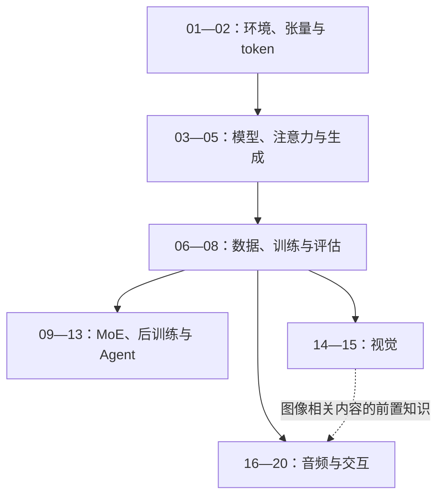

# MiniMind 源码阅读与工程实践

**从一个文本 token 出发，读懂训练与生成，再走向视觉和语音。**

本项目编写《从零读懂大模型：MiniMind、MiniMind-V 与 MiniMind-O 源码阅读与工程实践》，
面向普通初中级工程师与大学软件工程类学生。具备 Python 基础即可开始，所需的 PyTorch、
数学和音频知识随章节补齐。原蓝图中的“手撕”可以保留为副标题；正文以可理解、可验证为标准。

最终交付：一套 Markdown 书稿、配套教学代码与实验，以及方便离线传阅的**完整 EPUB3 和 PDF 各一本**。
核心模型以 PyTorch 实现为学习对象；Transformers、视觉/音频预训练编码器与 codec 的复用边界会明确说明。

> 2026-10-18 迁移候选：已按上游指定提交逐章评估，11 章有针对性修订并标为 stale，其余 9 章保留旧基线与正文；不是新版出版验收通过。见[20 章影响与复验清单](meta/upstream-impact-2026-10-18.md)。
> 以下 2026-10-08 状态及电子书下载是迁移前历史记录。
> 历史书稿（2026-10-08）：已重新逐章对照锁定源码，修正接口、标签、缓存、损失归约及音频状态边界，补充反例实验。范围与验证见 [本次源码复核](meta/source-audit-2026-10-08.md)。
> 下方电子书下载仍为 2026-09-09 的 v1.0.1（194 页 PDF）；本次 Markdown 修订尚未重新导出、验收或发布 EPUB/PDF。
> 本书验证范围是各章声明的机制、数值与控制流；未声称完成默认权重的 GPU 训练、语音质量或真实设备时延评测。

完整交付：[EPUB](https://github.com/cluster1900/minimind_reader/releases/download/v1.0.1/minimind-source-guide.epub) · [PDF](https://github.com/cluster1900/minimind_reader/releases/download/v1.0.1/minimind-source-guide.pdf) · [Markdown 与教学代码](https://github.com/cluster1900/minimind_reader/archive/refs/tags/v1.0.1.zip)。
[Release v1.0.1](https://github.com/cluster1900/minimind_reader/releases/tag/v1.0.1) 提供电子书下载与 SHA-256 校验值。
v1.0.1 的历史验收依据：[终审记录](meta/final-review.md)、[一致性复审](meta/consistency-review.md)、[完整验收清单](meta/final-review.json)。这些记录不代表当前修订已通过新版出版验收。
维护检查现在会核对固定源码、章节依赖和已复核的正文/公式/图源；改动后须重新复核，具体命令见出版说明。

在线阅读：[MiniMind Reader GitHub Pages](https://cluster1900.github.io/minimind_reader/)。站点首页提供阅读路线、二十章目录、实验入口、源码基线和 EPUB/PDF 下载；页面源文件位于 [`docs/`](docs/)，不依赖外部 CDN。若要在自己的仓库启用页面，按 [`docs/README.md`](docs/README.md) 在 Settings → Pages 中选择 `main` 分支的 `/docs` 文件夹即可。

## 这本书要帮助你做到什么

- 用小例子理解 token、张量、注意力、loss 和梯度，能读懂关键公式。
- 从命令入口追到数据集、模型、训练循环和生成输出，独立找到功能所在的代码。
- 看懂每一步输入输出的形状，发现标签错位、mask、缓存偏移及冻结策略等工程问题。
- 用小实验验证理解，再接入真实源码；区分“程序跑通”和“模型效果好”。
- 解释视觉特征怎样进入语言模型、语音码本怎样生成，以及打断如何贯穿服务端和播放端。

本书采用“问题 → 直觉 → 小例子 → 公式与张量 → 源码 → 实验”的顺序。
复杂流程配图，每张图附读图说明；不会把整份源码逐行翻译成中文。

## 对原始蓝图的检查结论

文本 → 后训练 → 视觉 → 语音的方向值得保留，但原先 12 章承载过多概念，
缺少初学者所需的张量、训练基础、评估和环境路线。这里改为四篇二十章，并提供跳读路径。

| 原蓝图中的问题 | 修订方式 |
|---|---|
| “全部原生 PyTorch、从零实现全模态”承诺过满 | 聚焦核心模型，单独说明预训练编码器和外部库 |
| 预训练标签在 Dataset 中直接错位 | 当前文本 Pretrain/SFT 在模型 `forward` 内 shift；其他训练器分别核验 |
| LoRA 公式直接套用 `alpha/r`，合并称为无损 | 本实现无显式该缩放，合并含 FP16 转换；区分通用原理与当前实现 |
| 视觉 SFT 描述为默认全参解冻 | 默认只解冻 LLM 首尾层与 projector，视觉编码器保持冻结 |
| Bridge 写成第 3 层，并断言中间层最佳 | 默认零基索引 3，即第 4 个 block 后；最佳性需另有证据 |
| 八路码本预测被说成完全同时生成 | 补上文本/音频时间轴、delay pattern 与停止规则 |
| Agent 工具闭环被当成真实外部服务 | 天气、汇率等是模拟反馈，实际执行入口与采样后端分开讲 |
| RMSNorm 样章含无条件性能/稳定性结论 | 去掉未测加速比例与硬件断言，实验增加真实梯度与边界检查 |

详细依据和其他修订见 [蓝图检查记录](meta/blueprint-review.md)。初始蓝图检查采用静态核对；
随后已完成基础篇 CPU 实验，仍未测量 GPU 性能或验证实时音频体验。

## 源码基线

源码实际位于 `~/Desktop/minimind_resources/`，不是 `~/Desktop/minimind/`。
2026-10-08 再核对时，三个仓库均为 detached HEAD，工作区 clean，HEAD 与以下锁定 commit 一致：

| 项目 | 锁定 commit | 本地目录 |
|---|---|---|
| [MiniMind](https://github.com/jingyaogong/minimind/tree/6fc918beb68a0d8c40452338df6319fe168014ba) | `6fc918beb68a0d8c40452338df6319fe168014ba` | `../minimind_resources/minimind` |
| [MiniMind-V](https://github.com/jingyaogong/minimind-v/tree/740d467ece78a0b7d2d976fcb424472095d4a688) | `740d467ece78a0b7d2d976fcb424472095d4a688` | `../minimind_resources/minimind-v` |
| [MiniMind-O](https://github.com/jingyaogong/minimind-o/tree/ccab6d98520ac5ac5d7583a3fa21a65105137e28) | `ccab6d98520ac5ac5d7583a3fa21a65105137e28` | `../minimind_resources/minimind-o` |

本次三个 `model/model_minimind.py` 的 SHA-256 相同，但各仓库仍独立绑定版本。
未来升级不会自动改变本书基线，也不自动使旧版书稿失效；决定迁移时才记录差异并重验受影响章节。

### 2026-10-18 候选迁移基线（待 Normal Work 审核）

| 项目 | 候选 commit | 迁移章节 |
|---|---|---|
| MiniMind | `f659b55761b754d306bd140573493a6543cafd7f` | 02、04、07—13 |
| MiniMind-V | `1862b633fc082a723e78dbead9777545f09d960c` | 15 |
| MiniMind-O | `f900448c608318c53314ebf8a947ab05cd8c038e` | 19 |

上表是 issue #10 指定的比较终点，不是今日上游 HEAD 的声明。01、03、05、06、14、16—18、20 的主线未受影响，
继续绑定前表旧 commit；共享主干存在数值或可选 MoE 分支变化，不意味着所有路径逐位等价。
当前工作副本需同时保留各章声明的历史 Git 对象。实验脚本仍绑定旧 SHA，不能直接用新源码目录冒充新版通过。
完整变更、未改结论及验证缺口见[迁移记录](meta/upstream-impact-2026-10-18.md)。

## 全书设计

下表是完整出版范围；二十章在旧基线均已成稿并完成当时声明范围的源码与 CPU 核验。
本次候选采用逐章迁移：受影响 11 章已切换新源码引用、等待新版 CPU 复验，其余 9 章保留旧版绑定；不能将历史验证整体移植到新版本。
实际进度见 [实施路线图](meta/roadmap.md)。`M`、`V`、`O` 分别指上表三个仓库，
源码入口为仓库内相对路径，不能省略仓库区分。

| 篇 / 章 | 本章回答的问题 | 主要源码入口 |
|---|---|---|
| 一 · 01 [环境、张量与一次最小前向](book/01-start-here/README.md) | 怎样用 CPU、合成 token 和随机权重观察 shape？模块和梯度是什么？ | M `model/model_minimind.py`；`eval_llm.py` 仅作真实推理入口导航 |
| 一 · 02 [从文字到 token](book/02-tokenizer/README.md) | 分词、特殊 token 和聊天模板怎样连接？ | M `trainer/train_tokenizer.py`、`model/tokenizer_config.json` |
| 一 · 03 [搭起语言模型骨架](book/03-model-skeleton/README.md) | 配置、Embedding、残差、RMSNorm、SwiGLU 和输出头如何合作？ | M `model/model_minimind.py` |
| 一 · 04 [手算一次注意力](book/04-attention/README.md) | Q/K/V、因果 mask、GQA、QK-Norm 和 SDPA 怎样工作？ | M `model/model_minimind.py`：`Attention` |
| 一 · 05 [位置、缓存与逐字生成](book/05-rope-cache-generation/README.md) | RoPE 如何编码位置？缓存怎样增长？如何采样与停止？ | M 同文件：RoPE、`MiniMindForCausalLM.generate`；YaRN 为进阶框 |
| 一 · 06 [一条训练样本的旅程](book/06-datasets/README.md) | Pretrain/SFT 的模板、截断、mask 和 shift 各在哪里？ | M `dataset/lm_dataset.py`：`PretrainDataset`、`SFTDataset`；模型 `forward` |
| 一 · 07 [预训练循环与断点恢复](book/07-pretraining/README.md) | loss 怎样变成参数更新？AMP、累积、裁剪和 checkpoint 如何配合？ | M `trainer/train_pretrain.py`、`trainer/trainer_utils.py` |
| 一 · 08 [SFT、评估与训练排错](book/08-sft-evaluation/README.md) | 怎样训练对话行为、控制思考模板并识别错误？ | M `trainer/train_full_sft.py`、`eval_llm.py`；配套小型评估实验 |
| 二 · 09 [MoE 的路由与负载](book/09-moe/README.md) | 为什么只选部分专家？辅助损失怎样连接回模型？ | M `model/model_minimind.py`：`MOEFeedForward` |
| 二 · 10 [LoRA 与知识蒸馏](book/10-lora-distillation/README.md) | 少量参数怎样改变模型？学生如何学习教师分布？ | M `model/model_lora.py`、`trainer/train_lora.py`、`trainer/train_distillation.py` |
| 二 · 11 [DPO 与偏好数据](book/11-dpo/README.md) | 一对 chosen/rejected 如何形成优化目标？ | M `trainer/train_dpo.py`、`dataset/lm_dataset.py`：`DPODataset` |
| 二 · 12 [从 PPO 概念到 GRPO](book/12-ppo-grpo/README.md) | policy、reference、reward、value 和 advantage 分别是什么？ | M `trainer/train_ppo.py`、`trainer/train_grpo.py`、`trainer/rollout_engine.py` |
| 二 · 13 [Agent 多轮交互与奖励](book/13-agent/README.md) | 生成、工具反馈、response mask 和整轮奖励如何闭环？ | M `trainer/train_agent.py`、`trainer/rollout_engine.py` |
| 三 · 14 [图像怎样进入语言模型](book/14-vision/README.md) | 图像预处理、patch、projector 与占位符替换如何对应？ | V `model/model_vlm.py`、`dataset/lm_dataset.py` |
| 三 · 15 [视觉训练与评估](book/15-vlm-training/README.md) | 冻结哪些参数？多图、缺图、截断怎样影响训练？ | V `trainer/train_pretrain_vlm.py`、`trainer/train_sft_vlm.py`、`trainer/trainer_utils.py` |
| 四 · 16 [音频入门与特征注入](book/16-audio-basics/README.md) | 波形、采样率、声学特征和离散码本有什么区别？ | O `model/model_omni.py`、`dataset/omni_dataset.py` |
| 四 · 17 [Thinker、Bridge 与 Talker](book/17-thinker-talker/README.md) | 语义特征怎样与音色、历史音频共同影响生成？ | O `model/model_omni.py`：`OmniConfig`、`TalkerModule`、`MiniMindOmni.forward` |
| 四 · 18 [八路码本与时间对齐](book/18-audio-codebooks/README.md) | delay pattern 怎样组织训练与生成？Mimi 怎样还原波形？ | O `dataset/omni_dataset.py`、`MiniMindOmni.stream_generate`、`eval_omni.py` |
| 四 · 19 [Omni 训练流水线](book/19-omni-training/README.md) | T2A/A2A/I2T 怎样切换数据、loss、冻结和权重？ | O `trainer/train_sft_omni.py`、`trainer/trainer_utils.py`、`trainer/train.sh` |
| 四 · 20 [流式交互、打断与综合实战](book/20-realtime/README.md) | VAD、模型生成、WebSocket、音频播放怎样协作与取消？ | O `model/model_omni.py`：`RealtimeSession`；`webui/web_demo.py`、`webui/web_demo.html` |

附录包含数学与张量速查、环境与复现方法、源码符号索引及来源许可，另有全书术语表。
自检参考答案及推理过程放在各章末尾，参考资料链接就近放在相关机制旁。

第一篇用较多篇幅建立基础；第二、四篇拆小节并提供选读框。
“源码全解”指选定学习主线的解释完整，不承诺逐个覆盖所有平台分支和外部依赖内部实现。
页数待样章排版后估算，不以固定页数或字数作为完成标准。

## 前置知识放在哪里

“随用随讲”落实为以下章节内的小节；数学附录用于复习，不要求读者先通读附录。

| 首次位置 | 先补的知识与主线边界 | 可验证的学习结果 |
|---|---|---|
| 01 | shape、索引、广播、矩阵乘法；用标量例子认识梯度 | 预测小张量输出形状，运行一次前向/反向；知道随机模型不会正常对话 |
| 02 | 字符与 token 的区别、编码/解码、聊天模板 | 解释一段文字为何变成这些 ID；先用已有 tokenizer，再选做 BPE 训练 |
| 03 | Linear、参数、激活与残差；Attention 暂按输入输出契约理解 | 手算小向量的归一化与门控，指出参数和激活的区别 |
| 04 | 点积、指数、概率分布和 softmax | 手算带因果 mask 的小注意力矩阵；SDPA 后端优化为选读 |
| 05 | 三角旋转、位置索引、条件概率和采样 | 对照缓存与全量前向；YaRN 留在拓展小节 |
| 06～07 | 对数、交叉熵、有效 token 均值、链式求导、优化器 | 对齐输入/标签，算出小批 loss，完成一次参数更新；AMP/DDP 在基础循环后讲 |
| 08 | 训练集与验证集、过拟合、固定评估条件 | 区分训练 loss、验证 NLL 与生成样例，记录失败案例 |
| 10～11 | 低秩分解与温度；KL；序列对数概率与 reference policy | LoRA、蒸馏分别完成小实验；第 11 章再配对讲 DPO 数据与目标 |
| 12～13 | 期望、奖励、优势与策略更新，再引入多轮反馈 | 用一组小奖励算出优势，追踪哪些 token 参与更新 |
| 14、16 | 图像尺寸/通道/patch；波形/采样率/帧率/码本 | 预测图像占位长度，区别音频采样点、声学帧和文本 token |

第 10 章分为 LoRA 与蒸馏两个可独立学习的小节，不暗示训练时必须依次执行。
整条文本主线固定一组小输入和合法的小模型配置；切换到真实训练配置时明确说明变化。

## 推荐阅读路线

- **第一次学习大模型：** 01～08，完成 CPU 小实验；先跳过 YaRN 和 GPU 优化细节。
- **关注微调与后训练：** 01～08 → 10 → 11 → 12 → 13；MoE 可另读 09。
- **关注视觉应用：** 01～08 → 14～15，无需先学完强化学习。
- **关注语音与全模态：** 01～08 → 16～20；涉及图像时补读 14～15。
- **课程或毕业设计：** 完成基础路线，选择一个拓展方向，提交源码追踪、可复现实验和边界分析。



图 R1：学习依赖路线。自上而下先建立文本闭环，再选择方向；箭头表示学习依赖，
不是三个模型运行时互相调用。虚线表示仅在学习图像相关内容时补齐的依赖。

## 如何保证深入浅出

每章围绕一个小输入展开，说明它经过每个模块后变成什么。第一次读主线解释，
第二次对照形状表和关键源码，第三次运行实验并做自检题。

| 内容 | 约定 |
|---|---|
| 公式 | 行内 `$...$`，块公式独立行 `$$`；就近解释变量、维度、归约轴和适用条件 |
| 图示 | 复杂流程必须配图；附图题、读图方法和文字说明；支持静态离线出版 |
| 代码 | 引用短的真实片段，绑定仓库与 commit；改写实现明确标记为教学代码 |
| 实验 | 区分 CPU 教学、真实源码接入、GPU 训练/评估；记录实际运行范围 |
| 概念 | 先解释再缩写，给小数字例子和常见反例，不假定读者熟悉深度学习术语 |
| 自检 | 预测输出、追踪张量、查找实现、修改并验证；附参考答案 |

例如讲 RMSNorm，先解释“沿每个位置的隐藏维度缩放”，再给公式。
设隐藏维度为 $D$，该位置输入为 $x$，可学习缩放为 $\gamma$，稳定项为 $\epsilon>0$：

$$
y_i=\gamma_i\frac{x_i}{\sqrt{\frac{1}{D}\sum_{j=1}^{D}x_j^2+\epsilon}}.
$$

接着用小向量手算，核对输入输出形状，再定位 `RMSNorm.forward` 的 FP32 计算与类型还原。
当权重为全 1、稳定项相对输入均方值很小时，输出均方根接近 1；零输入的输出仍为零。
该观察不能推导出任意训练都不会出现 NaN。

## 环境与实验资源

不要求读者先购买 GPU。A 层例子采用合成小数据和 CPU；B 层按需接入真实源码；
C 层再使用训练数据、预训练权重和 GPU。每个实验自行说明依赖、显存、数据量及估计时间的来源。

三个项目的完整依赖不宜一开始装入同一环境。后续分别维护文本、视觉、音频及出版环境，
明确已验证版本；不要假设 CUDA、MPS 与 CPU 的算子、精度和性能完全一致。
没有实测前不承诺“某张卡几小时复现全模态”。

目前可以从本项目根目录运行以下只读命令确认源码基线；也可设置环境变量指向其他位置：

```bash
MM_SOURCE_ROOT="${MINIMIND_SOURCE_ROOT:-../minimind_resources}"
for repo in minimind minimind-v minimind-o; do
  git -C "$MM_SOURCE_ROOT/$repo" rev-parse HEAD
  git -C "$MM_SOURCE_ROOT/$repo" status --short --branch
done
```

第 01～20 章均有配套实验与记录，文件位于 `experiments/`，运行环境由 `requirements-book.lock` 锁定。
例如 [数据与监督实验](experiments/ch06-datasets.md)、[保存时机实验](experiments/ch07-training-loop.md)
以及 [SFT 与评估实验](experiments/ch08-sft-evaluation.md)。这些小配置实验不冒充完整 GPU 训练或发布模型质量验证。

评估约定也从基础篇开始：留出数据、固定生成参数、记录训练数据重叠情况和失败样例。
语言建模 NLL、偏好优化目标及多模态总损失分别报告，不把任意总 loss 直接解释为困惑度。
视觉问答、语音文本一致性、音色/音质与实时延迟各自声明测量条件；练习跑通不作为模型质量证据。

## EPUB 与 PDF 出版方案

参考桌面 `vllm_reader` 的 Markdown、Mermaid、公式预渲染和内容一致性检查方法，
增加独立 PDF 排版与验收。两个版本共享同一份正文和出版顺序清单。

章节拆成多个文件时，`publishing/book.yaml` 显式列出文件顺序；导航页不重复进入正文。
共用 AST 分别复制给两种输出，EPUB 的公式转 SVG 不会替换掉 PDF 需要的原生数学节点。

| 环节 | EPUB3 | PDF |
|---|---|---|
| 正文入口 | 相同 Markdown 与 `publishing/book.yaml` | 相同 Markdown 与 `publishing/book.yaml` |
| 转换方案 | Pandoc AST → XHTML → EPUB3 | Pandoc AST → LaTeX → Tectonic（XeTeX） |
| 数学公式 | MathJax 预渲染的自包含 SVG，保留原 TeX 与替代说明 | 原生 LaTeX 数学，保留矢量排版 |
| Mermaid | 预渲染 SVG，检查字形与兼容性 | 同一图源，转换为矢量 PDF 后嵌入 |
| 中文与代码 | 可调字号、窄屏可读、行内公式基线正确 | CJK 字体嵌入、可检索文字、合理分页与折行 |
| 完整性 | 容器、spine、目录、资源、链接、正文清单 | 目录、书签、字体、文本、页面图与正文清单 |
| 阅读验收 | EPUBCheck + 至少两种阅读器抽查 | 渲染页面检查，首版逐页视觉复核 |

Pandoc 支持 EPUB 与 LaTeX/PDF 输出；中文 PDF 需要正确配置 CJK 字体及相应 TeX 组件。
参见 [Pandoc 手册](https://pandoc.org/MANUAL.html)。公式 SVG 的字形打包依据
[MathJax 配置](https://docs.mathjax.org/en/v3.2/options/output/svg.html)，EPUB 结构检查使用
[EPUBCheck](https://www.w3.org/publishing/epubcheck/)。二十章已通过该管线的内容检查，整书验收见最终审阅记录。

离线阅读时，图片、公式和必要样式不依赖 CDN、JavaScript 或作者电脑上的路径。
长公式分行、宽图拆分、长代码换行；不会用整页截图来代替可检索书籍正文。
源 Markdown 需要支持数学和 Mermaid 的预览环境，普通纯文本预览不保证渲染。

完整产物为 `dist/minimind-source-guide.epub`、`dist/minimind-source-guide.pdf`，
附版本及校验清单。发布版包含封面、标题页、前言/阅读指南、四篇正文、附录和参考资料。
署名使用本项目名称；正文不擅自设定统一开源许可。封面与图源由本项目制作，字体与引用源码保留原许可。

已实现 `scripts/check_book.py`、`scripts/build_book.py`、`scripts/check_epub.py` 和 `scripts/check_pdf.py` 的预览与完整候选构建流程。
运行命令、工具来源与依赖见 [出版说明](publishing/README.md)。完整候选仅在内容、页面及阅读器验收完成后复制到 dist。
检查范围包括源码映射、章节顺序、锚点、公式、图源、代码与表格内容，不能只数段落或字数。
内容检查必须读回最终 EPUB 的 XHTML；PDF 同时检查文字和页面图，不能只检查转换前的中间稿。

构建模式使用 `--edition preview|release`，预览版只收录显式选择的已有章节，允许 `draft`，
并在封面和文件名标明“预览/未完成”；正式版必须收录完整清单且通过规定审阅与双格式检查。
两种格式同批通过后再更新正式文件。缺少可选 GPU 验证时收窄结论并披露范围，不能伪装成实测。

## 写作与出版里程碑

| 阶段 | 交付与通过条件 | 当前状态 |
|---|---|---|
| M0 设计与核对 | 受众、目录、基线、规范及蓝图问题记录 | 已完成规划级静态核对 |
| M1 短样章与出版试验 | 模型骨架/RMSNorm 样章和复杂排版样本；CPU 验证；两种格式均检查通过 | [已完成初始验收](meta/m1-publication-review.md) |
| M2 文本学习闭环 | 01～08 正文、图、实验、自检和基础篇预览版 | 已完成正文与实验；基础篇预览通过格式、内容和显示检查 |
| M3 进阶与视觉 | 09～15；分别记录无需 GPU 与需 GPU 的验证状态 | [已完成章节与限定范围的验证](meta/m3-publication-review.md) |
| M4 音频与交互 | 16～20；重点核对时间对齐、训练阶段、打断和播放队列 | 五章正文、配图、实验及限定范围的源码复核已完成 |
| M5 整书发行 | 全书事实/教学复核、EPUB/PDF 内容一致性、阅读检查、元数据与资源许可完整 | [已完成整书验收与发行](meta/final-review.md) |

样章先建立质量标准，再逐章推进；不要按同一个 Prompt 一次性生成二十章。
正文状态与实验状态、出版状态分开跟踪，缺少验证时明确保留 `draft`。

## 项目文件与协作

- [AGENTS.md](AGENTS.md)：源码证据、教学、数学、图示、实验和出版规范。
- [`docs/`](docs/)：GitHub Pages 对外展示页；首页从仓库正文、实验记录和固定源码基线组织阅读入口。
- [蓝图检查记录](meta/blueprint-review.md)：原蓝图问题、源码依据，以及第二轮设计复审与修复记录。
- [统一术语表](glossary/terms.md)：覆盖文本、后训练、视觉、音频与实时交互。
- 本 README：项目定位、完整目录、阅读路线、源码基线与交付计划。

开始撰写时，先依据 AGENTS 建立本章源码地图，再写一个可独立审阅的小节。
所有“已验证”声明必须说明依据和范围；所有未完成的构建和正文都如实标注。
