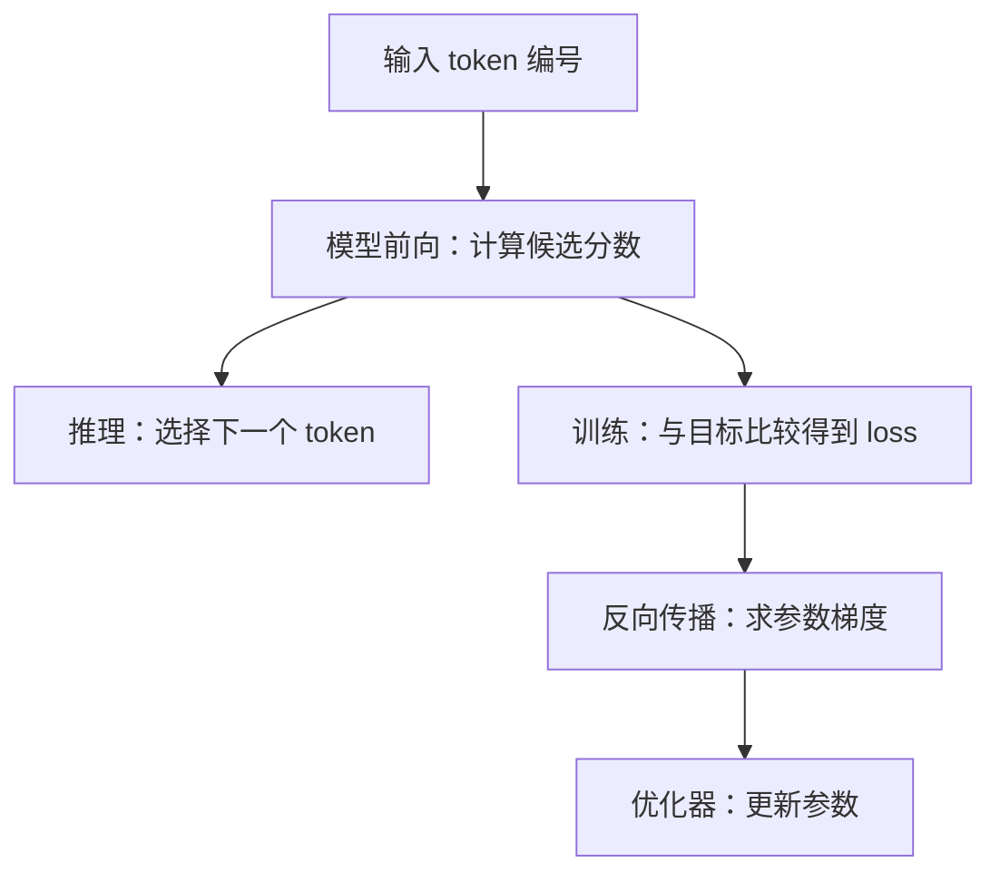
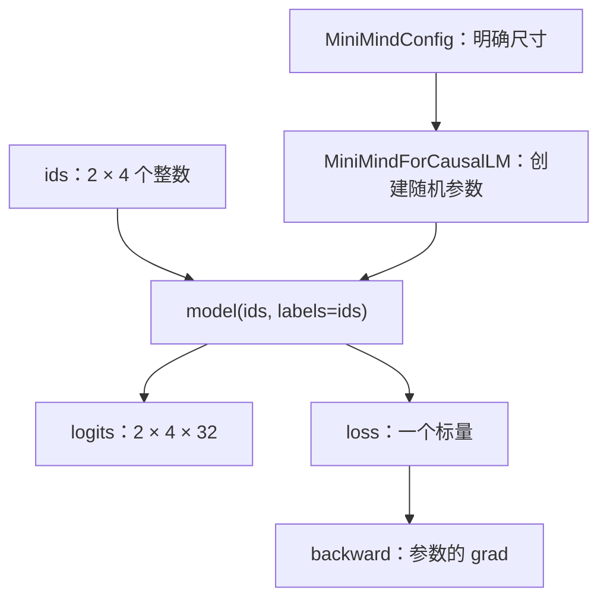

# 第 01 章 环境、张量与一次最小前向

打开一个大模型仓库，首先看到的往往是训练命令、模型权重和长长的依赖列表。
这很容易让人以为，必须先准备一张昂贵的显卡，才能开始理解代码。其实第一步只需要做一件小事：
让一组可控制的数字经过真实模型，并看清它变成了什么。

本章先补齐张量、维度、Linear 和梯度的最小知识，再运行一个随机权重的 MiniMind。
我们不要求它回答问题，也不需要预训练权重。读完后，你应能解释一段输出的形状，
找到模型前向入口，并区分“程序算通了”和“模型学会了”这两种完全不同的结果。

**主线必读：** 张量、广播、小模型前向与反向。先跟随本章的小输入，再对照图和源码。

**进阶选读：** 数值精度和实验记录；第一次阅读可先掌握输入输出契约。

**需要额外设备/权重：** 训练权重的中文问答。本章 CPU 实验只支持明确列出的机制结论。

## 1.1 我们究竟在阅读什么

MiniMind 是本书的文本基础。MiniMind-V 增加图像输入，MiniMind-O 进一步连接语音输入、
语音输出和实时交互。本书并不是把三个目录中的同名文件讲三遍，而是先理解公共的语言模型骨架，
再研究每个扩展增加了哪些输入、模块、训练目标和状态。

对一个文本语言模型，可以先建立如下最小认识：它接收一些 token 编号，为下一个 token 的候选计算分数。
token 是分词器划分的基本单位，不一定等于一个汉字或一个英语单词。第 02 章会解释文字怎样变成编号。
本章先直接构造合法编号，让“理解模型计算”不被“训练分词器”挡住。

**训练**用带目标的数据调整参数；**推理**使用已有参数计算结果。
同一个前向函数可以出现在两条路径中，因此不能看见 `forward` 就判断它一定在训练。
真正需要观察的是：是否提供监督、是否求梯度、是否调用优化器，以及参数有没有被更新。



图 1-1：训练与推理共享前向计算，但后续工作不同。先追输入到前向这一段，再看左右两条用途。
推理分支的采样细节留到第 05 章；训练分支本章先用一个标量例子体验，完整循环在第 07 章解释。
这是一张学习概念图，不表示所有项目都把每一步封装成同名函数。

## 1.2 准备一个不会互相干扰的环境

源码根目录中有三个独立仓库，它们都可能使用 `model`、`trainer` 这样的 Python 包名。
如果把三个目录同时塞进全局搜索路径，`import model` 可能读到你没打算阅读的那个仓库。
因此本书每个真实源码实验在独立进程里运行，并明确选择一个上游目录。

配套依赖和安装命令见阅读指南。先创建 Python 3.12 虚拟环境，再安装 `requirements-book.lock`。
虚拟环境像给本项目准备一个单独的工具柜：依赖在其中安装，其他项目不会因为本书升级某个包而被改变。
它不代替操作系统，也不等于 GPU 隔离。

本章使用 PyTorch 2.6.0、Transformers 4.57.6 和 CPU。PyTorch 负责张量运算与自动求导，
Transformers 在此提供模型配置、基类和输出结构等支持。理解主要计算仍然要回到 MiniMind 的实现。
这里不一次安装音频项目的全部依赖，也不把上游训练命令原样复制成入门步骤。

运行本章脚本：

```bash
.venv/bin/python experiments/ch01_start_here.py
```

默认查找相邻的 `minimind_resources/minimind`。如果源码放在其他位置，设置
`MINIMIND_SOURCE_ROOT` 为包含三个仓库的根目录。脚本会核对 commit，避免你用另一个版本运行，
却把结果误认为已经验证了本书版本。

## 1.3 张量：先看轴，再看数字

普通变量可以存一个数，列表可以存一排数，张量则把数字组织成有明确轴长度的多维数组。
在本书中，最常出现的是 `(B,S,D)`：$B$ 为批大小，$S$ 为序列长度，$D$ 为每个位置的隐藏维度。
你可以暂时把它想成“几句话、每句几个位置、每个位置几个特征”。类比的边界是：
真实模型中的每一维通常没有一个固定、可直接命名的人类概念。

下面创建一个形状为 `(2,3,4)` 的张量：

```python
a = torch.arange(24, dtype=torch.float32).reshape(2, 3, 4)
print(a.shape)
print(a[1, 2, 3])
```

`arange(24)` 产生 0 到 23，`reshape` 只改变这些数的组织方式。
轴从 0 开始编号，索引也从 0 开始，因此 `[1,2,3]` 是第二个批元素、第三个位置、第四个特征，值为 23。
`2×3×4=24`，总元素数必须保持一致，不能随意把它 reshape 成 `(2,4,4)`。

| 表达式 | 形状 | 发生了什么 |
|---|---|---|
| `a` | `(2,3,4)` | 完整三维数据 |
| `a[0]` | `(3,4)` | 取第一条样本，批轴消失 |
| `a[:,0,:]` | `(2,4)` | 每条样本都取第一个位置 |
| `a.mean(-1)` | `(2,3)` | 最后四个特征求均值，最后一轴消失 |
| `a.mean(-1,keepdim=True)` | `(2,3,1)` | 求均值但保留长度为 1 的轴 |

“最后一维”中的 `-1` 是轴的编号，不是减去一个元素。`keepdim=True` 在之后做广播时很有用。
先看形状再读代码，可以较早发现“把序列轴当成隐藏轴”这样的错误。

张量还带有两个经常被忽略的属性：**dtype** 是数值类型，**device** 是存放设备。
token 编号使用整数；模型向量与参数通常使用浮点数。CPU 与 GPU 是不同设备，
不能只因为形状相同，就假设两个张量能直接在一起计算。

## 1.4 广播与 Linear：两个经常出现的计算

广播让形状不同但兼容的张量进行逐元素运算。例如，给 `(2,3,4)` 的每个位置加上向量 `[1,2,3,4]`：

```python
b = a + torch.tensor([1.0, 2.0, 3.0, 4.0])
```

四个数沿批轴和位置轴重复使用，输出形状仍是 `(2,3,4)`。`a[0,0]` 原来是 `[0,1,2,3]`，
现在变为 `[1,3,5,7]`。这是逐元素相加，不是矩阵乘法，也不是把四个数接到末尾。

广播从最右边对齐各轴：对应长度相同，或其中一个长度为 1，才可扩展。
长度为 3 的向量无法直接加到最后一维为 4 的张量上；它们右端对齐后就是不兼容的 3 与 4。
即使广播成功，也要检查语义：你可能把一条共享向量用在了本应每个位置不同的数据上。

Linear 做的事情不同。它将最后一维的输入特征组合成另一组特征。
对于行向量 $x$，PyTorch 的权重以 `(输出维度,输入维度)` 存储，因此无 bias 时：

$$
y=xW^{\mathsf T}.
$$

上标 $\mathsf T$ 表示转置，即交换矩阵的行和列。看一个能手算的例子：

$$
\begin{aligned}
&x=\begin{bmatrix}1&2\end{bmatrix}\\
&W=\begin{bmatrix}1&0\\0&1\\1&1\end{bmatrix}\\
&y=\begin{bmatrix}1&2&3\end{bmatrix}.
\end{aligned}
$$

输出第一项保留输入第一项，第二项保留第二项，第三项把两项相加。
`nn.Linear(2,3,bias=False)` 恰好使用形状 `(3,2)` 的权重。本章实验把权重设置为这张表，
再用断言核对输出。以后看到 `nn.Linear(D,I)`，就能预测最后一维从 $D$ 变为 $I$。
批轴和位置轴通常会被保留，而不是被 Linear 当成特征一起压平。

## 1.5 梯度：知道该往哪个方向改一点

训练最容易被误解为“多调用几次模型就会进步”。真正推动参数变化的是损失、梯度和更新步骤。
我们先用一个参数 $w$ 模拟：预测值为 $3w$，目标值为 7，平方误差作为损失。

$$
\begin{aligned}
&L(w)=(3w-7)^2\\
&\frac{\mathrm dL}{\mathrm dw}=2(3w-7)\times3.
\end{aligned}
$$

损失 $L$ 告诉我们当前误差多大；导数告诉我们，$w$ 在当前点稍微增加时，损失向哪个方向变化。
代入 $w=2$，预测为 6，损失为 1，导数为 -6。负号意味着在这一小段附近增加 $w$ 会降低损失。

```python
w = torch.tensor(2.0, requires_grad=True)
loss = (3 * w - 7).square()
loss.backward()
with torch.no_grad():
    w -= 0.05 * w.grad
```

`requires_grad=True` 要求记录求导所需的计算关系；`backward()` 才真正计算梯度并写到 `.grad`。
代码中的 `no_grad()` 用于更新参数时不把这次更新再次记录成求导图，不表示从此禁止该参数训练。

学习率取 $\eta=0.05$，更新规则是沿梯度的反方向走：

$$
\begin{aligned}
w_{\mathrm{new}}&=w-\eta\frac{\mathrm dL}{\mathrm dw}\\
&=2-0.05\times(-6)=2.3.
\end{aligned}
$$

更新后预测 6.9，损失约 0.01，确实比原来的 1 小。这是一个局部小例子，
不能据此保证任何模型、任何学习率都让每步 loss 下降。学习率过大可以越过合适的位置。
真实模型有很多参数，PyTorch 按计算关系使用链式法则求梯度，优化器再处理更新；完整流程留到第 07 章。

## 1.6 让真实 MiniMind 跑一次

现在把数学小练习接到真实源码。最小实验只导入配置和模型，不进入需要数据集的训练入口。
采用以下显式小配置：

| 配置 | 数值 | 为什么这样选 |
|---|---:|---|
| 隐藏维度 | 32 | 让中间张量便于打印 |
| block 数 | 2 | 能观察多层结构，CPU 仍容易运行 |
| 查询头 / KV 头 | 4 / 2 | 保持可整除的分组关系 |
| 前馈中间宽度 | 64 | 展示扩维再降维 |
| 词表大小 | 32 | 使用合成编号，不接真实 tokenizer |
| 最大位置数 | 64 | 覆盖本次短输入即可 |

四个关键动作是创建配置、实例化模型、构造输入、调用前向。实验中的模型输入如下：

```python
ids = torch.tensor([[1, 4, 7, 2], [1, 5, 3, 2]], dtype=torch.long)
out = model(ids, labels=ids)
assert out.logits.shape == (2, 4, 32)
out.loss.backward()
```

`(2,4)` 表示两条输入、每条四个 token；`(2,4,32)` 表示每个位置产生 32 个候选分数。
给 `labels` 后模型会计算语言建模 loss，内部会错开预测位置和目标位置。
这里先观察它能否得到有限标量，第 06 章再用对齐表解释为什么需要错位，以及谁负责错位。
不能把本章的 `labels=ids` 当成所有任务都应照抄的数据处理方式。



图 1-2：本章真实源码实验。先看配置怎样决定模型尺寸，再看相同输入一次前向得到的两类输出。
logits 是候选分数，loss 是与目标比较后的训练标量。最后一步只求梯度；
本章的小模型没有执行优化器更新，也没有训练出语言能力。

源码入口在 MiniMind
[model/model_minimind.py](https://github.com/jingyaogong/minimind/blob/6fc918beb68a0d8c40452338df6319fe168014ba/model/model_minimind.py)
的 `MiniMindConfig`、`MiniMindForCausalLM.__init__` 和 `MiniMindForCausalLM.forward`。
暂时不要进入 RoPE 或 MoE 的细节；先把每次输入输出的类型和形状写到纸上。

## 1.7 真实推理入口和最小实验有什么区别

仓库的
[eval_llm.py](https://github.com/jingyaogong/minimind/blob/6fc918beb68a0d8c40452338df6319fe168014ba/eval_llm.py)
包含命令行参数、权重加载、聊天模板、生成和输出打印。
`main` 调用 `init_model` 准备模型和 tokenizer，再为用户输入构造 token，最后调用 `generate`。
这是你以后跑真实模型时要追的入口，但它需要与配置匹配的权重等资源。

本章实验省去了这些外部资源，只实例化随机参数。正式入口还会执行 `half().eval().to(device)`，
与本章 CPU、FP32 的设置不同。因此本章成功不证明该入口在所有设备上都能直接运行。
`eval()` 切换模块的训练/评估行为；它本身不等于关闭梯度，和 `no_grad()` 的作用需要分开理解。

遇到错误时按顺序检查：Python 能否导入依赖，是否导入了正确仓库，输入 ID 是否在词表范围内，
形状与 dtype 是否正确，模型与输入是否在同一设备，最后再追模型内部。
这样排查比看到异常就立即重装全部依赖更有针对性。

## 1.8 实验结果与自检

脚本用断言检查索引、广播、Linear 的手算、标量梯度和真实模型前向/反向。
通过条件包括：张量末项为 23，Linear 输出 `[1,2,3]`，标量梯度为 -6，
更新后的损失小于原损失，真实模型 logits 为 `(2,4,32)`，loss 与参数梯度有限。
运行报告保存在 `build/experiments/ch01-results.json`，固定随机种子为 42。

不要把随机模型的某个 loss 小数当作需要逐位一致的答案。依赖、硬件与初始化调用顺序会影响它；
这个实验的核心是形状、可求导性和手算性质，不是比谁的随机 loss 更低。

1. `(2,3,4)` 张量有多少元素？`a[0]` 为什么少了一维？
2. `(2,3,4)` 与 `(4,)` 为什么能逐元素相加，而与 `(3,)` 不行？
3. `nn.Linear(2,3)` 的权重为何是 `(3,2)`，而不是输入数据的形状？
4. 只设置 `requires_grad=True`，能否说明梯度已经算出来？
5. 本章随机模型成功前向，是否足以证明它能回答中文问题？下一步还缺什么？

参考解释：第一题有 24 个元素，整数索引选定一个批元素后该轴被消去。第二题从右边对齐，
4 与 4 相容，3 与 4 不相容。第三题每个输出需要一组覆盖两个输入的权重，三个输出共三行。
第四题不能，还需执行反向并查看 `.grad`。第五题不能，接入真实分词器、正确训练数据、
优化过程或经过训练的权重后，还要做独立评估。

可选练习：保持模型配置不变，把两条输入各加一个合法 token。先预测 logits 形状，
再修改实验验证。完成后回到第 02 章，看看真实文字为什么会被切成长度不一的 token 序列。
