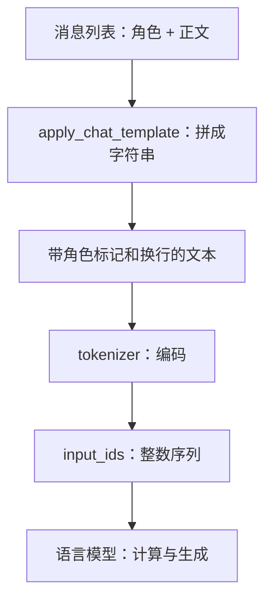
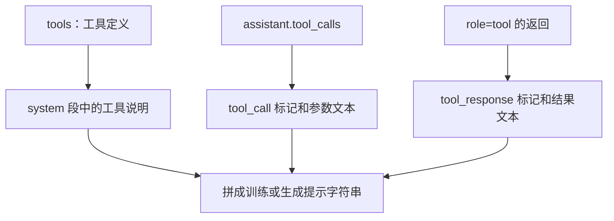

# 第 02 章 从文字到 token

上一章直接给模型一串整数。真实用户不会这样提问，而是输入“你好，MiniMind！”这样的文字。
分词器负责把文字转换成模型能索引的编号，并在输出后把编号还原成文字。
它像一套双方约定的编码表，但这个类比要加一条限制：编码单元不必是完整的字或词，
还可能是一个词的一部分，甚至是组成一个字符的部分字节。

本章先使用仓库自带 tokenizer，再阅读它的训练脚本。接着分析聊天模板如何把角色、正文、
思考段与工具信息拼成模型真正看到的字符串。读完后，你应能追踪“用户消息 → 模板字符串 → ID”，
也能解释为什么随意更换词表会破坏已有模型与文字之间的对应关系。

**主线必读：** 编码、解码与聊天模板。先跟随本章的小输入，再对照图和源码。

**进阶选读：** BPE 训练和工具模板；第一次阅读可先掌握输入输出契约。

**需要额外设备/权重：** 大语料 tokenizer 训练。本章 CPU 实验只支持明确列出的机制结论。

## 2.1 一句话经过了哪些步骤

我们从一条消息开始：`{"role":"user","content":"你好"}`。
它不仅含有正文，还说明是谁说的。聊天模板把这样的结构化消息变成一段带角色边界的文本，
分词器再把文本转换成整数序列。模型看到的是这条序列，不直接接收 Python 字典中的 `role` 对象。



图 2-1：一条聊天输入的加工过程。第一遍先区分“格式化消息”和“编码文字”两步；
第二遍再看边界标记也会被编码到序列中。对于 `tokenize=True` 的调用，这两步可以由同一个 API 完成，
并不表示它们在概念上变成了同一件事。

本章的两个关键源码位置是 MiniMind 的
[trainer/train_tokenizer.py](https://github.com/jingyaogong/minimind/blob/6fc918beb68a0d8c40452338df6319fe168014ba/trainer/train_tokenizer.py)
和 [model/tokenizer_config.json](https://github.com/jingyaogong/minimind/blob/6fc918beb68a0d8c40452338df6319fe168014ba/model/tokenizer_config.json)。
前者解释词表怎样训练并导出配置；后者是读取现有 tokenizer 时实际使用的配置和模板。
训练脚本不等于模型每次聊天时都会重新运行的步骤。

## 2.2 token 不等于汉字，也不等于单词

先用真实 tokenizer 做一次往返，不要靠字符串外观猜分词结果：

```python
tokenizer = AutoTokenizer.from_pretrained(source / "model", local_files_only=True)
text = "你好，MiniMind！"
ids = tokenizer.encode(text, add_special_tokens=False)
restored = tokenizer.decode(ids, skip_special_tokens=False)
assert restored == text
```

这里 `source` 指 MiniMind 仓库路径。当前词表的实际输出是：

```text
你好，MiniMind！
  -> [1968, 294, 80, 301, 108, 80, 916, 1364]
  -> 你好，MiniMind！
```

同一词表中，`hello world` 对应 `[6170,1707]`。
两个短例子已经说明：文字长度和 token 数不是同一个量。
这些具体编号只对本书锁定的 tokenizer 有效，不是任何语言模型通用的编码。

`convert_ids_to_tokens` 给出的底层符号和 `decode` 还原的文本也不完全是一回事。
Byte-level tokenizer 可能用特殊字符显示字节与空格的内部表示，单个 token 也未必独立组成完整 Unicode 字符。
逐个 ID 解码后硬拼字符串可能出现替代字符；应检查完整序列的解码，流式场景还要正确处理字节缓冲。

## 2.3 BPE：把经常相邻的小块合成大块

BPE 是 Byte Pair Encoding 的缩写。先把语料表示成小符号，再反复统计相邻符号对，
将经常一起出现的对合并为一个新符号。这样，常见片段可以用较少 token 表示，
不常见片段仍可以拆成更小的单位。

先看一个故意简化的手工例子。假设语料只有三次 `ab` 和一次 `ac`，
初始序列按字符拆为 `[a,b]`、`[a,b]`、`[a,b]`、`[a,c]`。
相邻对 `(a,b)` 出现 3 次，`(a,c)` 出现 1 次，合并 `(a,b)` 后，前三条各缩为 `[ab]`。
总 token 数从 8 变为 5。这个例子只解释相邻合并的直觉，不声称真实 tokenizer 就以汉字或 Python 字符为初始单位。

当前训练脚本使用 `Tokenizer(models.BPE())`，预分词器为 `ByteLevel(add_prefix_space=False)`，
并向训练器提供 `ByteLevel.alphabet()`。因此要把两个层次分开：ByteLevel 决定如何把文本交给字节级符号系统，
BPE 在允许的片段中学习合并规则。不能只用“找到常见单词”概括整个实现。

源码关键节选如下：

```python
tokenizer = Tokenizer(models.BPE())
tokenizer.pre_tokenizer = pre_tokenizers.ByteLevel(add_prefix_space=False)
trainer = trainers.BpeTrainer(
    vocab_size=vocab_size,
    show_progress=True,
    initial_alphabet=pre_tokenizers.ByteLevel.alphabet(),
    special_tokens=all_special_tokens
)
```

`train_from_iterator` 从 `get_texts` 返回的文本迭代器读取内容。
当前 `get_texts` 最多检查前 10000 行，提取 `conversations` 中非空的 `content`，用换行连接。
它不会自动把所有角色、工具字段和思考字段都作为同样的训练文本；字段的选择是脚本明确写出的。

训练结束后保存 `tokenizer.json`、BPE 相关文件和 `tokenizer_config.json`。
其中词表大小 6400 是默认目标，不表示任意小语料都一定能学到同样数量或同样内容的合并。
即使两个 tokenizer 的词表大小相等，同一个 ID 对应的字符串也可能不同。

## 2.4 “专门的标记”不一定被配置为 special

新手常把“看起来像尖括号标记”“拥有单独 ID”“解码时会被跳过”当成一回事。
当前源码提供了一个很好的反例：`<think>` 和 `<tool_call>` 都有单独 ID，
但在导出配置中被标为 `special=False`；它们与 `special=True` 的角色或模态边界标记行为不同。

| 文本 | 当前 ID | `skip_special_tokens=True` 的实测结果 |
|---|---:|---|
| `<\|im_start\|>` | 1 | 被跳过 |
| `<\|im_end\|>` | 2 | 被跳过 |
| `<\|image_pad\|>` | 12 | 被跳过 |
| `<tool_call>` | 21 | 仍保留文本 |
| `<think>` | 25 | 仍保留文本 |

源码先把这些预留字符串放进训练用列表，导出时又遍历 `added_tokens`，
将不属于 `special_tokens_list` 的项设为 `special=False`。
因此只读列表变量名 `all_special_tokens` 就结束调查，会得出错误结论；还要看保存前的属性修改。

分词器配置用 `bos_token`、`eos_token` 保存边界字符串；加载后，分词器的
`bos_token_id`、`eos_token_id` 属性分别解析为 1、2，padding 使用 `<|endoftext|>`，ID 为 0。
模型的 `MiniMindConfig` 则直接保存数值型 `bos_token_id=1`、`eos_token_id=2`；这两份配置应核对一致。
普通编码是否自动加入开头和结尾标记，要看 tokenizer 配置和具体调用，而不是仅看有没有 BOS/EOS 定义。
当前配置的 `add_bos_token` 与 `add_eos_token` 均为 false，数据集或聊天模板会在各自路径中显式组织边界。

同理，配置文件的 `model_max_length=131072` 只是 tokenizer 的配置值。
它不是模型已经验证过的上下文质量，也不能覆盖模型位置缓冲、训练长度与显存等限制。
第 05 章将分别解释“能构造多长输入”和“在多长输入上可靠工作”。

## 2.5 聊天模板把角色变成了可学习的格式

把消息交给 `apply_chat_template`，不意味着模型拥有一个独立的“角色解析器”。
模板生成带边界标记的文字，模型通过训练学习这些格式与输出行为的关系。
模板与训练数据不一致时，即使每个 ID 都合法，模型也可能收到它没有适应的上下文形式。

只有一条用户消息、请求追加生成提示且关闭思考时，当前模板形成以下字符串。
代码块中的换行是真实换行，不是反斜杠和字母 n：

```text
<|im_start|>user
你好<|im_end|>
<|im_start|>assistant
<think>

</think>

```

开头标记后是角色名，角色名后有换行，正文之后是结束标记。
`add_generation_prompt=True` 在末尾追加 assistant 的开头，让模型从这个位置续写。
它不是追加一条已经完成的回答，也不是要求模型从头重复用户消息。

若 `open_thinking=True`，末尾只打开 `<think>` 并换行，留待模型继续生成；
关闭时则预先给出一个空的思考段。它改变的是提示字符串，并不修改模型结构或切换一套新权重。
模型是否能产生有价值的推理，还与训练、数据和任务有关。

对于已经给出的 assistant 消息，模板会组织思考段和正文：有 `reasoning_content` 时使用该字段，
否则尝试从 `content` 中拆出思考部分。不能把末尾生成开关误认为它会无条件删除全部历史思考文本。
后续 SFT 数据处理还有自己的后处理逻辑，第 06 章会继续追踪。

## 2.6 工具说明和工具返回也是序列的一部分

当传入 `tools` 时，模板在 system 段中写入工具定义及调用格式说明。
assistant 的 `tool_calls` 会被组织为 `<tool_call>` 包裹的结构，
tool 消息则包装成 `<tool_response>`。当前模板把这类返回放在 user 段的外层边界中，
连续多个 tool 返回共用该外层边界，内部仍各有自己的 `<tool_response>`。
因此原消息的 `role=tool` 并不是直接以一个名为 tool 的角色段原样传给模型。
这些内容最终都进入 tokenizer，而不是绕过文本序列直接控制优化器。



图 2-2：工具相关信息怎样进入模板。分别追定义、调用、返回三条线，它们解决的是不同问题：
可用什么工具、模型请求了什么、环境返回了什么。图只解释序列格式，不表示模板本身会执行工具。
真实的交互循环与奖励计算留到第 13 章。

一个值得养成的习惯是：先打印 `tokenize=False` 的模板结果，确认格式，再比较它的编码。
本章实验检查了这两种路径得到相同 ID：直接 `apply_chat_template(...,tokenize=True)`，
以及先格式化字符串再 `encode(...,add_special_tokens=False)`。
这样能发现重复边界或意外空白，而不必从一串整数里猜模板发生了什么。

## 2.7 怎样衡量分词数量，怎样做小实验

对于本章的短文本，可以用“字符数除以 token 数”观察编码粒度：

$$
R=\frac{N_{\mathrm{char}}}{N_{\mathrm{token}}}.
$$

$N_{\mathrm{char}}$ 在这个实验中是 Python `len(text)`，不是 UTF-8 文件字节数；
$N_{\mathrm{token}}$ 是编码后的 ID 数。`hello world` 的比值为 $11/2=5.5$。
这个指标描述本条输入的编码情况，不是文件压缩率，也不能直接衡量模型质量。
空字符串还可能导致 token 数为零，做批量统计时必须先定义如何处理，不能直接除法。

运行配套实验：

```bash
.venv/bin/python experiments/ch02_tokenizer.py
```

它先验证现有 tokenizer 的完整往返、标记属性、思考开关和工具定义是否进入模板，
然后调用真实 `train_tokenizer`，只在 `build/experiments/ch02-toy` 中用合成语料训练小词表。
整个实验不改写上游 `model` 目录，也不把小词表接到已有模型权重上。

为什么不能随手替换？Embedding 的第 $i$ 行已经与原词表的第 $i$ 个 token 一起训练。
新词表若把编号 $i$ 分配给另一个片段，模型仍会取旧的那行权重，文字和表征的约定便被打乱。
“词表大小都为 6400”只能保证部分尺寸相同，不能保证这些编号的含义相同。

实验报告保存当前文件哈希、具体 ID、模板字符串和小词表结果，路径为
`build/experiments/ch02-results.json`。这些观察证明本次输入与配置的行为，
不宣称小语料重新训练出来的 tokenizer 比原词表更好。

## 2.8 常见误解与自检

三个最容易混淆的层次是：原始消息列表、模板字符串、token ID 序列。
排查问题时分别保留它们，往往比只打印最终输入张量更有效。
另一个常见误解是“显示成完整文字的 token 就是唯一正确分词”；
字节级表示本来就可能需要多个 token 共同还原一个字符，完整往返才是这个实验要检查的性质。

1. `hello world` 有 11 个字符、2 个 token，是否能推断任何英语文本都按 5.5 倍压缩？
2. `<think>` 有单独 ID，为什么 `skip_special_tokens=True` 仍可能把它保留下来？
3. `add_generation_prompt=True` 与 `open_thinking=True` 分别改变哪部分字符串？
4. 两个 tokenizer 都有 6400 项，为什么仍不能无条件互换？
5. 工具返回写进模板，是否表示 `apply_chat_template` 已经执行了工具？

参考解释：第一题不能，比值取决于输入，也不是字节压缩率。第二题单独 ID 不等于 `special=True`。
第三题前者追加 assistant 开头，后者控制思考段开闭。第四题同一 ID 可能代表不同字符串。
第五题模板只组织格式，工具另由外部代码执行。

可选练习：用中英文、空格和换行组成消息，核对字典、模板、ID 与解码结果。
下一章把 ID 交给 Embedding，建立内部向量。
