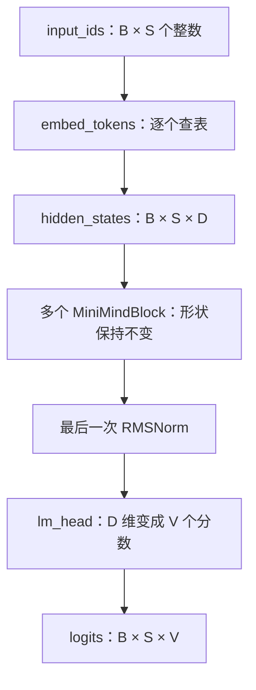
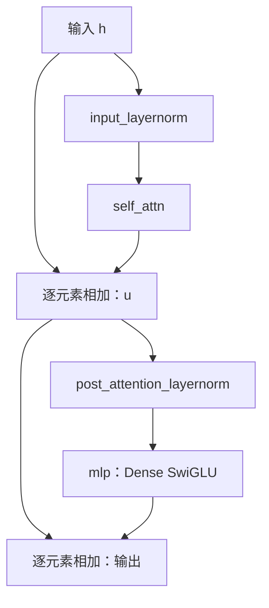

# 第 03 章 搭起语言模型骨架

一串整数怎样变成对下一个词的预测？上一章的分词器已经把文字交给了模型，
但模型内部还没有“词义”这样的 Python 对象。它拥有的是一组可学习的数值表，
以及反复修改向量的计算模块。本章沿着一条输入走过模型，先搭起能放下细节的骨架。

读完后，你应能指出 Embedding、block、归一化和输出头各自负责什么；
能手算一个 RMSNorm，解释 SwiGLU 的两条分支，还能用代码确认权重是否真的共享。
本章主线只用 CPU 和小张量。注意力在这里暂时看作“结合上下文更新向量”的模块，
其内部的 Q/K/V、mask 和矩阵乘法在第 04 章展开。

**主线必读：** Embedding、RMSNorm、残差和前馈。先跟随本章的小输入，再对照图和源码。

**进阶选读：** 权重共享与参数统计；第一次阅读可先掌握输入输出契约。

**需要额外设备/权重：** 大配置模型的资源测量。本章 CPU 实验只支持明确列出的机制结论。

## 3.1 先沿着一条输入走一遍

假设输入是 `[1, 4, 7, 2]`。这些数只是词表里的编号，数值 7 不表示比数值 4 更重要。
Embedding 查找每个编号对应的一行向量。之后每个 block 都读入并输出相同形状的向量，
最后输出头为每个位置计算整个词表的分数。这些未归一化分数称为 **logits**，还不是概率。

我们固定符号：$B$ 为批大小，$S$ 为序列长度，$D$ 为隐藏维度，$V$ 为词表大小。
“隐藏”指模型内部表征，不是不可查看。它们都能直接打印出来。



图 3-1：Dense 模型前向主干。自上而下读，首先只追张量最后一个维度：
查表得到 $D$，经过 block 仍是 $D$，输出头才把它变为 $V$。
图中省略了本章不讨论的缓存与训练 loss 分支，不表示模型没有这些功能。
最后一个位置的 logits 可用于生成下一个 token；训练则会对多个位置构造监督。

| 步骤 | 输入形状 | 输出形状 | 操作含义 |
|---|---|---|---|
| `embed_tokens` | `(B,S)` | `(B,S,D)` | 整数索引到可学习向量 |
| 单个 block | `(B,S,D)` | `(B,S,D)` | 更新各位置的表征 |
| `norm` | `(B,S,D)` | `(B,S,D)` | 沿最后一维缩放 |
| `lm_head` | `(B,S,D)` | `(B,S,V)` | 计算每个候选 token 的分数 |

真实调用链按下面的顺序进入内层：

```text
MiniMindForCausalLM.forward
  -> MiniMindModel.forward
     -> MiniMindBlock.forward
```

回到外层后执行 `lm_head`。类名很长，读时可以先简称为
“任务外壳、模型主干、一个 block”，再回到具体符号定位。

源码依据：MiniMind 的
[model/model_minimind.py](https://github.com/jingyaogong/minimind/blob/233d00fa068ec2b8c0d4f07b703934d6391a5a73/model/model_minimind.py)，
重点看这三个 `forward`，不要把另外两个仓库里的同名文件混进本章。

## 3.2 配置像尺寸说明书，不是一组独立旋钮

`MiniMindConfig` 指定模块尺寸。默认隐藏维度 768、8 层、词表 6400，
但本书的小实验采用隐藏维度 32、2 层、词表 32。小配置让我们在普通电脑上检查计算，
不意味着用这些随机权重就能聊天，也不代表上游训练结果。

几个值必须相互协调。默认 `head_dim` 由隐藏维度除以查询头数得到；
本书取 $D=32$、查询头数 4，按默认的 `head_dim = hidden_size // num_attention_heads` 得到每头 8 维。
KV 头数取 2；查询头数 4 可被 KV 头数 2 整除，因此每组 K/V 对应 2 个查询头。
`head_dim` 也能显式覆盖，这时不能再只用 $D/H_q$ 推断投影宽度。
本实现的 RoPE 把向量分成两个等长部分，小实验也保持每头维度为偶数。
配置对象可以接收很多值，并不表示任意组合都有意义或都提前检查过。

前馈中间维度也有一个默认计算式：

$$
I=64\left\lceil\frac{D\pi}{64}\right\rceil.
$$

这里 $I$ 是中间宽度，$\lceil\cdot\rceil$ 表示向上取整。代入 $D=768$，
得到 $I=2432$。式子说明“当前实现怎样选择默认宽度”，不能证明这个比例对所有模型最优。
实验显式设 `intermediate_size=64`，因此不会采用这个默认计算值。

还要分清模型参数、激活与缓存。参数是训练要调整的数；激活是本次输入产生的中间结果；
缓存是为了下一次推理重复利用而保留的中间结果。它们都可能占内存，但生命周期与用途不同。
把三者统称为“模型大小”，会让后面估算显存时失去依据。

## 3.3 残差连接：在已有结果上增加修正量

写程序时，常把一个函数的结果整体交给下一个函数。残差连接多留了一条直接通路：
除了计算一个新结果，还把原输入加回来。它像在原稿上增加修订量，但这里修订的是向量，
并不是把某个 token 的文字追加到另一个 token 后面。

本实现每个 block 有两次残差相加。对隐藏状态 $h$，记注意力模块为 $A$，前馈模块为 $F$：

$$
\begin{aligned}
u &= h + A(\operatorname{RMSNorm}(h)),\\
h_{\mathrm{out}} &= u + F(\operatorname{RMSNorm}(u)).
\end{aligned}
$$

等号右边的加号是逐元素相加，因此两个分支必须具有相同形状。
归一化在子模块之前，这种布局称为 **Pre-Norm**。两次归一化有各自的权重，
不是调用同一个可学习层两遍。



图 3-2：一个 Dense block 的两次修正。先看左侧输入如何绕过注意力到达第一次相加，
再看第一次结果如何绕过前馈到达第二次相加。绕行的箭头保留原向量，主分支计算修正量。
两条通路都参与后续求导；图没有承诺梯度在任何训练中都不会变大或变小。

源码中的关键节选是：

```python
hidden_states += residual
hidden_states = hidden_states + self.mlp(
    self.post_attention_layernorm(hidden_states)
)
```

第一行位于注意力返回之后，第二行完成前馈分支。若只看到第二行就解释整个 block，
便会漏掉前面的归一化、注意力以及第一次残差相加。
源码定位：`MiniMindBlock.forward`；`use_moe=False` 时 `mlp` 为 `FeedForward`，
MoE 是可选替代实现，留到第 09 章。

## 3.4 RMSNorm：让一个位置的数值尺度便于处理

现在打开刚才略过的归一化。一个位置的向量可能是 `[3,4]`，另一个可能是 `[30,40]`。
方向相同而整体尺度不同。RMSNorm 先按该向量的均方根缩放，再乘上可学习的每维权重。
它不会减去均值，因此不能把它解释为“让每个位置的所有数平均为零”。

对一个位置的向量 $x\in\mathbb{R}^D$，本实现计算：

$$
r=\sqrt{\frac{1}{D}\sum_{j=1}^{D}x_j^2+\epsilon},
\qquad y_i=\gamma_i\frac{x_i}{r}.
$$

$r$ 是带稳定项的分母；$\gamma_i$ 是第 $i$ 维可学习缩放；$\epsilon$ 是正的小数，
避免零输入导致除零。对 `[3,4]`，平方是 `[9,16]`，均值为 12.5，
暂忽略很小的稳定项，分母约为 3.5355，输出约为 `[0.8485,1.1314]`。
注意第二个数可以大于 1：归一化不是把每个数截断到区间内。

当权重全为 1、输入均方值远大于稳定项时，输出的均方根接近 1。
这只是特定条件下的结论。全零输入仍输出全零；将所有权重改为 2，输出尺度也相应改变。
训练正是可以通过这些权重调整不同维度的影响。

下面是当前源码的原样短节选：

```python
def norm(self, x):
    return x * torch.rsqrt(x.pow(2).mean(-1, keepdim=True) + self.eps)

def forward(self, x):
    return (self.weight * self.norm(x.float())).type_as(x)
```

先拆 `norm`。`pow(2)` 平方，`mean(-1, keepdim=True)` 沿最后一维求均值，
`rsqrt` 给出平方根的倒数，然后逐元素乘回输入。`keepdim=True` 让被归约的轴保留长度 1，
这样每个位置自己的分母可沿隐藏维度广播，不会误用整批数据的一个共同分母。

| 表达式 | 形状 | 阅读提示 |
|---|---|---|
| `x` | `(B,S,D)` | 各批、各位置自己的向量 |
| `x.pow(2)` | `(B,S,D)` | 每个元素平方 |
| `mean(-1, keepdim=True)` | `(B,S,1)` | 每个位置单独求均值 |
| `rsqrt(... + eps)` | `(B,S,1)` | 每个位置的缩放系数 |
| `x * scale` | `(B,S,D)` | 长度为 1 的轴广播 |
| `weight * norm_x` | `(B,S,D)` | 长度为 D 的权重跨批与位置共享 |

再看 `forward`。`x.float()` 在计算前转为 FP32，最后恢复到输入 dtype。
例如 FP16 的数值 300 可以表示，但其平方 90000 超过 FP16 有限值范围；
先在 FP16 中平方可能得到无穷大。转为 FP32 后再平方，可以避免这个具体问题。
这不表示 FP32 能容纳任意数，也不表示所有 NaN 都来自这里。BF16 与 FP16 的数值范围也不同。

独立创建 `RMSNorm` 时默认 `eps=1e-5`，模型配置通常显式传入 `1e-6`。
看到两个默认值不要自行统一；先检查调用点传了什么。`torch.rsqrt` 的数学含义是倒数平方根，
但只凭 API 名称不能断言所有硬件都使用同一条指令或总比另一写法快。

源码定位：`RMSNorm`、`MiniMindBlock.__init__` 与 `MiniMindModel.__init__`。
本节解释当前实现，不借此宣称 LayerNorm 的均值中心化在所有任务中都没有作用。

## 3.5 SwiGLU：一条分支给内容，一条分支给门

注意力负责让位置之间交换信息；这里的前馈网络对每个位置分别使用同一组参数做变换。
同一位置的各隐藏维度仍会混合，所以“逐位置处理”不等于“每维互不影响”。

`FeedForward` 有 `gate_proj`、`up_proj` 与 `down_proj` 三个 Linear。
前两者分别把 $D$ 维扩到 $I$ 维；gate 分支经过 SiLU 后与 up 分支逐元素相乘，
最后投影回 $D$ 维。门控的类比是给每项内容调节强度，不过 SiLU 输出并不限于 0 到 1，
因此它不是一个简单的开关概率。

以行向量约定写出公式，更方便与 PyTorch 的权重形状核对：

$$
\begin{aligned}
\operatorname{SiLU}(z)&=z\,\sigma(z),
\quad \sigma(z)=\frac{1}{1+e^{-z}},\\
F(x)&=\left[\operatorname{SiLU}(xW_g^{\mathsf T})
\odot(xW_u^{\mathsf T})\right]W_d^{\mathsf T}.
\end{aligned}
$$

$W_g,W_u$ 的形状为 $(I,D)$，$W_d$ 为 $(D,I)$；符号 $\odot$ 表示逐元素乘。
转置来自 `nn.Linear` 把权重保存为“输出维度在前”。如果论文用列向量写法，
公式外观可能不同，核对维度后才判断是否矛盾。

本实验 $D=32,I=64$，三层均无 bias，因此参数量是 $3DI=6144$。
`FeedForward.forward` 的核心只是一行：

```python
return self.down_proj(self.act_fn(self.gate_proj(x)) * self.up_proj(x))
```

读这一行时先找最内层的两个投影，再看激活与乘法，最后看 down 投影。
它与刚才的公式逐项对应。配置的默认 `hidden_act='silu'` 通过 `ACT2FN` 查到激活；
如果改变配置，不能继续无条件把该分支称为 SwiGLU。

## 3.6 输出头和 Embedding 为什么能共用一张表

Embedding 的权重形状是 $(V,D)$；输出 Linear 把 $D$ 变成 $V$，
按照 PyTorch 的存储约定，其权重恰好也是 $(V,D)$。
因此可以让查词表和给候选打分使用同一个 Parameter，称为 **weight tying，权重共享**。

源码在 `MiniMindForCausalLM.__init__` 中根据配置执行：

```python
if self.config.tie_word_embeddings:
    self.model.embed_tokens.weight = self.lm_head.weight
```

这里的赋值绑定到同一个对象，不是拷贝两个数值相同的张量。
读入某个 token 时取一行，输出打分时与各行做内积；反向传播的贡献汇集到共享参数上。
相对于两张独立表，共享减少一张 $(V,D)$ 参数表，减少量为 $VD$。
它并不等于整个模型参数减半，也不自动证明任务质量提升。

查验共享请用对象身份或存储检查。仅比较两个张量当前数值相等，只能证明它们现在一样，
不能证明下一次更新后仍由同一份参数驱动。

## 3.7 动手验证：不要只相信 print

完整实验在配套仓库的 `experiments/ch03_model_skeleton.py`，从书稿仓库根目录运行：

```bash
.venv/bin/python experiments/ch03_model_skeleton.py
```

环境安装见阅读指南。脚本先核对上游 commit，再导入真实 `RMSNorm`、`FeedForward` 和模型。
它不需要数据集或预训练权重，使用固定随机种子 42。断言失败就以错误退出，不把错误输出包装成成功。

| 检查 | 通过条件 | 能支持的结论 |
|---|---|---|
| `[3,4]` 手算 | 输出与公式在容差内相符 | 此输入上的公式与实现一致 |
| 反向传播 | 输入与权重都有有限、非零梯度 | 本次计算图确实支持反向 |
| 零输入 | 输出为零，梯度有限 | 稳定项处理了这个零输入边界 |
| 缩放权重改为 2 | 输出也变为原来的 2 倍 | 输出尺度不是永远固定为 1 |
| FP16 输入 300 | 直接平方溢出，上游归一化输出有限 | FP32 中间计算解决了这个数值案例 |
| 前馈与共享 | 前馈参数 6144，权重为同一对象 | 小配置中的尺寸与共享成立 |

预期手算输出约为 `[0.848528,1.131371]`，小模型 logits 形状为 `(1,4,32)`。
本次 CPU 实测与上述预期一致，输入和权重梯度均有限且非零。
精确运行结果及环境写入 `build/experiments/ch03-results.json`，已在配套实验记录中保存摘要。
这些检查支持模块理解，不测 GPU 性能，也不证明随机模型能够生成有意义文字。

## 3.8 常见误解与自检

如果对模型暂时只有一个整体印象，请记住三个区别：token ID 与向量不同，
参数与当前输入的激活不同，logits 与概率不同。后续很多 shape 错误都来自把它们混成一种东西。

另一个常见错误是把归一化写成 `mean()`，漏掉 `dim=-1`。
这样整批、整段、所有隐藏维度被一起归约，公式中的“每个位置自己缩放”就被改变了。
形状能广播成功不代表语义正确，必须同时检查归约轴。

试着先回答，再看参考解释：

1. 输入 `(2,5)`、隐藏维度 32、词表 100，输出头的权重和 logits 各是什么形状？
2. RMSNorm 是否保证所有输出元素都不大于 1？用 `[3,4]` 说明。
3. 把前馈中间维度从 64 改成 128，会改变 block 的输出形状吗？参数增加多少？
4. 两张数值相同的权重表是否一定共享？怎样验证？
5. 将 `use_moe=True` 后，本章哪部分实现描述需要重新核对？

参考解释：第一题权重 `(100,32)`，logits `(2,5,100)`。第二题不保证，
例子的第二个输出约 1.1314。第三题输出仍是 `(B,S,32)`，前馈参数从 6144 增至 12288，
增加 6144；这里计数只含无 bias 的三层 Linear。第四题不一定，实验检查 `is`。
第五题 `mlp` 改为 MoE，需要检查专家选择与辅助 loss，不能把 Dense 前馈的一行计算当成整个 MoE。

可选练习：在实验自己的小配置中关闭 `tie_word_embeddings`，重新统计参数，
检查增加量是否为 $VD$。只改教学脚本，不为做练习修改上游源码。
下一章打开本章暂时保留的 Attention，看看“结合上下文更新向量”到底怎样计算。
