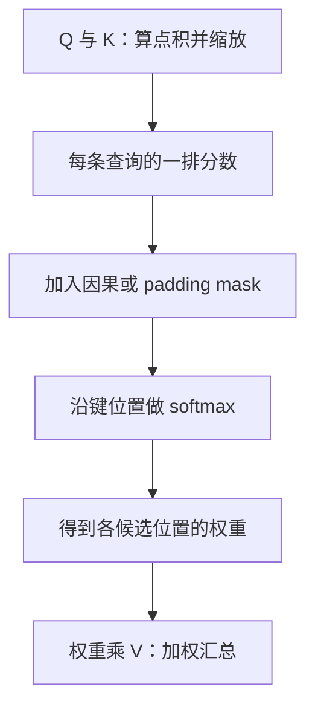
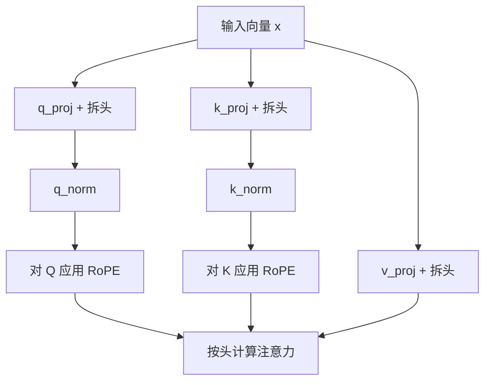

# 第 04 章 手算一次注意力

前馈网络可以修改一个位置的向量，但“它”指的是前文哪个对象，需要结合其他位置的信息。
注意力提供了这种结合方式：当前位置先计算与各候选位置的匹配分数，再按分数加权汇总信息。
这不是程序员写死的关键词查询，分数来自训练得到的投影和输入向量。

本章先把注意力缩成两个位置、二维向量，手算每一步，再放回真实 `Attention.forward`。
第一次阅读先掌握“分数 → mask → 权重 → 汇总”四步；GQA 的维度和 SDPA 的选择条件可以第二遍再核对。
位置编码的接口会出现，但旋转的内部细节留到第 05 章。

**主线必读：** 点积、softmax、因果 mask 与形状。先跟随本章的小输入，再对照图和源码。

**进阶选读：** GQA、QK-Norm 和 SDPA 分支；第一次阅读可先掌握输入输出契约。

**需要额外设备/权重：** GPU 内核与性能比较。本章 CPU 实验只支持明确列出的机制结论。

## 4.1 查询、键和值分别是什么

同一个输入向量通过三组 Linear，形成查询 Q、键 K、值 V。
查询表达当前位置用于匹配的特征，键提供候选位置用于匹配的特征，值提供最终被汇总的内容。
可以类比“查询条件、索引、取回的信息”，但实际运算是向量之间的连续计算，不是在字典里按字符串查键。

对一个头，设查询位置有 $S_q$ 个，键和值位置有 $S_k$ 个，每头维度为 $d_h$。
Q、K、V 的形状分别为 $(S_q,d_h)$、$(S_k,d_h)$、$(S_k,d_h)$。
令 $i$ 是查询位置、$j$ 是键位置，则：

$$
\begin{aligned}
&e_{ij}=\frac{q_i\cdot k_j}{\sqrt{d_h}}\\
&a_{ij}=\frac{\exp(e_{ij}+m_{ij})}{\sum_{r=1}^{S_k}\exp(e_{ir}+m_{ir})}.
\end{aligned}
$$

$e$ 是匹配分数，$m$ 是加到分数上的 mask，$a$ 是沿键轴归一化的权重。
分母只跨同一条查询的候选位置求和，不跨批或头求和。输出为：

$$
o_i=\sum_{j=1}^{S_k}a_{ij}v_j.
$$

每个权重乘对应的值向量，再相加。输出维度仍是 $d_h$，不会因为参考的位置多就自动变成更长的向量。
除以 $\sqrt{d_h}$ 是这个实现使用的缩放因子；它不等于把所有分数限制到固定区间。

## 4.2 用两个位置走完四步

先给定点积前的 Q/K/V，暂不涉及它们怎样由真实模型投影得到：

$$
Q=K=\begin{bmatrix}1&0\\0&1\end{bmatrix},\qquad
V=\begin{bmatrix}10&0\\0&20\end{bmatrix}.
$$

点积除以 $\sqrt{2}$ 后，对角线约为 0.7071，非对角线为零。
自回归训练要求当前位置看不到未来，所以第一个位置不能参考第二个位置。
把禁止的分数设为负无穷，经过 softmax 后得到：

$$
\begin{aligned}
&A\approx\begin{bmatrix}1&0\\0.330238&0.669762\end{bmatrix}\\
&O\approx\begin{bmatrix}10&0\\3.302385&13.395231\end{bmatrix}.
\end{aligned}
$$

第一行只能取第一个值，输出 `[10,0]`。第二行可参考两个值，
第一维为 $0.330238\times10$，第二维为 $0.669762\times20$。
两个输出维度的和不需要等于 1；等于 1 的是每行注意力权重之和。



图 4-1：手算注意力的顺序。先追分数如何变成权重，再看权重怎样用于 V。
mask 在 softmax 之前影响分数；输出不是“选中一个词”，而是若干值向量的加权组合。
真正选下一个 token 还要经过模型其余部分和词表输出头。

## 4.3 把批、位置和头放回去

真实实现先对 `(B,S,D)` 的输入投影，再把最后一维拆成头数和每头维度。
本书小配置为 $D=32,H_q=4,H_{kv}=2,d_h=8$，其中 $H_q$ 为查询头数，$H_{kv}$ 为键值头数。

| 步骤 | Q 的形状 | K/V 的形状 |
|---|---|---|
| Linear 后 | `(B,S,32)` | `(B,S,16)` |
| 拆分头 | `(B,S,4,8)` | `(B,S,2,8)` |
| KV 按组展开，再转置 | `(B,4,S,8)` | `(B,4,S,8)` |
| 注意力分数 | `(B,4,S,S)` | 每条查询对应一排键 |
| 汇总与拼头 | `(B,S,32)` | 再经过 `o_proj` |

这里没有缓存，因此查询与键的长度都是 $S$；带缓存时两者长度可能不同。
`transpose(1,2)` 把头轴移到序列轴前，方便按头做矩阵乘法；它不是把头的内容重新随机分组。
最后反向转置，再 reshape 拼回隐藏维度。形状相同还不够，轴的含义也要一致。

源码中的投影与拆头节选为：

```python
xq, xk, xv = self.q_proj(x), self.k_proj(x), self.v_proj(x)
xq = xq.view(bsz, seq_len, self.n_local_heads, self.head_dim)
xk = xk.view(bsz, seq_len, self.n_local_kv_heads, self.head_dim)
xv = xv.view(bsz, seq_len, self.n_local_kv_heads, self.head_dim)
```

阅读时先代入小配置检查元素数，再换成默认配置。默认 768 维、8 个查询头、4 个 KV 头时，
每头为 96 维；不要把小例子的 8 维写成真实默认值。
源码锚点：MiniMind
[model/model_minimind.py](https://github.com/jingyaogong/minimind/blob/6fc918beb68a0d8c40452338df6319fe168014ba/model/model_minimind.py)
的 `Attention.__init__`、`Attention.forward` 与 `repeat_kv`。

## 4.4 GQA：多个查询头共用一组键和值

如果每个查询头都有独立 K/V 头，称为多头注意力的一种常见布局。
GQA，即 Grouped-Query Attention，让若干查询头共用同一组 K/V。
本配置中 4 个查询头配 2 个 KV 头，`n_rep=4//2=2`。
`repeat_kv` 把 KV 头按组展开，使注意力矩阵乘法时头数相容。

这不是把两组不同的 K/V 求平均。每一组原 K/V 被相应查询头复用，查询投影仍各自不同。
当前源码先保存未展开的 `past_kv`，再调用 `repeat_kv` 参与计算，因此缓存按 $H_{kv}$ 存储。

若模型有 $L$ 层，缓存长度为 $T$，每个元素占 $b$ 字节，仅 K/V 缓存元素的字节量为：

$$
M_{\mathrm{KV}}=2LBTH_{kv}d_hb.
$$

最前面的 2 表示 K 与 V 各一份。在其余条件相同时，KV 头数从 4 降至 2，这部分缓存量减半。
这不等于总显存减半：参数、激活、临时展开、优化器状态等另有开销。
`expand` 创建广播视图，也不能推出后面的 reshape 与整个运算过程永远不分配新存储。

## 4.5 QK-Norm 与位置编码在哪一段

第 03 章介绍了沿最后一维做 RMSNorm。这里 Q/K 已拆成头，最后一维恰好是 $d_h$，
因此 `q_norm` 与 `k_norm` 对每个位置、每个头的向量做归一化。
两层各自的权重长度为每头维度，在所属路径的各个头之间共享，并不是每个头各建一个 RMSNorm 对象。
V 没有经过这两个层，也没有在本实现里参加 RoPE 旋转。



图 4-2：三条投影路径的不同处理。先分别追 Q、K、V，确认两次归一化和旋转只在 Q/K 路径上。
图省略了缓存与 KV 展开，专门回答“哪些向量被归一化与旋转”。
归一化有助于控制点积前向量尺度，但不自动保证所有训练都稳定，也不保证注意力权重不会集中。

`Attention.forward` 从调用者收到 `position_embeddings`，拆成 cos/sin，再交给 `apply_rotary_pos_emb`。
本章实验使用全 1 的 cos 与全 0 的 sin，把旋转变成恒等变换，以便单独观察注意力。
这只是实验隔离方式，真实模型仍会按位置生成不同旋转，下一章再打开这部分。

## 4.6 两种 mask，两个不同的问题

**因果 mask** 解决“不偷看未来”。没有缓存时，分数矩阵上三角被屏蔽，位置 $i$ 只能参考不晚于自己的位置。
**padding mask** 解决“哪些键位置不是有效输入”。它们可以同时存在，不能互相替代。

当前显式分支在计算分数后依次处理两类 mask：

```python
if self.is_causal:
    scores[:, :, :, -seq_len:] += torch.full((seq_len, seq_len), float("-inf"), device=scores.device).triu(1)
if attention_mask is not None:
    scores += (1.0 - attention_mask.unsqueeze(1).unsqueeze(2)) * -1e9
```

因果掩码之所以作用在尾部切片 `scores[:, :, :, -seq_len:]` 上，是因为在带 KV Cache 解码时，
查询长度为本次输入的 `seq_len`（单步解码时通常为 1），而键的总长度为 $\mathrm{past\_len} + \mathrm{seq\_len}$。
前 $\mathrm{past\_len}$ 个历史键全部属于已经发生的过去，当前新 token 可以合法关注全部历史，无需掩码；
只有尾部新来的 $\mathrm{seq\_len}$ 个查询与新对应的 $\mathrm{seq\_len}$ 个键之间，才需要因果三角掩蔽。
当逐 token 解码时 $\mathrm{seq\_len}=1$，`(1,1)` 张量的 `triu(1)` 为全零，不会屏蔽任何位置，
当前 token 可以完整参考所有历史及自身。

`attention_mask` 从 `(B,S_k)` 扩为 `(B,1,1,S_k)`，沿头和查询轴广播。
因此它屏蔽的是作为键的候选位置，不是自动把该位置的所有 query 输出清零。
训练是否监督某个输出，还由 labels/loss mask 决定，第 06 章会进一步区分。

一个反例很重要：全零 mask 在这个实现中不是“输出必为零”的保证。
它使用有限的大负数；在本章 CPU 实验中，最终仍得到非零有限输出。
没有有效键的样本应在输入阶段明确定义处理方式，不要把全零 mask 当成万能清空操作。
这项观察只针对本次显式分支和数值环境，不推广成所有注意力实现的行为。

## 4.7 SDPA 分支何时被选中

SDPA 是 `scaled_dot_product_attention` 的缩写，即一个实现缩放点积注意力的 PyTorch API。
源码变量叫 `self.flash`，但这个名字不证明某次执行一定用了 FlashAttention GPU 内核。
本项目先决定调用哪个 Python 路径，依赖库再根据设备、dtype 等决定底层实现。

当前调用 SDPA 的条件同时包括：API 可用且配置开关打开；本次查询长度 `seq_len > 1`；
`not self.is_causal or past_key_value is None`；mask 未提供或所有值都是 1。
任一条件不满足就走显式的分数、mask、softmax 与矩阵乘法。

`Attention.is_causal` 在构造时固定写成 `True`。因此只要 `past_key_value is not None`，
无论这次查询是 1 个 token 还是更长的一段，SDPA 分支都不成立，带缓存的多 token 前向同样走显式路径。
单步解码还被长度条件单独挡住：`seq_len == 1` 时，即使没有历史缓存也不会调用 SDPA。

源码没有注释这次回退。PyTorch 2.6.0 的这个函数也不会因为长度不等而报错。
[PyTorch 2.6 官方文档](https://docs.pytorch.org/docs/2.6/generated/torch.nn.functional.scaled_dot_product_attention.html)
写明：方阵时 `is_causal=True` 是下三角；非方阵时是左上角因果偏置，查询从第一个键算起。
本书 CPU 上的调用与文档一致。掩码前分数全为 0 时，查询长度 1、键长度 4 只保留第一个键；
查询长度 2、键长度 4 时，两个查询分别只看到前 1 个和前 2 个键。
4.6 节的尾部切片则是右下角对齐，新的查询可以看到全部历史键，只在新键之间做上三角屏蔽。
若把带缓存的解码直接交给这个 `is_causal`，新 token 只能看到最早的键，看不到更近的历史。
从掩码结果看，源码在有 `past_key_value` 时走显式分支，避开了上述错位。
这是对分支效果的解释；源码未说明作者选择该条件的动机，不能将推断写成作者说明。
`seq_len == 1` 且没有缓存时，键长同样是 1，两种三角重合；此时不走 SDPA，只是长度条件本身。

显式路径还把 softmax 输入转为 FP32，再把权重转回 Q 的 dtype。
训练时可能应用 dropout，评估时应关闭随机失活。比较两个分支前先保证权重、输入、位置和 dropout 条件相同，
否则输出不一致可能只是比较条件不同。

## 4.8 用反例验证理解

运行 `.venv/bin/python experiments/ch04_attention.py`。实验不仅比较手算，
还改变输入来检验因果和 padding 的语义：

| 实验 | 实际观察 | 支持的结论 |
|---|---|---|
| 手算两个位置 | 权重和输出与 4.2 节一致 | 给定 Q/K/V 的计算正确 |
| 同权重 SDPA 与显式路径 | 最大误差约 `5.96e-8` | 此 CPU 配置在容差内一致 |
| 改变最后一个输入位置 | 更早位置输出误差为 0 | 本次因果遮挡成立 |
| 改变被屏蔽的中间键 | 其他有效查询输出误差为 0 | mask 的键轴语义成立 |
| padding、单 token 或带缓存的多 token | 未调用 SDPA API | 实际分支条件符合源码 |
| 查询 2、键 4，零分数、V 为 1～4 | SDPA 输出 1、1.5 | 非方阵左上角对齐，非缓存尾部对齐 |

详细数值保存在 `experiments/ch04-results.json`。这不是性能 benchmark，不证明 GPU 加速比例。
正式排错时，先检查 mask 的形状和语义，再检查具体后端；不要见到变量名 flash 就直接推断内核。

1. softmax 应沿查询轴还是键轴求和？为什么？
2. Q/K 归一化后，V 是否也被相同代码归一化？
3. KV 头数减半，能否直接声称训练峰值显存减半？
4. padding mask 某项为 0，是否表示对应 query 输出也为 0？
5. CPU 上两个分支结果一致，是否证明使用了 FlashAttention GPU 内核？

参考解释：第一题沿键轴，因为每条查询需要分配候选位置的权重。第二题没有。
第三题不能，还存在多种其他存储。第四题不保证，这个 mask 作用于候选键。
第五题不能，API 路径与底层内核不是同一个层次。
可选练习：把一个未屏蔽位置改为 padding，预测哪些查询可能受影响，再用实验检查。
