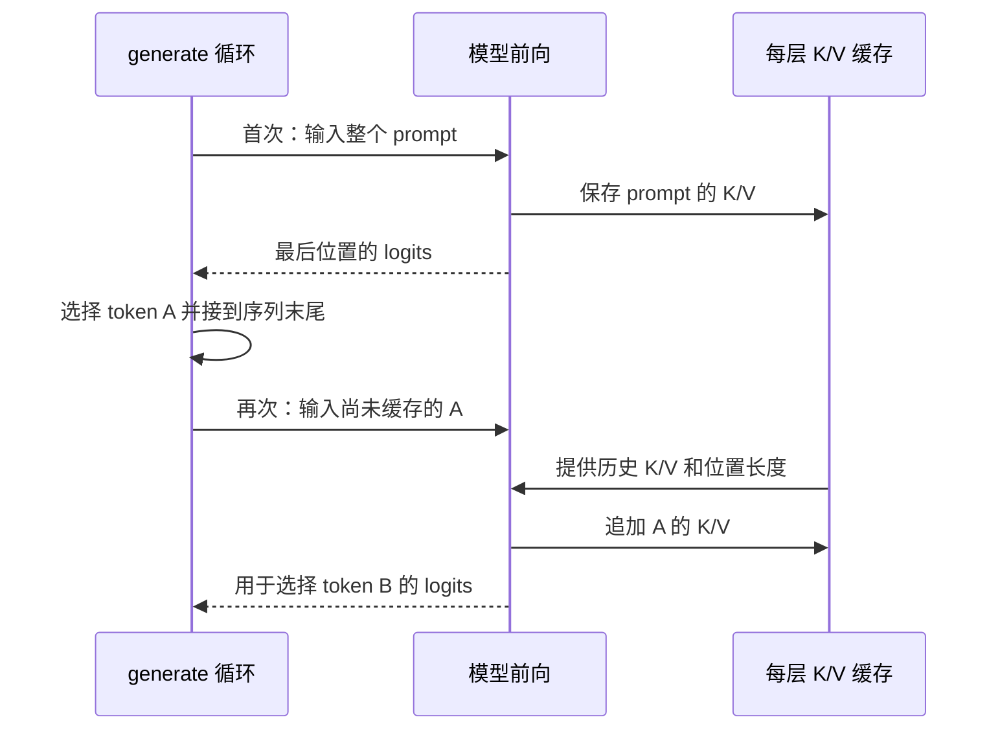

# 第 05 章 位置、缓存与逐字生成

上一章解释了“一个位置怎样参考其他位置”，但还有两个问题：模型怎样区分先后顺序？
生成第十个 token 时，前面九个位置是否都要重新计算？本章分别用旋转位置编码和 KV Cache 回答，
最后把它们接入真实的生成循环。

第一次读先追“已有文本 → 计算分数 → 选一个 token → 再计算”这条主线。
旋转的数学推导和 YaRN 属于逐步深入的部分，不要求先学过复数或高级信号处理。
本章的“逐字”是直观说法，代码实际逐 token 生成，一个 token 未必是一个字。

**主线必读：** 位置旋转、缓存增长与采样停止。先跟随本章的小输入，再对照图和源码。

**进阶选读：** YaRN 频率调整和分块缓存；第一次阅读可先掌握输入输出契约。

**需要额外设备/权重：** 长文本质量与 GPU 吞吐测试。本章 CPU 实验只支持明确列出的机制结论。

## 5.1 用旋转让位置参与匹配

如果只看相同的内容向量，模型还需要知道它们分别出现在什么位置。
RoPE，即 Rotary Position Embedding，把位置转换为旋转角度，作用在 Q/K 上。
可以想象两根指针：各自的方向包含内容和位置，比较它们时，位置差影响夹角。
类比只解释几何关系，实际旋转发生在向量的一组二维子空间里。

对二维列向量，转过角度 $\theta$ 的矩阵为：

$$
R(\theta)=\begin{bmatrix}\cos\theta&-\sin\theta\\\sin\theta&\cos\theta\end{bmatrix}.
$$

在普通正交旋转下，向量长度不变。更重要的是两个位置的内积满足：

$$
\begin{aligned}
&(R(m\omega)q)^{\mathsf T}(R(n\omega)k)\\
&\qquad=q^{\mathsf T}R((n-m)\omega)k.
\end{aligned}
$$

$m,n$ 是位置，$\omega$ 是这一对维度的角频率。右边出现位置差 $n-m$，
这说明旋转能把相对位置关系带进 Q/K 的匹配。这里并没有说注意力只由位置决定，内容 $q,k$ 仍然参与。

## 5.2 MiniMind 怎样配对维度

真实代码不是只旋转一个二维向量。每个头有 $d_h$ 维，每一对维度使用不同频率：

$$
\omega_j=\mathrm{base}^{-2j/d_h},\qquad j=0,\ldots,d_h/2-1.
$$

本实现默认 `rope_theta=1e6`，它对应式中的 base。
`precompute_freqs_cis` 先生成频率，再将位置与频率做外积，得到每个位置、每对维度的角度。
接着预计算 cos 和 sin，避免每次前向重复算同样的三角函数。

需要特别看清配对方法。`rotate_half` 把前后两半配对，而不是把相邻维度配对。
例如 8 维向量中的 0 与 4、1 与 5、2 与 6、3 与 7 分别是一对。

```python
def rotate_half(x):
    return torch.cat((-x[..., x.shape[-1] // 2:],
                      x[..., : x.shape[-1] // 2]), dim=-1)
```

这个节选仅把源码的一行排成两行，计算未改。cos/sin 的频率也沿最后一维重复，
保证配对维度取得相同角度。最后组合 `x*cos + rotate_half(x)*sin`。
若把别的项目中“偶数位与奇数位交错”的写法直接换过来，而没有同时处理权重/布局，可能改变计算含义。

源码锚点：MiniMind
[model/model_minimind.py](https://github.com/jingyaogong/minimind/blob/6fc918beb68a0d8c40452338df6319fe168014ba/model/model_minimind.py)
中的 `precompute_freqs_cis`、`apply_rotary_pos_emb` 及 `MiniMindModel.forward`。
普通旋转保持范数的结论以标准 cos/sin 缩放为前提；若额外乘 attention factor，还要计算它的尺度影响。

## 5.3 位置不是每次都从零开始

假设 prompt 有 4 个 token，首次前向使用位置 0～3。
选出一个新 token 后，它的位置应为 4，而不是再次作为位置 0 进入模型。
`MiniMindModel.forward` 从第一层缓存的 K 长度读取 `start_pos`，再切出本次需要的 cos/sin。

```python
start_pos = past_key_values[0][0].shape[1] if past_key_values[0] is not None else 0
position_embeddings = (
    self.freqs_cos[start_pos:start_pos + seq_length],
    self.freqs_sin[start_pos:start_pos + seq_length]
)
```

缓存不仅是一种加速手段，也参与确定当前位置。
如果缓存来自另一段 prompt，或各层长度不一致，即使张量形状能勉强拼接，语义也已错位。
调用者应保持每层各一对 K/V，且对应相同历史前缀；不能把任意“长得像缓存”的对象直接塞进来。
当前 `MiniMindModel.forward` 对带 `layers` 属性的缓存对象直接置为 None，并没有转换其内容；
随后用 `zip(self.layers, past_key_values)` 遍历。列表过短会少执行 block，而不是可靠地报出层数错误。
这里要求的是与层数匹配的 K/V 列表；缓存由调用者持有并传回，模型没有一个自动管理会话的全局缓存。
不再使用时应释放调用者保存的引用。

## 5.4 缓存到底省去了哪些重复计算

因果模型中，过去位置不会因为未来 token 出现而改变自己的隐藏状态。
因此过去位置已经算出的 K/V 可以保存起来。新 token 的 Q 仍需与历史 K 匹配，
也仍需汇总历史 V，所以缓存并没有让注意力不再依赖历史长度。

首次处理整段 prompt 称为 **prefill，预填充**；随后逐 token 前向称为 **decode，解码**。
当前代码用 `torch.cat` 把新 K/V 拼到历史上，沿缓存的序列轴增长；保存发生在 `repeat_kv` 之前。
这是一种易读的实现，不是分页缓存，也不自动具备多请求调度或常数开销追加的能力。



图 5-1：生成与缓存的交替推进。先看 prompt 只在第一次完整输入，再看新 token 要到下一次前向才写入缓存。
这解释了一个容易误判的现象：最后刚采出的 token 可以已经在结果中，却还没有对应的 K/V。
图里的“提供历史缓存”是同进程对象传参，不表示网络服务或另一个后台进程。

| 阶段 | 本次输入长度 | 前向前缓存长度 | 前向后缓存长度 |
|---|---:|---:|---:|
| prompt 前向 | 4 | 0 | 4 |
| token A 前向 | 1 | 4 | 5 |
| token B 前向 | 1 | 5 | 6 |

第三行前向后再采出 C，返回的序列长度为 7，而缓存长度为 6。
本书实验验证了这项 `return_kv=True` 的行为。继续生成时传回完整序列及对应缓存，
当前循环用 `input_ids[:, past_len:]` 取尚未处理的尾部，而不是盲目再送整个序列。
因此两个入口的约定不同：直接调用 `forward` 时传未缓存的尾部；调用 `generate` 续写时，
传完整 `generated_ids` 和对应的 `past_kv`（参数名仍是 `past_key_values`）。
若只把最后一个 token 传给带缓存的 `generate`，它还会按历史长度切片，可能得到空输入。
本章补充实验验证了“先生成 3 个，再携缓存续写 3 个”与一次贪心生成 6 个的结果一致。

## 5.5 生成循环不是一次输出整段答案

`MiniMindForCausalLM.generate` 覆盖了类继承来的生成入口。
阅读时应追当前这个方法，不能直接把其他框架的所有 generate 参数和行为套到它上面。
主流程为：准备输入与 finished 标记，前向，取最后位置 logits，调整候选分布，选 token，拼接结果，检查停止。

没有缓存时 `past_len` 为 0，每轮重新输入当前整段前缀；有缓存时只输入未缓存尾部：

```python
past_len = past_key_values[0][0].shape[1] if past_key_values else 0
outputs = self.forward(input_ids[:, past_len:], attention_mask, past_key_values, use_cache=use_cache, **kwargs)
```

在首次 prefill 步，`past_key_values` 为 None，`past_len = 0`，切片 `input_ids[:, 0:]` 完整前向 prompt；
在随后的 decode 各步，`past_len` 恰好是已缓存的历史键长度，切片 `input_ids[:, past_len:]` 每次仅截出
最新生成的 1 个 token 喂给模型，避免了重复计算已有前缀。
模型参数并不在这个循环中更新，生成方法使用 `torch.inference_mode()`。
随机权重模型仍可能重复输出同一个编号；能运行循环不表示已经有对话能力。

`finished` 为批中每条序列单独记录是否新生成了 EOS。已结束的行在其他行继续时填入 EOS，
直到全部结束或达到 `max_new_tokens`。这个参数限制的是新增 token 数，不是 prompt 加输出的总长度。
prompt 中原本存在 EOS 不等于 finished 一开始就为真。
上下文还受位置缓存长度等限制，不能单凭一个很大的 max_new_tokens 声称支持可靠长文本。

批量生成还有一条输入约定：代码始终取 `outputs.logits[:, -1, :]`，不会根据
`attention_mask` 找每行最后一个有效位置。右侧补齐的短 prompt 因而会从 padding 位置的
logits 选词。不同长度 prompt 应采用左侧补齐并传入正确 mask，同时检查实际生成行为；
位置编号仍按整批的列和缓存长度推进，并未根据各行有效 token 数单独生成。

## 5.6 从 logits 到候选分布

当前代码按以下顺序处理最后位置的分数：温度、重复惩罚、Top-K、Top-P，最后采样或 argmax。
温度 $T>0$ 作用为 $z_i/T$：较低温度让相对差异更大，较高温度让分布更平缓。
这不是重新训练模型，也不是把回答质量乘以一个系数。不要用 $T=0$ 表示贪心，本实现仍会先做除法。

重复惩罚系数 $r$ 对已经出现过的 ID 分别处理正负分数。对常用的 $r>1$：

$$
z_i'=\begin{cases}
z_i/r,& z_i>0,\\
r z_i,& z_i\le 0.
\end{cases}
$$

正数变小，负数更负，都在降低该候选的相对分数。例如 $r=2$ 时，2 变为 1，-2 变为 -4。
如果误把负数也除以 2，会把 -2 变为 -1，反而提高它。

Top-K 找第 K 大分数作为阈值，低于阈值的候选被屏蔽。
因为源码用的是严格小于，边界并列时可能保留多于 K 个候选。实验中前三项同分、K=2，实际保留 3 项。
K 还不能随意大于词表大小；本书小模型测试显式使用 `top_k=0` 关闭筛选或使用合法值。

Top-P 先排序，累积 softmax 概率，保留累计质量达到阈值所需的前缀。
源码将“超过阈值”的 mask 右移一位，因此跨过阈值的那一项也保留，至少留下首项：

```python
sorted_logits, sorted_indices = torch.sort(logits, descending=True)
mask = torch.cumsum(torch.softmax(sorted_logits, dim=-1), dim=-1) > top_p
mask[..., 1:], mask[..., 0] = mask[..., :-1].clone(), 0
logits[mask.scatter(1, sorted_indices, mask)] = -float('inf')
```

为什么要右移？如果首项概率就达到了 0.7 且阈值取 0.6，累积和在第 0 项即为 True（即超过阈值）；
若不右移，连概率最高的第一项也会被掩盖。右移并将首位置 0，保证了刚刚累积跨过阈值的边界项与首项必被保留。
随后的 `mask.scatter(1, sorted_indices, mask)` 依据排序索引，把排序空间里的掩码写回词表原始维度。
例如概率 `[0.4,0.3,0.2,0.1]`、阈值 0.6，会留下前两项，重新归一化为 `[4/7,3/7,0,0]`。
这是保留累计质量，不是保留概率单独大于 0.6 的项。

`do_sample=True` 从分布抽样，false 则取 argmax。当前 false 分支前面仍会走分数处理，
因此比较贪心行为时也要固定温度和惩罚配置。

## 5.7 YaRN：选读的长度缩放配置

当预计算长度与原始长度的比值大于 1 时，YaRN 分支会调整部分旋转频率。
当前实现先计算从 0 到 1 的线性过渡系数 $\gamma_j$，再按缩放因子 $s$ 修改频率：

$$
\omega_j'=\omega_j\left(1-\gamma_j+\frac{\gamma_j}{s}\right).
$$

当 $\gamma_j=0$ 时保持原频率，等于 1 时频率缩为原来的 $1/s$，中间平滑过渡。
`beta_fast`、`beta_slow` 决定过渡区的索引界限，代码还对边界作 clamp。
这些算式解释配置如何改变 cos/sin，不能直接证明长文本任务质量。

默认 `inference_rope_scaling=False`；开启后配置含 `factor=16`、
`original_max_position_embeddings=2048` 等值。2048 是这里的配置基准，
不等于当前每个训练脚本都实际训练过 2048 长度。阅读命令行帮助、配置和运行代码时，应以实际值为准。
本章不声称开启开关即可无损外推到 32k。

## 5.8 验证缓存，而不是只看回答相似

运行 `.venv/bin/python experiments/ch05_rope_cache.py`。
脚本比较同一随机模型的全量前向、逐 token 缓存前向、一次输入两个新 token 的缓存前向。
比较对象是对应位置的 logits，不是“看起来都说了差不多的话”。

本次 CPU 实测：逐 token 最大误差约 `5.96e-8`，分块误差约 `2.98e-8`；
缓存长度依次为 1、2、3、4、5。RoPE 相对内积误差约 `2.38e-7`，在设定容差内。
另用固定 logits 隔离采样策略，验证 Top-P 的边界项、Top-K 同分和正负重复惩罚。
固定 logits 实验只检查采样代码，不用它证明模型实际会给出该分布。

1. 本实现 8 维 RoPE 中，第 0 维和哪一维配对？
2. 4-token prompt 后已返回 3 个新 token，缓存为什么可能只有 6 个位置？
3. 开启缓存是否让每步完全不再读取历史 K/V？
4. Top-P 为 0.6 是否表示只选概率大于 0.6 的 token？
5. YaRN 的频率公式算对了，是否足以证明长文本质量不变？

参考解释：第一题配第 4 维：本实现把前半维度与后半维度成对旋转，不是把相邻两个元素配对。第二题首次前向缓存 4 个 prompt 位置，再有两次新 token 前向形成 6 个缓存位置；第三个新 token 刚被采出，还没有作为输入执行前向。

第三题仍需读取历史 K/V，与新 Q 做匹配；缓存省去的是旧位置 K/V 的重新计算。第四题是从高概率开始累加、保留达到阈值的候选前缀，不是逐项比较概率与 0.6。第五题公式与实现一致只验证位置计算，长文本质量仍需在相应长度和任务上独立评估。

可选练习：改变 prompt 长度，再预测返回序列与缓存长度的差，运行核对。
