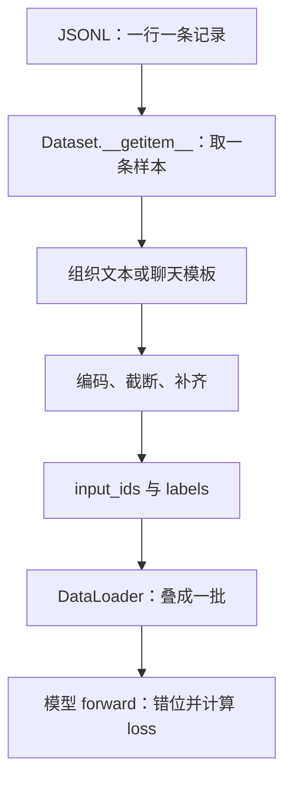
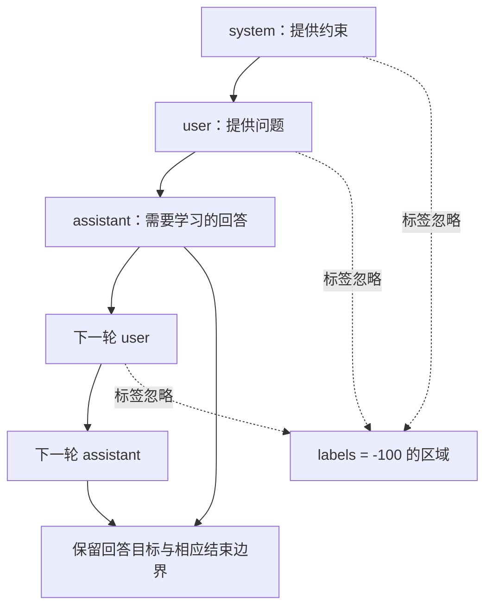

# 第 06 章 一条训练样本的旅程

模型能够前向，并不表示它知道应该学习什么。训练数据除了输入，还必须告诉损失函数：
哪个位置的预测要和哪个目标比较，哪些位置不计分。本章沿着一条文本和一段对话进入 Dataset，
追到模型真正计算交叉熵的位置。

这部分代码不长，却很容易发生“程序能跑，学习目标已经错了”的问题。
最值得养成的习惯是并排打印 input_ids、labels 和有效监督位置，必要时把它们解码回文字。
不能只看 loss 是一个有限数，就认定数据处理正确。

**主线必读：** 模板、截断、labels、mask 与 shift。先跟随本章的小输入，再对照图和源码。

**进阶选读：** 空监督区和多轮扫描边界；第一次阅读可先掌握输入输出契约。

**需要额外设备/权重：** 完整语料的数据质量检查。本章 CPU 实验只支持明确列出的机制结论。

## 6.1 JSONL、Dataset 与一批数据

JSONL 是每行一个 JSON 对象的文本格式。预训练数据在每行取 `text`，
SFT 则从 `conversations` 读取带角色的消息列表。Dataset 定义如何从一条记录得到张量，
DataLoader 再把若干条样本组成一个 batch。它们是两个层次，不要把批大小写成一条样本的长度。



图 6-1：样本进入训练的主线。先看一条记录如何变成两个等长张量，再看 DataLoader 添加批轴。
最后的错位在当前文本模型中进行，因此不能在前面再错一次。图概括了 Pretrain/SFT 的共同接口，
两者组织 labels 的规则并不相同。

源码入口是 MiniMind
[dataset/lm_dataset.py](https://github.com/jingyaogong/minimind/blob/233d00fa068ec2b8c0d4f07b703934d6391a5a73/dataset/lm_dataset.py)
的 `PretrainDataset` 和 `SFTDataset`，以及
[model/model_minimind.py](https://github.com/jingyaogong/minimind/blob/233d00fa068ec2b8c0d4f07b703934d6391a5a73/model/model_minimind.py)
的 `MiniMindForCausalLM.forward`。读取时把数据集的返回值和模型的消费位置连起来。

## 6.2 预训练样本：先保持输入和标签等长

`PretrainDataset.__getitem__` 读取文本，以 `max_length-2` 为内容截断上限，
给 BOS/EOS 各留一个位置，再用 PAD 补到固定长度。它返回完整的 input_ids 和复制后的 labels。

```python
labels = input_ids.clone()
labels[input_ids == self.tokenizer.pad_token_id] = -100
return input_ids, labels
```

`-100` 是损失函数忽略目标的约定，不是送进 Embedding 的 token ID。
input_ids 中仍是合法词表编号；把它也替换成 -100 再前向，就把“忽略监督”和“输入索引”混淆了。
当前做法按 PAD 的 ID 屏蔽标签，所以原始语料中的结构标记也应规范使用。

用教学符号 A、B 表示两个内容 token，长度固定为 5：

| 原位置 | input_ids | labels | 此时是否已错位 |
|---|---|---|---|
| 0 | BOS | BOS | 否 |
| 1 | A | A | 否 |
| 2 | B | B | 否 |
| 3 | EOS | EOS | 否 |
| 4 | PAD | -100 | 否 |

这里 A/B 是解释用的符号，不承诺它们对应某两个汉字的真实分词结果。
完整实验用真实 tokenizer 编码“甲乙”：它产生三个内容 ID，说明两个汉字未必正好两个 token。

## 6.3 为什么需要错位，而且只错一次

自回归语言建模用当前位置预测下一个 token。模型前向得到每个位置的 logits 后，
取 `logits[..., :-1, :]` 与 `labels[..., 1:]` 对齐。
输入和标签原本同位置，切片之后才形成“前一个位置的输出，预测后一个位置的目标”。

| 用哪一位置的 logits | 看过的前缀 | 对应目标 | 是否计分 |
|---|---|---|---|
| 0 | BOS | A | 是 |
| 1 | BOS、A | B | 是 |
| 2 | BOS、A、B | EOS | 是 |
| 3 | BOS、A、B、EOS | -100 | 否 |

最后位置的 logits 没有下一项标签，故不参与这次 loss。第一个标签 BOS 也不会作为被预测目标使用。
如果 Dataset 先返回 `tokens[:-1]` 和 `tokens[1:]`，然后仍交给这个 forward，
就会再次错位，让模型预测更远一项。DPO、Omni 的数据路径要另外核验，不能把本文规则套到所有训练器。

源码中随后调用 `F.cross_entropy(..., ignore_index=-100)`。
`contiguous` 与展平让 `(B,S-1,V)` 和 `(B,S-1)` 变成它接收的二维分数表及一维目标。
展平只是重排批与位置的组织，不能改变哪一个目标与哪一行 logits 配对。

## 6.4 用交叉熵给正确目标计分

设一条有效预测对正确目标分配的概率为 $p$，它的负对数似然是 $-\log p$。
正确目标概率越大，这一项越小。实际交叉熵直接接收 logits，并在内部完成相应的数值计算，
不需要先把概率取整或把 argmax 的 ID 当作输入。

对有效目标集合 $\mathcal V$，当前平均 loss 可表示为：

$$
\mathcal L_{\mathrm{NLL}}=-\frac{1}{|\mathcal V|}
\sum_{(b,t)\in\mathcal V}\log p_\theta(y_{b,t+1}\mid x_{b,0:t}).
$$

$b$ 是样本索引，$t$ 是产生预测的位置，$\theta$ 是模型参数；集合只包括目标不为 -100 的位置。
例如两个有效目标的概率为 0.5 与 0.25，平均负对数似然约为 1.0397。
忽略位置不会按零分再参与分母，它们应从有效目标计数中排除。

现在也能解释空监督边界：如果 $|\mathcal V|=0$，平均值没有定义。
本章对真实模型输入全部 -100 标签，实际 loss 为 NaN。
正确做法是在数据检查或训练入口识别这类样本，决定过滤或跳过；
简单地把 NaN 强行换成 0，会掩盖“本批根本没有学习目标”的事实。

## 6.5 SFT：同一段对话中，只给回答区域计分

SFT 是 Supervised Fine-Tuning，即监督微调。用户问题与系统说明为模型提供上下文，
assistant 的回答区域则作为主要监督目标。当前 `SFTDataset` 先组织聊天模板，
再在 token 序列中寻找 assistant 开头及结束边界，把对应正文和结束标记附近的目标保留下来。

`generate_labels` 先把整个 labels 初始化为 -100，找到 assistant 边界后再填回原 ID。
因此本实现中的多个 assistant 回答都会得到监督，不是只保留最后一轮回答。
具体包括哪些换行也由边界序列决定，不能只凭肉眼看一段聊天文本估算 token 级监督范围。



图 6-2：SFT 的上下文与监督区域。沿实线先读完整对话，再看哪些区域给目标计分。
“标签忽略”不表示该文字不输入模型，也不表示它对后续回答没有影响。
图显示角色层面的直觉，真正的 token 边界要按 `generate_labels` 的扫描结果检查。

## 6.6 标签 mask 不等于关闭上下文梯度

第 04 章的 attention_mask 影响可以参考哪些键位置；本章的 labels=-100 影响哪些预测项计分。
两者解决的问题不同。当前文本 Dataset 返回的是 input_ids 和 labels，并没有返回一份通用的 attention_mask。
对于边界完整的 SFT 样本，assistant 的结束序列先于右侧 padding，扫描会在结束序列后停止，
这些 padding 才不进入监督区。`SFTDataset.generate_labels` 没有像 Pretrain 那样再按 PAD ID
统一清除标签：缺少结束序列时，它会把后续 padding 也标为目标；回答内部的 PAD ID 也不会自动忽略。
实验用真实分词器构造“assistant 起始序列 + 答 + 3 个 PAD”，确认这 3 个 PAD 均参与监督；
补上完整结束序列后，末尾 3 个 PAD 才被忽略。因此要检查模板边界和截断结果，不能只检查是否补齐。
对正常右侧补齐样本，因果性让较早有效位置看不到后面的 padding，但无效位置仍可能花费计算。

还要避免更隐蔽的误解：prompt 的标签被忽略，并不意味着 prompt 的 Embedding 没有梯度。
后续回答通过注意力依赖 prompt，回答 loss 可以沿这条路径反传。
而且共享输出权重等机制也使“某个 token 不作为目标”和“某行参数完全不训练”不能简单等同。

本章实验单独检查两件事：忽略目标对应的 logits 梯度为零；
同时在 Embedding 输出上保留梯度，发现 prompt 的第一个位置仍有非零梯度。
这两个结果同时成立，正好说明“不给该项预测计分”和“输入不参与学习”不是一回事。

## 6.7 模板后处理与截断需要一起看

`pre_processing_chat` 可能添加 system 提示，遇到带工具信息的会话则保留。
`post_processing_chat` 对空思考段有随机移除逻辑。当前默认比例下，分支条件对应较高概率移除空思考段。
这些处理使同一原始样本可能呈现不同文本，所以调试标签时也要固定随机种子。

随后 tokenizer 编码、按 `max_length` 截断并补 PAD，最后扫描标签。
若截断发生在 assistant 回答开始之前，就可能完全没有有效目标；
若切在回答中间，模型学到的结束行为也会受到影响。先报告有效 token 数和截断比例，比只看原始 JSON 行数更有用。

这个扫描器依赖 token 中出现的特定角色边界，并不重新解析原始消息结构。
原始内容若混入同样的角色标记，也应作为数据边界案例检查。
不要把当前教学数据处理器误认为已经处理了所有可能的脏数据和模板冲突。

## 6.8 实验与排查顺序

运行 `.venv/bin/python experiments/ch06_datasets.py`。
它使用真实 Dataset、真实 tokenizer 和小模型，固定种子后构造两轮 assistant 回答。
实际有效监督解码为“甲答案 + EOS/换行 + 乙答案 + EOS/换行”，共 9 个有效目标；
模型 loss 与独立切片计算的交叉熵一致。将最大长度缩到 4 后，没有保留回答，loss 变为 NaN。

当数据问题出现时，按“原始 JSON → 模板字符串 → 完整 ID → 截断后 ID → labels → shift 后目标”逐层检查。
每层只改变一种东西，才能找到错误开始的位置。不要同时重训 tokenizer、改模板和改 loss，再凭结果好坏猜原因。

1. 为什么 input_ids 中不能照搬 labels 的 -100？
2. 当前 Pretrain/SFT 路径到底在哪一层 shift？
3. prompt 标签被忽略，是否表示 prompt 的隐藏状态没有梯度？
4. 一条 JSON 记录存在，是否保证它贡献至少一个有效训练目标？
5. 当前文本 SFT 是否只监督最后一轮 assistant？

参考解释：第一题 input_ids 用来查 Embedding，必须是合法非负词表索引；-100 是损失函数约定的忽略标签，不能当作词表编号。第二题在文本模型 MiniMindForCausalLM.forward 内做 shift，Dataset 提供的是同位置标签。

第三题忽略 prompt 的直接预测目标，不会切断回答经注意力读取 prompt 的计算路径，因此 prompt 表征仍可得到梯度。第四题截断可能删掉全部回答，必须在 shift 后数有效目标。第五题当前 SFT 扫描多个 assistant 段，不能套用 Omni 只监督最后回答的约定。

可选练习：逐步减小 max_length，打印有效目标计数，找到回答第一次被截断的位置。
