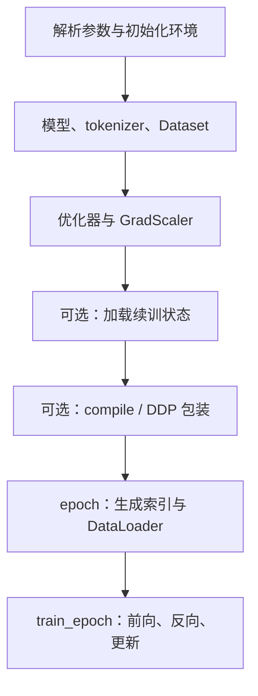
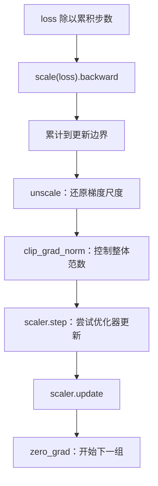

# 第 07 章 预训练循环与断点恢复

> 迁移候选：本章源码链接已更新，静态差异已核对；既有数值与实验记录仍属于旧基线，不表示新版已重验。
> 新版 PyTorch 实验与独立复核待完成，暂标 stale，不可直接用于新版出版验收。详见[迁移记录](../../meta/upstream-impact-2026-10-18.md)。

上一章把样本变成了可计分的输入和标签。本章继续追问：loss 是怎样真正改变参数的？
训练中的 step 到底是一个小批次还是一次参数更新？中断后加载 checkpoint，又恢复了多少状态？
这些问题都要沿循环的先后顺序回答。

主线先用单进程、无混合精度的小模型理解更新，再看 AMP 与 DDP 的接入位置。
我们会直接运行真实 `train_epoch` 的控制流，但用一个标量模型隔离循环行为；
这不会被包装成训练出语言能力的证据。

**主线必读：** loss、反向、累积、更新和保存顺序。先跟随本章的小输入，再对照图和源码。

**进阶选读：** AMP、DDP 与断点恢复；第一次阅读可先掌握输入输出契约。

**需要额外设备/权重：** 真实多 GPU 训练及精确恢复评估。本章 CPU 实验只支持明确列出的机制结论。

## 7.1 入口先建立哪些对象

`train_pretrain.py` 的主入口先解析参数与初始化分布式环境，再创建配置、模型和 tokenizer，
随后构造 Dataset、采样器、GradScaler 和 AdamW。需要续训时加载模型、优化器、scaler、epoch 和 step，
之后才进行可选编译及 DDP 包装，最后进入按 epoch 遍历数据的循环。



图 7-1：训练入口的对象准备顺序。先找到模型与数据，再看优化器和续训状态，最后进入重复执行的循环。
图中的可选步骤不能写成每个读者必须具备的前置环境。CPU 主线不要求 NCCL、多 GPU 或编译功能。

源码索引包含 MiniMind 的三个文件：

- [trainer/train_pretrain.py](https://github.com/jingyaogong/minimind/blob/f659b55761b754d306bd140573493a6543cafd7f/trainer/train_pretrain.py)：预训练入口与循环。
- [trainer/train_full_sft.py](https://github.com/jingyaogong/minimind/blob/f659b55761b754d306bd140573493a6543cafd7f/trainer/train_full_sft.py)：SFT 入口与循环。
- [trainer/trainer_utils.py](https://github.com/jingyaogong/minimind/blob/f659b55761b754d306bd140573493a6543cafd7f/trainer/trainer_utils.py)：学习率、采样、加载与保存。

两个训练器的核心更新顺序相近，但 Dataset、默认学习率、累积步数与初始化权重不同。

## 7.2 一个小批次经过循环

循环先把 input_ids 和 labels 放到目标设备，为当前 step 计算学习率，再做前向。
模型返回语言建模 loss 和 MoE 辅助 loss，训练器把它们相加，再除以梯度累积步数。
Dense 配置下辅助项为零；把总 loss 与纯语言建模 NLL 区分开，后面计算困惑度才不会误用。

```python
res = model(input_ids, labels=labels)
loss = res.loss + res.aux_loss
loss = loss / args.accumulation_steps
scaler.scale(loss).backward()
```

这几行只把梯度累计到参数的 `.grad`，并不表示每一小批之后都更新参数。
当 step 能被累积步数整除，或到达本 epoch 的最后一批 `step == iters` 时，才依次执行 unscale、梯度裁剪、optimizer step、scaler update 和清空梯度。
所以日志中的 step 与优化器更新次数不能直接当作同一个计数。

## 7.3 梯度累积的平均口径

假设累积 $K$ 个小批，每个小批损失为 $\mathcal L_k$。
在相同参数点计算并累加，得到：

$$
g=\frac{1}{K}\sum_{k=1}^{K}\nabla_\theta\mathcal L_k.
$$

可以把它理解为“先收集 K 次修改建议，再执行一次更新”。
这样能减少一次前向必须同时放进内存的样本量，但没有消除总计算量。
它与大 batch 的关系也有条件：如果每个小批自己的 loss 都按有效 token 求均值，
而有效 token 数不同，平均这些均值不等于把所有 token 合并后求一个总平均。

例如两个小批分别有 1 和 9 个有效目标，当前除以 K 的方式让两个小批各占一半权重，
而全局 token 平均会让后者占九成。比较实验时，除了 batch size，还要记录监督 token 数及归约口径。
随机失活、数值精度和更新日程也可能影响等价性。

当前源码在循环内最后一批处理不足一组的剩余梯度，并在之后保存；不再在退出循环后另做 flush。每个小批仍除以原来的 K。
若最后只剩 $q<K$ 个小批，这组总梯度相对于它们自身的平均值多了一个 $q/K$ 缩放。
这不是“末尾完全没更新”，也不是“已经按实际剩余数量重新平均”。

## 7.4 AMP、裁剪与优化器必须按顺序理解

AMP 是自动混合精度。在当前入口，CPU 使用 `nullcontext()`，CUDA 才进入相应 autocast 区域。
GradScaler 依据 dtype 选项启用，运行平台还会影响其实际可用行为。
不能因为命令默认写着 bfloat16，就声称 CPU 主线的所有运算都变成了 BF16。

启用 loss scaling 时，先把 loss 放大以改善某些低精度梯度的表示，再在更新前还原梯度尺度。
因此裁剪应在 `unscale_(optimizer)` 之后进行；否则裁剪阈值面对的是放大后的梯度。
`clip_grad_norm_` 按整体范数缩放过大的梯度，不是把所有参数裁成 [-1,1]，也不是每项梯度逐个截断。



图 7-2：一次梯度更新的顺序。先沿竖线记住“先反向，后还原，再裁剪和更新”，
然后注意 step 是由 scaler 包装的尝试更新；启用缩放时发生非有限值可能影响是否真正执行优化器更新。
图并不把每次 backward 都等同于一次成功 step。

AdamW 还维护动量等优化状态，不能只用“参数减去学习率乘梯度”完整概括。
第 01 章的标量 SGD 用于建立方向感；真实训练入口选择 AdamW，应同时记录其超参和状态。

## 7.5 学习率跟随哪个 step

`get_lr` 实现：

$$
\eta(t)=\eta_0\left[0.1+0.45\left(1+\cos\frac{\pi t}{T}\right)\right].
$$

$\eta_0$ 是传入初始学习率，$T$ 是总步数，$t$ 是传入当前计数。
代入 0 得到 $\eta_0$，代入 $T$ 得到 $0.1\eta_0$。本函数没有显式 warmup 分支，
不能因为某些训练方案常用 warmup，就在书里替它补上一段并不存在的流程。

循环用 `epoch * iters + step` 调用它，而 step 从 1 开始；并且每个小批都更新学习率，
不是只在 optimizer step 时推进。梯度累积打开后，要据此解释本次参数更新实际使用了哪一小批设置的学习率。
改变总步数也会改变这条曲线，续训时应保留相关配置。

## 7.6 checkpoint 是状态快照，不只是一个权重文件

训练器会导出便于后续加载的权重文件，还调用 `lm_checkpoint` 保存续训字典。
该工具先写临时文件，再用 `os.replace` 替换目标文件，降低留下半写文件的风险。
这并不自动让两份文件形成一个跨文件事务，也不说明其中保存了训练的全部状态。

当前调用形成的主要内容如下：

| 字段 | 恢复什么 | 不能据此推断什么 |
|---|---|---|
| model | 模型权重，保存时转为 CPU FP16 | 不保证与原 FP32 参数逐位相同 |
| optimizer | AdamW 等优化器状态 | 不包含参数 `.grad` 的待累积值 |
| scaler | 混合精度缩放状态 | 不代替随机数状态 |
| epoch、step | 数据推进位置 | 不保证任意新 batch 配置下样本完全相同 |
| world_size、wandb_id | 并行规模、跟踪标识 | 不保证跨规模恢复的数值轨迹相同 |

`lm_checkpoint` 允许额外 kwargs，但这里应以训练器实际传入的字段为准。
默认调用没有保存完整 Python/NumPy/Torch 随机数快照，也没有保存尚未 step 的梯度。
恢复可继续训练，与精确延续同一条数值轨迹，是不同层次的承诺。

## 7.7 对照新旧保存时机

旧基线的标量实验设 3 个小批、累积步数 2，记录到第 2 步更新后参数约 0.065，
第 3 步先保存同一参数，退出循环后才做第二次更新得到约 0.07435。
这些是 `6fc918be` 的历史实测，不是新基线的运行结果。

新基线 `train_pretrain.train_epoch` 与 `train_full_sft.train_epoch` 都将条件改为
`step % args.accumulation_steps == 0 or step == iters`，并删除循环外 flush。
因此最后一批的尝试更新、清梯度发生在保存分支之前；原来的“末批保存落后于尾部更新”时序已修复。
这要求 `iters` 与最后一个枚举 step 一致，不能把提前中断的数据迭代器当作正常走完一个 epoch。

周期保存仍可能落在累积组内部。例如累积步数 4、保存间隔 3，第 3 步的梯度尚未提交，
checkpoint 又不包含 `.grad`；末批修复不等于任意断点都可精确恢复。
若要实现组内精确续训，仍需保存梯度、累积进度以及必要的数据/随机状态，或只在更新边界保存。

本次对真实训练函数进行了标准库替身控制流检查，验证末批“更新 → 清梯度 → 保存”的事件顺序，
不是 PyTorch 数值或 AMP 正确性测试。旧 `experiments/ch07_training_loop.py` 绑定旧 commit，
其中“保存时仅更新一次”的断言不适用于新基线；升级该实验与重跑的要求见本次迁移记录。

## 7.8 采样顺序、路径与实验

`SkipBatchSampler` 根据已读小批数跳过索引，末尾也可以返回不足 batch_size 的一组。
例如索引 0～4、batch_size=2、跳过 1 组，结果是 `[2,3]` 与 `[4]`。
恢复时只恢复权重但从头读数据，与跳过正确数据位置，是两件不同的事。
DDP 使用 DistributedSampler 并设置 epoch；当前循环也没有用 `no_sync` 明确跳过每个累积小批的同步。
本书不据静态代码宣称多 GPU 吞吐收益。

路径同样是运行语义的一部分。多个默认路径相对于运行目录，`init_model` 的默认读权重目录与
`lm_checkpoint` 的续训目录各有约定；仅修改一个 `--save_dir` 不代表所有读写路径都自动随之改变。
读者应在自己的训练工作副本中配置数据、模型和输出目录，不在本书的只读源码基线上试跑完整训练。

在旧基线运行 `.venv/bin/python experiments/ch07_training_loop.py` 可重现历史边界；不要仅改其 commit 后仍沿用旧断言。
标量模型只隔离循环，不代替真实语言模型；此外实验调用真实 checkpoint 工具，
验证保存字段、FP16 权重和优化器动量，再验证学习率端点和 SkipBatchSampler。

1. backward 次数一定等于优化器更新次数吗？
2. 两个有效目标数不同的小批，各自 mean 后再平均，是否等于全体 token 平均？
3. 为什么应在 unscale 后裁剪梯度？
4. checkpoint 含 optimizer，是否意味着尚未更新的 `.grad` 也保存了？
5. 如何修复末尾更新晚于保存的时序问题？

参考解释：第一题不一定：累积时多个 backward 才对应一次 step；混合精度检查还可能跳过一次更新。第二题不等价，例如一个批有 1 个有效 token，另一个有 9 个，直接平均两批均值会让前者每个 token 的权重更大。

第三题先 unscale 才能按原始梯度尺度裁剪，否则同一阈值的含义随缩放系数变化。第四题 optimizer 的状态字典不包含参数上尚未执行 step 的 .grad。第五题应先处理尾部剩余梯度再保存，并比较连续训练与恢复后继续一步的结果；仅调整文件名不能修复时序。

可选练习：把实验的累积步数改为 3，比较保存与更新时机，再说明变化来自哪一个条件。
