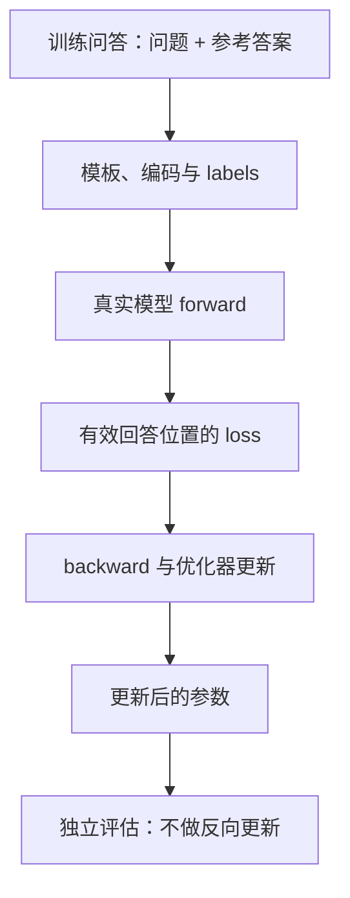
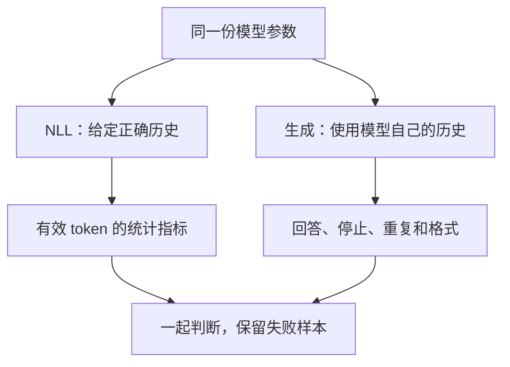

# 第 08 章 SFT、评估与训练排错

当模型终于能把 loss 降下来，很容易想立刻宣布训练成功。但 loss 衡量的是一个明确定义的目标，
它并不自动回答“会不会正确聊天”。本章把前面学过的模型、模板、Dataset 和训练循环串起来，
用一个可复现的小实验建立完整的检查习惯。

实验只用两条合成训练问答、一条留出问答和随机初始化的小模型。
它能证明训练路径有效、暴露记忆与泛化的区别，不能代替真正的预训练与发布模型测评。
读完本章，基础篇就形成从输入、计算、训练到检查结果的闭环。

**主线必读：** SFT 数据、有效 token 平均与留出评估。先跟随本章的小输入，再对照图和源码。

**进阶选读：** 思考模板和少量样本过拟合；第一次阅读可先掌握输入输出契约。

**需要额外设备/权重：** 默认权重的规模化问答评估。本章 CPU 实验只支持明确列出的机制结论。

## 8.1 SFT 改变的是任务数据与监督方式

预训练让模型从文本学习续写，SFT 用带角色的示例进一步塑造回答格式与行为。
当前 full_sft 仍使用同一个因果语言模型和交叉熵计算，并不是额外接上一个叫“对话能力”的模块。
变化主要在初始化权重、数据组织、监督位置和训练配置。

| 默认项 | pretrain | full_sft |
|---|---|---|
| Dataset | `PretrainDataset` | `SFTDataset` |
| 初始化来源 | `none` | `pretrain` |
| 学习率 | `5e-4` | `1e-5` |
| batch_size | 32 | 16 |
| accumulation_steps | 8 | 1 |
| max_seq_len | 340 | 768 |

这些是锁定版本脚本的默认值，不是针对任意数据和硬件的调参建议。
SFT 默认从预训练权重开始，是因为实际目标是在已有能力基础上调整行为；
本章的小模型从随机权重训练，仅为了隔离并验证学习闭环。

源码入口是 MiniMind
[trainer/train_full_sft.py](https://github.com/jingyaogong/minimind/blob/233d00fa068ec2b8c0d4f07b703934d6391a5a73/trainer/train_full_sft.py)。
`init_model` 创建并加载模型，`SFTDataset` 提供监督标签，AdamW 接收模型参数。
当前主路径没有 LoRA 的冻结/注入步骤，参数高效微调在第 10 章另讲。
本次更新把末批剩余梯度的尝试更新移到循环内、保存之前；组内周期保存与精确恢复的限制仍见第 07 章。
读取权重时还需核对配置、词表和加载结果；`strict=False` 不能替代形状与语义兼容性检查。

## 8.2 从一条问答追到参数更新

先准备一条 user 问题和 assistant 答案，由聊天模板生成文本，再编码并构造 labels。
模型看到问题上下文，用前一位置预测后一个目标；assistant 区域的有效目标贡献 loss。
反向传播把这些误差传回参数，优化器再更新。没有哪一步可以由“数据看起来像问答”自动替代。

图 8-1：SFT 与评估的边界。先追训练数据如何影响参数，再看更新后的参数进入评估。
评估数据不能沿同一箭头再进入优化器，否则就不再是独立观察。
本章的评估函数是配套教学代码新增的，不把它说成上游训练器已经自动完成的功能。

`model.eval()` 改变 dropout 等模块的行为，`torch.no_grad()` 则不记录反向计算图。
评估时两者常一起使用；回到训练后应恢复 `model.train()`。
保存权重时短暂切到 eval，与真正对留出数据计算指标，也不是同一件事。

## 8.3 先分数据，再讨论分数

训练集用于更新参数，验证集用于观察和选择训练方案，最终测试集用于在方案固定后评估。
如果不断根据某个集合的结果调参数，它就已经参与开发决策，不能再把它当作未碰过的独立测试。
对于小实验，本书只称第三条问答为留出诊断样本，不把一条样本包装成完整基准。

划分应尽量在数据增强之前做。若同一原问题的改写同时进入训练与验证，
看似不同的记录仍可能泄漏信息。工程记录至少保存数据来源、划分方式、样本哈希、去重策略和排除项。
仅记录“训练了多少行”不足以说明评估独立。

本次训练两条“问题甲 → 答甲”“问题乙 → 答乙”，留出“未见问题丙 → 答丙”。
这是人为规定映射的小任务，不是自然知识问答。它很适合检查模型能否记住训练关系，
却没有足够证据说明模型会从甲、乙规则推导出丙。

## 8.4 先累加 NLL，再按有效 token 求平均

对所有有效目标，先累加负对数似然，再除以总有效 token 数：

$$
\begin{aligned}
&\overline{\mathcal L}_{\mathrm{NLL}}=
\frac{\sum_{b,t:\,y_{b,t}\ne-100}\ell_{b,t}}
{\sum_{b,t}\mathbf 1[y_{b,t}\ne-100]}\\
&\operatorname{PPL}=\exp(\overline{\mathcal L}_{\mathrm{NLL}}).
\end{aligned}
$$

$\ell$ 是已正确错位后每项的负对数似然，$\mathbf 1$ 在条件成立时为 1，否则为 0。
PPL，即困惑度，是自然对数 NLL 的指数形式。它可以帮助观察同一编码与监督口径下的变化，
但不同 tokenizer、不同监督区域的数字不能不加说明就直接排成模型质量榜。

一个反例：第一小批只有 1 个有效 token，NLL 为 1；第二小批有 9 个，各项平均 NLL 为 3。
正确的 token 平均为 $(1+27)/10=2.8$，直接平均两个小批均值却得到 $(1+3)/2=2$。
因此评估代码保存 `nll_sum` 和 `valid_tokens`，最后统一相除。

此外，MoE 辅助损失、DPO 损失、音频损失等不等于纯语言建模 NLL，不能把任意总 loss 取指数就叫困惑度。
有效目标为零时要报告并处理，不能用一个很小的分母悄悄把它伪装成正常样本。

## 8.5 teacher forcing 与实际生成看见的历史不同

在计算训练或验证 NLL 时，后续位置使用数据中的正确历史 token，常称为 teacher forcing。
即使模型在某一步更倾向于选错 token，下一位置仍能看到参考答案提供的正确前缀。
实际自回归生成则把自己刚选出的 token 接回输入，一次错误可能改变之后的所有上下文。

图 8-2：两种互补的评估视角。先看它们使用相同参数，再看历史输入来源不同。
NLL 适合追踪目标分布的变化，实际生成能暴露重复、格式和停止问题。
图没有把两个结果压成一个“万能总分”，也没有让一次流畅回答代替统计检查。

固定生成比较时，至少记录 prompt、模板、最大新增长度、温度、Top-K/Top-P、重复惩罚和随机种子。
使用贪心可以减少抽样差异，但不能代替质量评估。
`eval_llm.py` 中的输出示例是观察入口；其 Speed 计时覆盖 generate 调用及相关输出过程，
不宜直接当成严格的单 token 解码器微基准。
源码定位：[eval_llm.py](https://github.com/jingyaogong/minimind/blob/233d00fa068ec2b8c0d4f07b703934d6391a5a73/eval_llm.py)

新基线的脚本入口捕获 EOF 与键盘中断后打印换行；LoRA 加载路径补上与 MoE 权重对应的 `_moe` 后缀。
原生权重与 transformers 权重的分界改为：仅当 `load_from` 规范化后的**目录名**恰好是 `model` 时走 MiniMind 本地加载（`os.path.basename(os.path.normpath(...)) == 'model'`），不再用子串 `'model' in path`。路径里偶然含有 `model` 字样但末段不是该目录名时，会走 `AutoModelForCausalLM.from_pretrained`。
若使用 LoRA，需传与训练一致的 `--lora_rank`（默认 16）给 `apply_lora`；rank 不一致时形状对不上。
这些入口修正不改变本章的 NLL/PPL 定义，也不提供新的吞吐或模型质量证据。

## 8.6 思考开关先改变模板，再观察行为

第 02 章已经核对 `open_thinking`：开启时在生成开头留下打开的思考段，
关闭时提供空思考段。它不是替换权重，也不保证某类任务因此正确。
评估时把模板开关作为一个明确条件，比较回答正确性、长度和格式，而不是只数有没有 `<think>`。

还要考虑训练后处理。当前 SFT 数据可能移除空思考段，所以训练样本的具体前缀与某个推理模板未必完全相同。
本章实验同时用默认关闭思考的模板，以及移除空思考段的前缀做诊断。
这不是建议无条件删除所有思考标记，而是检查模板差异是否影响当前小模型。

如果希望教授推理行为，需要与目标相符的数据和评估任务。
看到一个更长的“思考”文本，不能直接推导出推理更正确；把模型输出的标签当成能力证明会误导读者。

## 8.7 跑完一个可解释的小实验

运行 `.venv/bin/python experiments/ch08_sft_evaluation.py`。
它导入真实 `SFTDataset` 与 `MiniMindForCausalLM`，固定预处理随机性后保存输入，
用隐藏维度 32、2 层、原有 6400 词表的随机模型，在两条样本上做 80 次 AdamW 更新。
学习率为 0.003，dropout 为 0，设备为 CPU。这个学习率只属于合成小实验，不是正式 SFT 的推荐值。

| 指标 | 更新前 | 更新后 |
|---|---:|---:|
| 训练集有效目标数 | 9 | 9 |
| 训练 NLL | 约 8.7770 | 约 0.1137 |
| 留出集有效目标数 | 5 | 5 |
| 留出 NLL | 约 8.7982 | 约 6.7956 |

两条训练问答在贪心生成中分别输出了“答甲”和“答乙”并结束。
对“未见问题丙”，模型却输出“答甲”，没有得到规定的“答丙”。
两种诊断模板在这次运行中结果相同；这不能推广为任意模型都不受模板影响。

这组结果支持三个有限结论：数据和梯度链路能推动小模型学习；训练数据上的改善明显；
这一次对未见样本的回答仍然错误。留出 NLL 也比训练 NLL 大很多。
我们不把留出指标相对随机初始化下降，改写成“已经获得了广泛泛化能力”。

详细记录在 `experiments/ch08-results.json`，包含数据哈希、loss 轨迹、有效 token 数和实际生成文本。
复现时先检查这些条件，差异明显就定位环境或输入变化，不要直接修改结果表来迁就运行输出。

## 8.8 按现象找证据

| 现象 | 先检查的证据 | 常见误解 |
|---|---|---|
| loss 一开始就 NaN | 有效目标数、数值范围、梯度 | 所有 NaN 都是学习率大 |
| loss 很低却答错 | 留出数据、实际生成、监督分布 | 训练均值等于问答正确率 |
| 输出重复或不结束 | 模板、EOS 监督、采样参数 | 一定是注意力实现坏了 |
| 加载后表现突变 | 权重来源、配置、词表、加载结果 | 文件能打开就完全兼容 |
| 续训轨迹不同 | 保存边界、随机状态、数据顺序、精度 | optimizer 字典足以精确恢复 |

排错时尽量一次只改变一个条件。例如先在少量样本上过拟合确认链路，再扩大数据；
先固定生成参数，再比较 checkpoint。训练记录还应保留失败样例，避免只挑看起来最好的回答展示。
第 07 章指出的保存时机问题也适用于当前 full_sft 的相近循环，不能在微调章节又把它描述成精确续训。

1. 当前 full_sft 是否换成了另一种模型结构？
2. 为什么评估应累计 NLL 总和与有效 token 数，而不是简单平均 batch loss？
3. teacher forcing 下低 NLL 能否保证自由生成永不走偏？
4. 本次两条训练题答对、第三条答错，能支持多大的质量结论？
5. 开启思考模板是否等于已经训练了更强的推理权重？

参考解释：第一题结构未换，主要改变的是样本组织和监督区域。第二题应把各批 NLL 总和相加，再除以总有效 token 数；否则小批或短回答可能得到额外权重。

第三题 teacher forcing 给每一步正确历史，自由生成则会把自己的错误带入后续，所以低 NLL 不保证生成永不偏离。第四题只支持这三条记录、当前权重与生成参数的观察，不能估计总体准确率。第五题模板只是改变输入格式；推理能力是否变化还要核对权重训练和独立任务表现。

可选练习：保持训练集不变，新增留出问答，比较 NLL 与实际生成并解释差异。
下一篇进入 MoE 与后训练，也可按路线跳读视觉或音频。
