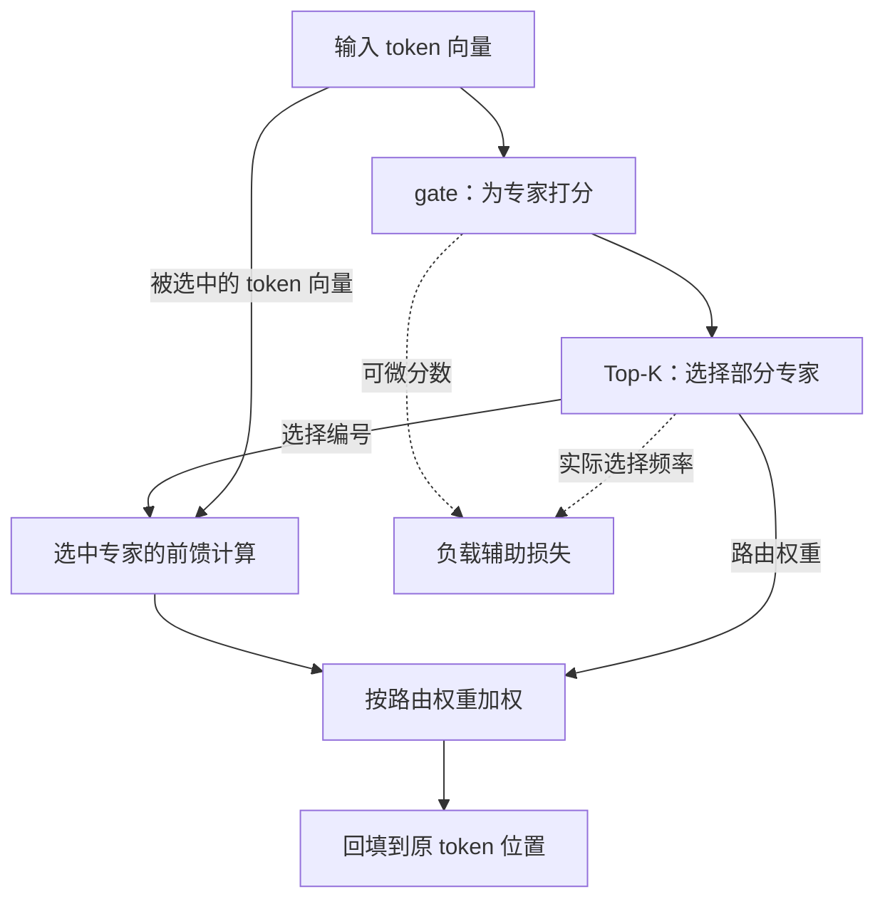
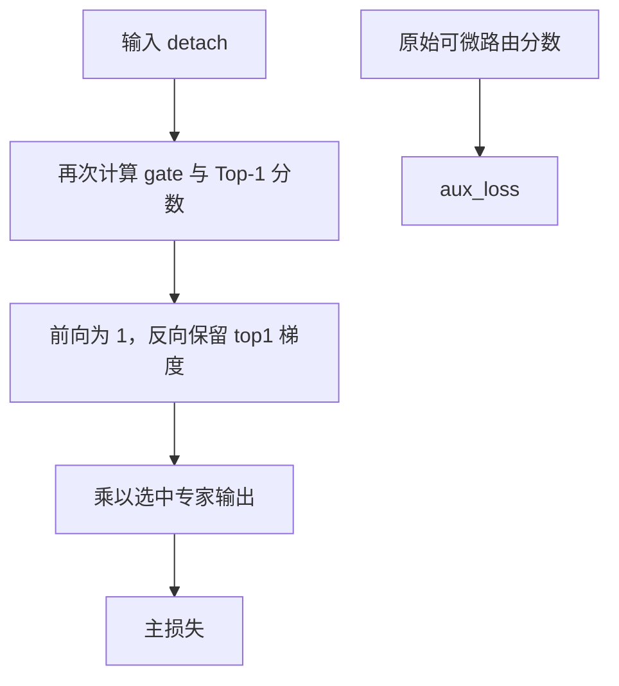

# 第 09 章 MoE 的路由与负载

> 迁移候选：本章源码链接已更新，静态差异已核对；既有数值与实验记录仍属于旧基线，不表示新版已重验。
> 新版 PyTorch 实验与独立复核待完成，暂标 stale，不可直接用于新版出版验收。详见[迁移记录](../../meta/upstream-impact-2026-10-18.md)。

第 03 章的 Dense 前馈让每个位置都经过同一组参数。MoE，即 Mixture of Experts，混合专家，
准备多组前馈网络，让路由器为每个 token 选择其中一部分。它提供了另一种分配模型容量的方式，
但“专家”只是模块名称，不表示训练之前就有人给它们分配了数学、写作或翻译岗位。

本章先追一个 token 被送到哪一组参数，再看多个专家的结果如何回到原位置。
最后重点解释负载辅助损失，因为只看 `topk` 容易漏掉路由器真正得到梯度的路径。
本章是进阶选读，不是学习视觉或音频的必经前置。

**主线必读：** 一个 token 的选专家、加权和回填。先跟随本章的小输入，再对照图和源码。

**进阶选读：** 辅助损失、Top-1 梯度与归约口径；第一次阅读可先掌握输入输出契约。

**需要额外设备/权重：** 专家并行与真实任务质量比较。本章 CPU 实验只支持明确列出的机制结论。

## 9.1 替换的是 block 中的前馈分支

当前 `MiniMindBlock` 按 `use_moe` 在 `FeedForward` 与 `MOEFeedForward` 之间选择。
注意力和残差主干并没有因为开启 MoE 就被全部替换。
每个专家本身仍采用前面读过的门控前馈结构，新增的是选择与汇总机制。

图 9-1：MoE 的主输出与辅助损失。先追实线，回答“向量去了哪里，又如何回来”；
再看两条虚线：实际选择频率和可微路由分数共同决定辅助项；选择编号本身不提供普通梯度。
专家接收的是原 token 向量，Top-K 提供的是选哪些专家及对应权重，并非把 gate 分数当成专家输入。
辅助项不是主输出的一部分，需要上层模型和训练器继续收集。
图不表示各专家已经分布在不同 GPU 上。

源码入口：MiniMind
[model/model_minimind.py](https://github.com/jingyaogong/minimind/blob/f659b55761b754d306bd140573493a6543cafd7f/model/model_minimind.py)
的 `MOEFeedForward.forward`、`MiniMindBlock.__init__` 与 `MiniMindModel.forward`。

## 9.2 把批与位置展平，再给专家打分

输入原形状是 `(B,S,D)`。实现先展为 `(N,D)`，其中 $N=BS$，
使每个 token 都成为一行；gate 是从隐藏维度到专家数量的 Linear。
设专家数为 $E$，gate 权重形状为 $(E,D)$，则按本书行向量约定：

$$
p_n=\operatorname{softmax}(x_nW_g^{\mathsf T}).
$$

$p_n$ 的 E 项表示本次路由使用的分数归一化结果，不是模型生成词表的概率。
`torch.topk` 为每行选出 K 个专家编号及对应分数，形状均为 `(N,K)`。
默认 E=4、K=1；这只是本次源码配置，不是 MoE 必须采用的专家数量。

若启用 `norm_topk_prob` 且 K>1，代码只在选中的分数之间重新归一化：

$$
w_{n,e}=\frac{p_{n,e}}{\sum_{j\in\mathcal T_n}p_{n,j}+10^{-20}},
\qquad e\in\mathcal T_n.
$$

$\mathcal T_n$ 是 token n 选中的专家集合。分母没有对全部 E 个分数重新求一次总和，
因为那样仍为 1，不能表达“在已经选中的专家之间分配权重”。
例如选中分数 0.6 与 0.2，重归一化后约为 0.75 与 0.25。

## 9.3 分发、计算、回填是三件事

当前实现按专家循环，先找出选中该专家的 token，再批量计算这些 token 的前馈输出。
最后用 `index_add_` 回填到原 token 行。一个 token 若选中多个专家，其各项贡献会相加：

$$
y_n=\sum_{e\in\mathcal T_n}w_{n,e}F_e(x_n).
$$

这里的加权发生在向量上，不是投票挑一个专家的回答字符串。
保存原 token 索引十分关键，否则把专家输出简单拼接，会让输入位置与输出位置错位。

| 对象 | 形状 | 含义 |
|---|---|---|
| `x_flat` | `(N,D)` | 展平后的 token |
| `scores` | `(N,E)` | 全部专家分数 |
| `topk_idx` / `topk_weight` | `(N,K)` | 选中编号及权重 |
| 某专家输入 | `(N_e,D)` | 送到它的 token 子集 |
| `y` | `(N,D)` | 按原位置累计的结果 |

`N_e` 可为零，不能假设每个专家每批都被使用。
当前代码是 PyTorch 专家循环，不等于已经实现了跨设备 token 交换、容量裁剪或专家并行调度。
判断性能时还要考虑分组、索引、同步和实际 batch 分布，不能只用激活参数量估计速度。

## 9.4 为什么还需要辅助损失

如果大量 token 总被送到少数专家，其他专家很少得到有效训练，容量就没有被充分利用。
本实现把实际选择频率与平均路由分数相乘，构造一个鼓励负载分散的辅助目标。
它不是给专家提供人工任务类别，也不保证每个 batch 都严格平均分配。

为了和代码归约一致，定义：

$$
\begin{aligned}
&f_e=\frac{1}{N}\sum_{n=1}^{N}\sum_{k=1}^{K}\mathbf 1[a_{n,k}=e]\\
&\bar p_e=\frac{1}{N}\sum_{n=1}^{N}p_{n,e}.
\end{aligned}
$$

$a_{n,k}$ 是 top-k 编号。注意本定义满足 $\sum_e f_e=K$，不是 1。
源码先对 one-hot 张量的 token 轴求均值，保留 K 轴，随后在乘法与 sum 中把它一并归约：

$$
\mathcal L_{\mathrm{aux}}=\lambda E\sum_{e=1}^{E}f_e\bar p_e.
$$

这条公式描述当前实现。若另一篇资料把选择频率除以 NK，它的归一化口径就不同。
本章实验将所有路由概率设为均匀，K=1 和 K=2 时辅助项分别为约 $\lambda$ 与 $2\lambda$。
相同概率也不保证实际选择均匀：并列分数仍要由 topk 选出某些编号。

训练模式且系数为正时，模块计算辅助项；否则设为零。
`MiniMindModel.forward` 汇总各层的 `aux_loss`，训练器再与主损失相加。
如果只调用前馈并对输出算损失，却忘了辅助项，训练目标就与上游训练器不同。

## 9.5 Top-1 的直通梯度与输入分离

旧基线在 K=1 时也做 $p/p$ 归一化，主输出对 gate 分数几乎不敏感。
新基线单独处理 `norm_topk_prob=True` 且 K=1：再次用 `gate(x_flat.detach())` 算 softmax，
取最大分数 `top1`，并令 `topk_weight = top1 - top1.detach() + 1.0`。

前向数值仍为 1，但反向保留了 `top1` 对 gate 参数的导数，这叫直通估计（straight-through）。
它不是常数函数“1”的真实导数，而是代码有意构造的代理梯度。
`x_flat.detach()` 切断这次重算分数到输入的路径，却没有冻结 gate 参数。
专家输出依然使用未 detach 的输入，原始 `scores` 也仍用于辅助项，所以不能说输入整体没有梯度。
例如两个专家概率为 0.6 和 0.4，选中专家输出暂按标量 2 处理，
这条代理路径对两个 gate logits 的局部梯度为 0.48 与 -0.48，而前向权重仍为 1。
这是解析示例，不是本次 PyTorch 实测。

图 9-2：Top-1 的代理梯度路径。先看前向权重仍为 1，再区分 gate 参数梯度与被截断的输入梯度。
图省略专家对原始输入的直接路径；Top-K 编号仍是离散选择，没有普通的“换专家”导数。
K>1 沿用选中分数重归一化；关闭 `norm_topk_prob` 时不进入该代理分支。
辅助项继续存在，不能把主损失现在可训练 gate 理解为不再需要检查负载目标。

训练时，未被选中的专家仍通过乘零表达式连到输出，梯度存在但为零不表示有效学习。
旧实验关于 Top-1 主损失 gate 梯度的观察绑定旧版本，新分支需要独立反向重验。

## 9.6 实验、误解与自检

运行 `.venv/bin/python experiments/ch09_moe.py`。
实验固定 gate 让三个 token 都选择同一专家，核对输出；检查 token 重排后的结果仍对应原 token；
分别反向主损失与包含辅助项的目标；再验证模型外壳确实汇总各层辅助项。
未选专家的梯度在这个训练分支中存在但为零；eval 下辅助项为零。

不要把“总参数多、单 token 激活少”直接写成更快或更好。
本书这个实验只支持路由、聚合与梯度的理解，没有比较真实模型质量或 GPU 吞吐。
完整结果及源文件哈希在 `experiments/ch09-results.json`。

1. 专家在训练前是否已经被指定为数学、翻译等类别？
2. 为什么需要保存 token 索引，而不是直接拼接各专家输出？
3. 当前 f 的各专家分量总和为什么是 K？
4. Top-1 重归一化后，为什么要单独检查 gate 的梯度？
5. 未选专家的 grad 存在但为零，能否说明它有效学习了这一批？

参考解释：第一题没有人工预分配语义类别，路由与专家参数共同从目标中学习。第二题专家收集后的行顺序已经不同，必须按原索引回填；Top-K 大于 1 时还要累加同一个 token 的多路贡献。

第三题每个 token 贡献 K 次选择，按 token 数归一化后各专家选择频率合计为 K。第四题新 Top-1 分支前向权重为 1，但通过直通表达式给 gate 参数代理梯度；重算时 detach 输入，需分别检查 gate、输入、专家和辅助项的路径。第五题零梯度不能证明这一批给它提供了有效学习信号；后续优化器状态或权重衰减也应与本批数据梯度区分。

可选练习：将 K 改成 2，检查辅助项量级和主损失的 gate 梯度，说明哪些结论需要随配置改变。
