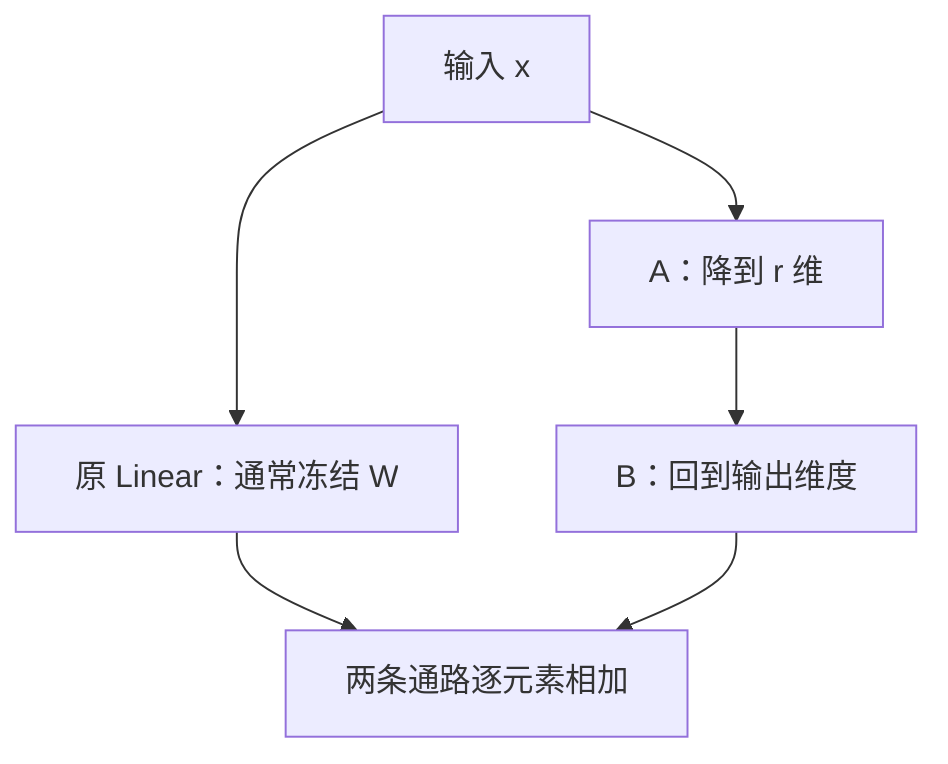
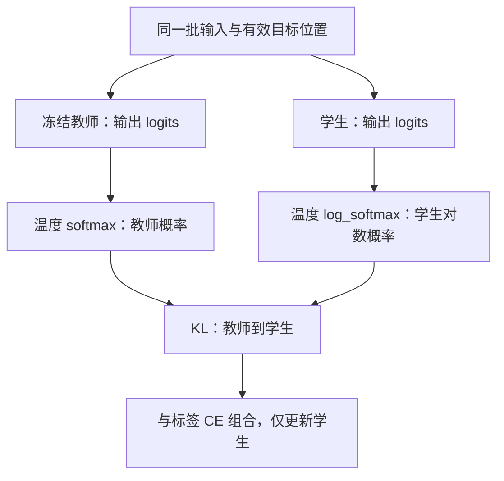

# 第 10 章 LoRA 与知识蒸馏

如果已经有一个模型，能否只训练少量新增参数？如果有一个较强教师，能否让学生学习它的输出分布？
LoRA 和知识蒸馏分别回答这两个问题。本章把它们放在一起比较，但它们是独立方法，
不表示训练时必须先 LoRA、再蒸馏。

先学习 LoRA 的读者只需第 03 章的 Linear 和第 07 章的梯度概念。
读蒸馏部分前，我们会就近补上概率分布、KL 和温度的含义，不要求先读完强化学习。

**主线必读：** LoRA 低秩增量与蒸馏分布两个独立小节。先跟随本章的小输入，再对照图和源码。

**进阶选读：** 初始化梯度、合并舍入和 KL 方向；第一次阅读可先掌握输入输出契约。

**需要额外设备/权重：** 真实教师权重与任务压缩评估。本章 CPU 实验只支持明确列出的机制结论。

## 10.1 用两个小矩阵表示参数增量

假设一个 Linear 的权重为 $W\in\mathbb R^{d_{\mathrm{out}}\times d_{\mathrm{in}}}$。
LoRA 准备 $A\in\mathbb R^{r\times d_{\mathrm{in}}}$ 和 $B\in\mathbb R^{d_{\mathrm{out}}\times r}$，
用乘积 BA 表示增量。r 通常比输入输出维度小，增量矩阵的秩不超过 r。

当前实现的行向量计算是：

$$
\begin{aligned}
&y=xW^{\mathsf T}+xA^{\mathsf T}B^{\mathsf T}\\
&W_{\mathrm{eff}}=W+BA.
\end{aligned}
$$

它可以类比在原功能旁边增加一个小的修订通路，但这个通路在训练时仍参与前向和反向。
新增参数量为 $r(d_{\mathrm{in}}+d_{\mathrm{out}})$。例如方阵维度 32、r=4，新增 256 个数，
而直接训练一张 32×32 矩阵有 1024 个数。这只比较该层可训练参数，不代表整个运行显存同比缩小。

通用 LoRA 资料可能在 BA 前加入 `alpha/r` 等缩放。本地 `LoRA.forward` 直接返回 `B(A(x))`，
没有显式该缩放，不能把通用公式里的参数写进当前源码。

图 10-1：LoRA 的加法结构。先追原通路，再看新增通路如何保持相同输出维度。
冻结 W 只是不更新它，并不跳过原 Linear 的计算，也不阻止梯度通过它传到更早的可训练位置。

源码锚点：MiniMind 的
[model/model_lora.py](https://github.com/jingyaogong/minimind/blob/6fc918beb68a0d8c40452338df6319fe168014ba/model/model_lora.py)
中 `LoRA`、`apply_lora`、`save_lora` 和 `merge_lora`。

## 10.2 初始不改变输出，不表示两个矩阵都立即得到非零梯度

本实现把 A 随机初始化，把 B 初始化为零，因此新增通路初始输出为零。
这样插入 LoRA 时，模型前向可以保持原行为，随后通过训练逐步改变。

但反向也有结构：第一步 A 的梯度会经过 B，B 为零时它可能正好为零；
B 的梯度则可以依赖 A 产生的非零中间特征。首次看到 A.grad 为零，不应立刻判断导入失败。
还要看 B 是否在更新，第二步以后 A 是否开始得到信号。

本章真实小模型实验观察到：初次插入前后 logits 一致；第一次反向 A 的梯度和为 0，
B 的梯度非零。更新 B 后再次反向，A 也出现非零梯度。
这不是所有“梯度为零”都正常的借口，而是当前初始化与乘法结构可解释的结果。

## 10.3 哪些 Linear 实际被注入

`apply_lora` 遍历模块，仅在 `in_features == out_features` 的 Linear 上添加 LoRA。
它不是按 q/k/v/o 的名字名单选择，也不是对全部 Linear 一律注入。
当前默认 GQA 中，K/V 投影比隐藏维度窄，通常不满足这个方阵条件；Q/O 则满足。

实验采用隐藏维度 32、两层、词表 40、r=4，实际命中四处：两层的 q_proj 和 o_proj，
共 1024 个 LoRA 参数。故意让词表不同于隐藏维度，是为了避免实验中的输出头也恰好成为方阵。
改变模型尺寸后，必须重新打印注入名单，不能认为它永远只包含这四处。

包装 forward 时，源码用默认参数绑定原 forward 和当前 LoRA 模块。
这是 Python 闭包里的重要细节：循环结束后每层仍需调用自己的通路，而不是全部引用最后一次循环的对象。

训练器的冻结与优化器设置位于
[trainer/train_lora.py](https://github.com/jingyaogong/minimind/blob/6fc918beb68a0d8c40452338df6319fe168014ba/trainer/train_lora.py)。
它调用 `apply_lora(model)`，随后按参数名称里的 lora 标记设置 requires_grad，并只把这些参数交给 AdamW。
仅调用注入函数，并不自动完成该训练器的冻结步骤。

## 10.4 合并是代数等价，导出还涉及浮点精度

在线性分支满足前述结构时，BA 可以加回 W，推理不必保留两次小矩阵乘法。
这说明计算具有代数上的合并形式，不说明实际保存和加载一定逐位相同。

当前 `save_lora` 保存适配器参数为 CPU FP16；`merge_lora` 加载适配器，
把基础权重和增量转换到相应的导出精度后相加，输出不含 LoRA 子模块键的 state_dict。
保存与加载过程的舍入都可能影响结果。
`merge_lora` 要求传入已注入 LoRA 的模型；它加载适配器后另存合并的 state_dict，
并没有在当前模型里拆掉适配器或把基础参数就地替换成合并权重。验证时需另建无 LoRA 分支的模型加载导出文件。

本章用真实函数保存、合并，再加载到没有 LoRA 分支的新模型，比较相同输入的 logits。
误差在设定容差内，但并非严格为零，因此书中不称其为“完全无损合并”。
验证合并时既要检查键名和 shape，也要检查真实前向结果；只有文件成功保存还不够。
尤其当词表大小恰好等于隐藏维度时，输出头也会注入 LoRA；若它与 Embedding 共享权重，
在线适配器只改输出分支，重新加载合并权重却会一起改变输入查表。
此时单层的代数等价不能推出整个模型等价。补充实验用 `V=D=32` 复现了这项差异，
因此本章的合并误差结论只适用于前述注入名单和共享关系。

不同 dtype 的适配器和基础模型也需要核对。设备相同不代表精度相同，
源码的 `.to(model.device)` 不能自动代替所有混合精度兼容性检查。
第 07 章讨论的保存时机与续训状态边界，在相似的 LoRA 训练循环里同样需要检查。

## 10.5 蒸馏：学习一整排候选之间的关系

普通标签告诉学生哪个 token 是目标；教师 logits 还给出其他候选之间的相对倾向。
知识蒸馏让学生的分布接近教师，可能利用这些额外关系。教师如果有错误或偏差，也可能把它们传给学生，
所以不能把“有教师指导”自动等同于质量提升。

令教师和学生 logits 分别为 $z_t,z_s$，温度为 $T>0$：

$$
\begin{aligned}
&p_t^{(T)}=\operatorname{softmax}(z_t/T)\\
&p_s^{(T)}=\operatorname{softmax}(z_s/T).
\end{aligned}
$$

较高温度使分布更平缓，让非首选候选的差异更容易被观察。
KL 散度可用来表达两个分布的差别；本地代码采用教师到学生的方向：

$$
D_{KL}(p_t\Vert p_s)=\sum_i p_{t,i}\log\frac{p_{t,i}}{p_{s,i}}.
$$

它按教师概率加权，不应随手交换方向。这里不是一个对称距离。
当两个分布相同时，数学值为零；浮点实现可能出现极小残差，应该用容差检查。

图 10-2：当前 logits 蒸馏的梯度方向。先看教师和学生吃同一输入，再看教师提供概率目标，
学生提供可求导的对数概率。冻结教师及 no_grad 让教师不被这个目标反向更新。
图没有把教师每一层的内部特征也加入损失；本章只覆盖当前 logits 路径。

## 10.6 PyTorch 参数顺序与总损失

真实 `distillation_loss` 在
[trainer/train_distillation.py](https://github.com/jingyaogong/minimind/blob/6fc918beb68a0d8c40452338df6319fe168014ba/trainer/train_distillation.py)。
它把学生的 log_softmax 作为 `F.kl_div` 输入，把教师概率作为目标；
不能因函数参数“学生在前”就误写为反方向 KL。

本地函数还乘上 $T^2$。训练器将有效 token 展成行之后使用 batchmean，
所以这里的 batch 轴是有效预测行，不是未经处理的原始样本数。
对 Dense 模型，总目标为：

$$
\mathcal L=\alpha\mathcal L_{\mathrm{CE}}+(1-\alpha)T^2D_{KL}(p_t^{(T)}\Vert p_s^{(T)}).
$$

CLI 默认 alpha 为 0.5、温度为 1.5。它们是源码默认值，不是普遍最优参数。
MoE 学生的辅助项在这段代码中先加到 CE 分支，再整体乘 alpha，因此权重不能在推导时丢掉。
忽略目标的位置由 labels 的 shift 后 mask 决定；空有效集合同样需要显式处理。

## 10.7 形状对齐不等于词表语义对齐

训练器按学生词表宽度截取教师 logits。这个切片隐含一个重要假设：
保留下来的每个教师 ID，与学生同一 ID 表示相同 token。
如果只是恰好维度相同、编号含义却不同，KL 可以算出正常数字，但学生学的是错误对应关系。

截取后再 softmax 还会在保留候选中重新归一化，不是把教师原分布原封不动缩短。
因此更换 tokenizer、教师架构或词表时，要检查 ID 映射和被删去的概率质量，不能只修到矩阵乘法不报错。

本章实验交换教师两个词表列，即使 shape 不变，KL 也从接近零变成明显非零，
用这个反例说明“同一列是什么意思”也是训练目标的一部分。

## 10.8 实验与自检

运行 `.venv/bin/python experiments/ch10_lora_distillation.py`。
LoRA 部分使用真实小模型、注入、冻结和合并函数；蒸馏部分用给定 logits 直接调用真实损失函数，
核对手写 KL 方向、教师无梯度和列交换反例，不下载教师权重。
完整结果在 `experiments/ch10-results.json`，这不构成真实任务微调或压缩效果的 benchmark。

1. 本地 LoRA 是否包含显式 alpha/r？
2. 第一次反向 A.grad 为零、B.grad 非零，是否必然是错误？
3. 注入 LoRA 是否自动等于已冻结基础参数？
4. KL 函数里学生参数在前，能否据此判断散度方向？
5. 两份词表宽度相同，是否足够进行 logits 蒸馏？

参考解释：第一题没有显式 alpha/r，应读本地 forward 中实际相加的增量。第二题 B 初始为零，增量 BA 对 A 的导数带有 B，故首次 A 梯度可为零；B 的梯度仍可非零。第三题注入模块与冻结基础参数是两个操作，训练入口另行设置可训练状态。

第四题 PyTorch KL 接口的第一个参数常是对数概率，第二个是目标概率；应展开目标乘对数比，确认这里是教师到学生方向。第五题相同列数只保证 shape 相容，若同一 ID 表示不同内容，就会把教师的某个词当成学生的另一个词来监督。

可选练习：改变学生隐藏维度，重新打印 LoRA 命中名单与参数数目，再比较合并结果。
