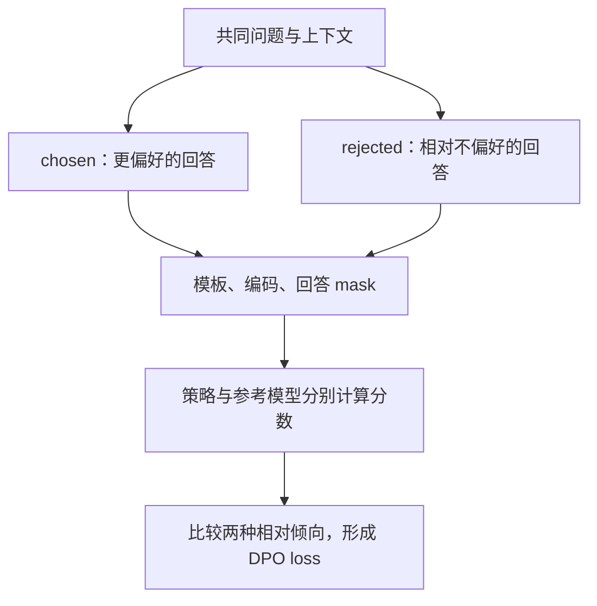
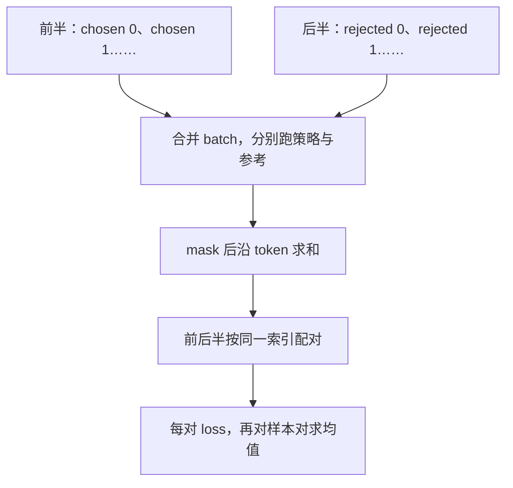

# 第 11 章 DPO 与偏好数据

SFT 通常给模型一份参考答案。偏好数据则告诉模型：对于同一个问题，两个候选中更喜欢哪一个。
DPO，即 Direct Preference Optimization，直接偏好优化，把这种成对关系变成可优化目标。
当前训练路径不再额外训练一个独立奖励模型，但仍有策略模型和固定参考模型。

本章先把两个候选变成两个序列分数，再解释参考模型和损失的作用。
它学习的是数据中的偏好，不保证偏好标签客观正确，也不保证任意能力都会提升。

**主线必读：** 偏好对、序列分数与相对参考的差。先跟随本章的小输入，再对照图和源码。

**进阶选读：** 空 mask、随机模板和梯度方向；第一次阅读可先掌握输入输出契约。

**需要额外设备/权重：** 真实偏好数据训练及留出评估。本章 CPU 实验只支持明确列出的机制结论。

## 11.1 一对样本必须先说明在比较什么

`DPODataset` 每条记录含 `chosen` 与 `rejected`，二者都是消息列表。
chosen 表示偏好的候选，rejected 表示相对不偏好的候选，不必分别等同于“完美答案”和“完全错误答案”。
有效比较还需要核对问题、上下文和评判标准，不能把两个无关问题的回答硬组成一对。



图 11-1：偏好对进入训练的主线。先确认两条回答是在同一问题上比较，再看数据如何变成可计分区域。
两个候选都需要前向，不是只对 chosen 做一次普通 SFT。
图中的共同上下文是数据要求，不表示当前 Dataset 已经自动验证了所有成对样本。

源码位于 MiniMind 的
[dataset/lm_dataset.py](https://github.com/jingyaogong/minimind/blob/233d00fa068ec2b8c0d4f07b703934d6391a5a73/dataset/lm_dataset.py)
与 [trainer/train_dpo.py](https://github.com/jingyaogong/minimind/blob/233d00fa068ec2b8c0d4f07b703934d6391a5a73/trainer/train_dpo.py)。
重点追 `DPODataset.__getitem__`、`logits_to_log_probs`、`dpo_loss` 及 `train_epoch`。

## 11.2 这条路径由 Dataset 负责 shift

与第 06 章的 Pretrain/SFT 不同，DPODataset 已经构造 `x=tokens[:-1]`、`y=tokens[1:]`，
mask 同样取后一个位置。训练器调用模型得到 logits，没有再把 y 作为 labels 交给模型内置 loss。
它自己 gather 出每个目标的 log-prob，再交给 DPO 损失。

| 返回字段 | 作用 | 需要注意 |
|---|---|---|
| x_chosen / x_rejected | 前一个位置的输入序列 | 已去掉末项 |
| y_chosen / y_rejected | 对应的下一 token 目标 | 保持合法 ID，不使用 -100 做 gather 索引 |
| mask_chosen / mask_rejected | 哪些目标计入序列分数 | 与 y 同步 shift |

`logits_to_log_probs` 先沿词表轴 log_softmax，再按 y 的 ID gather。
因此即使 mask 某处为零，该处 y 也要是合法词表 ID；mask 是后续乘法，不会提前阻止非法索引。
把 SFT 的 -100 标签直接搬到这里，可能在 gather 阶段就报错。

## 11.3 从每个 token 到整个回答的分数

对于候选 y，当前代码把有效位置的 log-prob 相加：

$$
s_\theta(y)=\sum_t m_t\log\pi_\theta(y_t\mid x,y_{<t}).
$$

x 表示共同输入上下文，$m_t$ 为目标 mask，$\pi_\theta$ 是当前策略分布。
相加对应条件概率连乘后的对数形式，避免直接连乘很多小数。
当前实现使用总和，不是除以回答长度的平均分。
不同长度及不同监督区域因此会影响分数，不能在讲解时悄悄加入源码没有的长度归一化。
`DPODataset.generate_loss_mask` 会扫描序列里的所有 assistant 段，而非只定位最后一个候选回答。
若 chosen/rejected 包含多轮历史，这些历史回答也在各自的分数中；缺少结束边界时，扫描也可能延伸到 padding。
只有核对展开后的模板与 mask，才能说清本条偏好对到底比较了哪些位置。

参考模型用同样方式得到 $s_{\mathrm{ref}}$。它通常从同一初始化权重建立并冻结，
提供一个比较基准；old policy、reference policy 和 reward model 不是三个可以随意替换的名称。
本章只有固定参考策略，下一章才讨论 rollout 时的旧策略记录。

## 11.4 目标是改变相对于参考的偏好差

用 $y^+$ 表示 chosen，$y^-$ 表示 rejected。先比较策略偏好差，再扣除参考偏好差：

$$
\begin{aligned}
\Delta_\theta={}&\big[s_\theta(y^+)-s_\theta(y^-)\big]\\
&-\big[s_{\mathrm{ref}}(y^+)-s_{\mathrm{ref}}(y^-)\big].
\end{aligned}
$$

当前 DPO 目标为：

$$
\begin{aligned}
&\mathcal L_{\mathrm{DPO}}=-\log\sigma(\beta\Delta_\theta)\\
&\sigma(z)=\frac{1}{1+e^{-z}}.
\end{aligned}
$$

当策略与参考相同，差为零，单对损失为 $\log2\approx0.6931$。
若提高 chosen 的有效 log-prob 而其他量不变，损失下降；提高 rejected 则方向相反。
beta 调整这个偏好差进入目标时的尺度。当前 CLI 默认 `beta=0.15`，训练入口把它传给
`train_epoch`；`train_epoch` 的形参默认值是 0.1，而 `dpo_loss` 本身要求显式传 beta，没有默认值。
正常从命令行运行时应以实际传入的 0.15 或用户覆盖值为准。

本地用 `-F.logsigmoid(...)` 表达稳定计算，再对样本对求平均。
它不是对所有候选 token 重新做一次分类交叉熵，也不是让 chosen 的绝对概率无条件变为 1。

## 11.5 批次顺序是公式的一部分

训练器先把整批 chosen 接在前面，再把整批 rejected 接在后面：

```python
x = torch.cat([x_chosen, x_rejected], dim=0)
y = torch.cat([y_chosen, y_rejected], dim=0)
mask = torch.cat([mask_chosen, mask_rejected], dim=0)
```

`dpo_loss` 按批轴的前半与后半拆分。如果改成 chosen/rejected 交替排列，却不改损失中的配对方式，
程序仍可能产生有限 loss，但比较的已不是原来的配对。



图 11-2：从合并批到重新配对。先看前后半的排列约定，再看每个索引如何恢复一对比较。
图刻意把“沿 token 求和”和“沿样本对求均值”分开，因为它们不能互换。
参考前向在 no_grad 中进行，真正优化的是策略参数；MoE 辅助项则另加到训练目标中。

## 11.6 随机模板与空 mask 会让直觉失效

新基线的 `DPODataset.__getitem__` 每对只抽一次 `remove_empty_think = random.random() > 0.2`，
再显式把同一布尔值传给 chosen 和 rejected 的 `post_processing_chat`。两边不再各自随机决定是否删除空思考段。
旧基线固定种子 42 时相同回答却得到 5 和 11 个监督目标的记录，是被本次修复针对的历史反例，不能继续当作新版结果。
这个改动只统一空思考删除决策，不验证两份原始对话确实共享上下文，也不消除不同回答长度或截断带来的监督差异。
未传 `remove_empty_think` 的 SFT 调用仍使用原来的随机行为。

还有一个与 SFT 不同的边界：若两边 mask 全为零，序列分数都为零，DPO loss 仍是约 0.6931，
而不会像平均空目标 CE 那样直接出现 NaN。有限 loss 因而不能证明样本提供了有效训练信号。
应检查每对有效目标数、共同上下文和格式一致性，而不是只监控 loss 是否报错。

## 11.7 动手验证与自检

运行 `.venv/bin/python experiments/ch11_dpo.py`。
实验对真实损失函数做梯度检查：beta=0.15 的零差案例中，chosen 有效项梯度为 -0.075，
rejected 为 +0.075，忽略位置为零；把一个 chosen log-prob 提高 0.4 后，loss 降至约 0.6636。
本次实验同时验证真实 Dataset 的 shift、gather 对齐，以及同一偏好对共用空思考删除决策。

它验证的是目标与数据语义，不是经过 DPO 后模型质量提升的证据。
输出和源文件哈希保存在 `experiments/ch11-results.json`。
DPO 训练循环已改为在最后一批的保存之前提交尾部剩余梯度；组内周期保存与恢复限制仍需沿用第 07 章的检查方法。

1. DPO 是否只需要 chosen 的前向？
2. 这条路径为什么不能再让模型内置 loss 做一次 shift？
3. 序列分数在当前实现中是求和还是求平均？
4. 参考策略与策略相同时，loss 为何约为 0.6931？
5. loss 有限，是否保证这对样本包含有效监督？

参考解释：第一题需要 chosen 和 rejected 的分数，也需要固定参考策略的对应分数，目标比较的是两者的相对差。第二题 DPODataset 已把输入和目标错开，再 shift 会让预测指向隔一个位置的 token。第三题当前按有效 token 对数概率求和，长度和 mask 因而直接影响分数。

第四题两套策略相同时差值为零，sigmoid 得 0.5，负自然对数约 0.6931。第五题两个空 mask 也可产生零差值和同样有限 loss，却没有有效内容监督，必须独立检查目标计数。

可选练习：打印同一偏好对的两份模板与 mask，说明分数变化到底来自内容、长度还是格式。

算法背景见 [DPO 原论文](https://arxiv.org/abs/2305.18290)。本章的批次排列、随机模板和空 mask 结论来自本地实现与实验。
