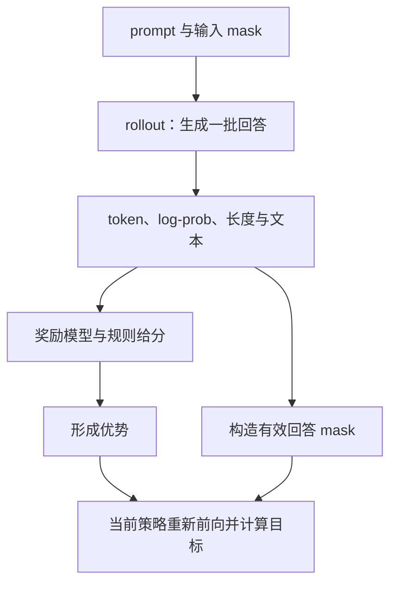
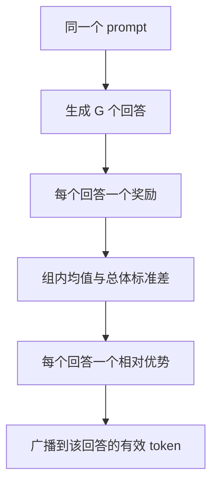

# 第 12 章 从 PPO 概念到 GRPO

前一章使用事先给定的偏好对。本章让策略自己生成回答，再根据奖励改进。
困难在于：一句回答最终得到一个分数，怎样把它变成每个生成位置的更新信号？
我们先用 PPO（Proximal Policy Optimization，近端策略优化）建立角色与优势的概念，
再读当前 GRPO（Group Relative Policy Optimization，组相对策略优化）脚本的真实分支。

这一章公式较多，先区分“谁生成、谁评分、谁估值、谁作为基准”，再跟随两项小奖励手算。
不需要先启动奖励模型或 GPU 服务；完整 RL 训练的资源和质量验证与本章算术实验分开。

**主线必读：** 奖励、价值、优势以及组内比较。先跟随本章的小输入，再对照图和源码。

**进阶选读：** GAE、PPO/CISPO 剪裁和概率对齐；第一次阅读可先掌握输入输出契约。

**需要额外设备/权重：** 策略、奖励权重与完整 RL 训练。本章 CPU 实验只支持明确列出的机制结论。

## 12.1 四种模型角色不要混用

| 角色 | 作用 | 是否在本轮优化 |
|---|---|---|
| policy / actor | 生成候选并计算当前 log-prob | 是 |
| reference policy | 固定的参考分布，用于约束偏移 | 否 |
| reward model | 对回答给分，可与规则奖励组合 | 当前流程中不随策略目标训练 |
| critic / value model | 估计当前前缀的预期回报，帮助形成优势 | PPO 中训练，GRPO 路径不使用它 |

此外还有 old log-prob：记录采样时对应的分数，供更新时比较。
它不一定对应一个长期保留的独立模型对象，也不等于固定 reference。
旧策略随采样批次而变，参考策略通常在这轮训练中保持固定。

源码索引是 MiniMind 的
[train_ppo.py](https://github.com/jingyaogong/minimind/blob/6fc918beb68a0d8c40452338df6319fe168014ba/trainer/train_ppo.py)、
[train_grpo.py](https://github.com/jingyaogong/minimind/blob/6fc918beb68a0d8c40452338df6319fe168014ba/trainer/train_grpo.py)
以及 [rollout_engine.py](https://github.com/jingyaogong/minimind/blob/6fc918beb68a0d8c40452338df6319fe168014ba/trainer/rollout_engine.py)。
以下每次说“当前实现”，都指这些固定版本的代码，不泛指所有同名算法库。

## 12.2 rollout 先生成，再准备学习材料

`RLAIFDataset` 从对话中移除最后一条示例答案，再用剩余消息构造 prompt；
因此数据末条需要满足这个约定，不能把最后一个用户问题也意外删掉。
其实现见 [dataset/lm_dataset.py](https://github.com/jingyaogong/minimind/blob/6fc918beb68a0d8c40452338df6319fe168014ba/dataset/lm_dataset.py)。

rollout 可以理解为让策略试做一次：输入 prompt，生成回答，记录 token、文本、log-prob 与长度。
`RolloutResult` 把这些量打包返回，训练器再计算奖励、优势、mask 和目标。
只保存解码后的字符串，无法可靠恢复每个训练位置的概率与边界。

图 12-1：采样材料怎样进入优化。先沿生成与记录这条线，再看奖励和 mask 如何共同决定哪些 token 得到什么信号。
“重新前向”不是重复采样，而是对已经选出的序列计算当前参数下的分数。
图省略了优化器和 checkpoint，重点展示数据依赖。

当前奖励包含回答长度、思考段格式、重复惩罚与外部奖励模型分数。
因此 reward 上升不自动等于事实正确率上升；也可能是模型更符合这些形式规则。
必须分别记录奖励组成与独立任务表现，避免把一种分数当成全部目标。

## 12.3 PPO 怎样把末尾奖励传回前面的位置

PPO 路径用 critic 估计值 $V_t$，把外部回答奖励放到最后有效位置，然后构造优势。
优势可以先理解为“这次结果比当前估计好多少”。当前 GAE（Generalized Advantage Estimation，广义优势估计）
按时间从后向前递推：

$$
\begin{aligned}
\delta_t&=r_t+\gamma V_{t+1}-V_t,\\
A_t&=\delta_t+\gamma\lambda A_{t+1}.
\end{aligned}
$$

$r_t$ 是位置奖励，$\gamma$ 为折扣，$\lambda$ 控制递推项的权重。
在本章两步小例子中，令两者都为 1，值估计为 `[0.2,0.4]`，末尾奖励为 1。
最后一步优势是 0.6，前一步是 $0.4-0.2+0.6=0.8$；对应 returns 为优势加旧值，均为 1。

当前代码随后按有效 token 对优势作均值/方差归一化。
本章实验加入一个无效尾位置，得到归一化优势约 `[1,-1,0]`，验证 padding 不作为有效训练目标。
不同折扣、边界值和任务奖励会改变结果，不能把这个例子的 returns=1 写成一般规律。

`CriticModel.forward` 使用主干隐藏状态再接单值输出头，返回 `(B,S)` 的值序列。
当前代码在主干已执行末尾 norm 后，又调用了一次 `self.model.norm`；实验钩子实际观察到两次调用。
它还保留了父类结构，不能只依据“替换 head”的注释推断整个模块已经删掉原输出头。

## 12.4 PPO 的剪裁在限制哪一种变化

记当前与采样时的 token log-prob 为 $\ell_t$ 和 $\ell_t^{\mathrm{old}}$，定义比值：

$$
\rho_t=\exp(\ell_t-\ell_t^{\mathrm{old}}).
$$

忽略此处暂不展开的 KL 项，最小化形式的策略目标可写为：

$$
\begin{aligned}
\bar\rho_t&=\operatorname{clip}(\rho_t,1-\epsilon,1+\epsilon),\\
u_t&=\min(\rho_t A_t,\bar\rho_t A_t),\\
\mathcal L_{\mathrm{policy}}&=-\frac{\sum_{b,t}m_{b,t}u_{b,t}}
{\max(1,\sum_{b,t}m_{b,t})}.
\end{aligned}
$$

前两行暂省略批索引；第三行补回 $b$，$m_{b,t}$ 是本次小批回答位置的 0/1 mask。
分母统计本次小批的全部有效 token；$u_t$ 是剪裁目标中的单项值，不是新的模型输出。
这与后文 GRPO/CISPO 的“先对每条回答求均值”不同。

当优势为正，策略提高该 token 的概率有利，但过大的比值不再带来同样收益。
当优势为负，乘法符号会改变哪一项更小，所以不能只记“把 ratio 限在一个区间”就理解完整梯度。
取 min 与单纯对 ratio clamp 后乘优势，并不是同一个目标。

critic 另有带剪裁的回归损失，拟合先前构造的 returns。
训练总目标还包括 value 系数、参考约束和可选 MoE 辅助项。
当前 early-stop 检查会把本次损失乘零以保持前向/反向闭环，不能描述成简单地在任意位置直接 break。

## 12.5 GRPO 用同题多回答建立相对基准

GRPO 为同一个 prompt 生成一组回答，用组内奖励均值和标准差形成优势，不需要这个 PPO critic。
这省去的是 critic 路径，不代表连 reward model 也一定不需要；当前脚本仍加载奖励模型。

若组大小为 G，第 i 个回答的奖励为 $r_i$：

$$
\begin{aligned}
\bar r&=\frac1G\sum_{i=1}^G r_i,\\
\sigma_r&=\sqrt{\frac1G\sum_{i=1}^G(r_i-\bar r)^2},\\
A_i&=\frac{r_i-\bar r}{\sigma_r+10^{-4}}.
\end{aligned}
$$

代码用 `std(...,unbiased=False)`，因此这里分母是 G 的总体标准差口径。
奖励 `[1,3]` 得到约 `[-0.9999,0.9999]`；同组 `[2,2]` 则优势均为 0。
后者不会凭空产生哪个回答更好的相对信号。若其他 KL/辅助项仍存在，也不能反过来断言总梯度一定为零。

图 12-2：组内相对优势的形成。先确认这些回答来自同一题，再做标准化；
不能把不同难度问题的奖励随意放进同一组。最后优势广播到回答 token，但 EOS 和 padding 的有效范围仍由 mask 决定。

## 12.6 文件叫 GRPO，默认损失却是 CISPO

这是本次源码最值得核对的一处默认值：`train_grpo.py` 的 `loss_type` 默认是 `cispo`，
只有选 `grpo` 才进入前面介绍的 PPO 式 ratio 剪裁分支。
书名或脚本名不能代替对实际参数默认值的阅读。

CISPO 在原报告中称为 Clipped IS-weight Policy Optimization，可理解为截断重要性权重的策略优化。
本地分支保留 KL 项并按回答归约，与原报告的无 KL、全 token 归约并非完全相同；下面公式以本地源码为准。
背景见 [MiniMax-M1 报告第 3.1 节](https://arxiv.org/html/2506.13585v1#S3.SS1)。

当前 CISPO 分支只截取 ratio 的上界，然后 detach：

$$
\begin{aligned}
N_i&=\sum_t m_{i,t},\\
c_{i,t}&=\operatorname{stopgrad}(\min(\rho_{i,t},u)),\\
J_{i,t}&=-c_{i,t}A_i\ell_{i,t}+\beta\kappa_{i,t},\\
\mathcal L_{\mathrm{CISPO}}&=\frac1M\sum_{i=1}^{M}
\frac{\sum_t m_{i,t}J_{i,t}}{\max(N_i,1)}.
\end{aligned}
$$

这里 $M=BG$ 是本批回答总数，$i$ 遍历回答，$t$ 遍历回答内 token。$A_i$ 由该回答所属题组计算，
$m_{i,t}$ 对应 `completion_mask`，$J_{i,t}$ 是包含参考惩罚的逐 token 损失。
$\ell_{i,t}$ 是当前策略对已选 token 的对数概率，$\rho_{i,t}$ 是新旧策略比值，$\kappa_{i,t}$ 在 12.7 节定义。
第一层平均的分母是各自的有效长度，第二层分母是回答数。逐项损失有限时，
空回答行贡献零，但仍在第二层分母中；mask 乘零不能清除 NaN。
$u$ 对应 `epsilon_high`，默认 5；它不是普通 GRPO 分支的 $1+\epsilon$。
`stopgrad` 表示系数在反向中作为常数，梯度通过后面的 log-prob 而不是再穿过 ratio。
这改变了梯度形式，不能把两种分支只当作名字不同的同一公式。

本章实验令 ratio=2、优势为 `[1,-1]`、beta=0。
普通剪裁分支对两行 log-prob 的梯度约 `[0,1]`，CISPO 为 `[-1,1]`。
实验使用真实源代码块计算，展示即使输入相同，两个分支的反向行为仍然不同。

## 12.7 KL 项、归约方式与日志要分清

当前逐 token 参考惩罚使用：

$$
d_t=\ell_t^{\mathrm{ref}}-\ell_t,\qquad
\kappa_t=e^{d_t}-d_t-1.
$$

这是一种按已选 token 构造的惩罚估计项，不是在每个位置完整遍历词表计算 KL 的同一个操作。
数学上该表达式非负；数值实现仍需考虑精度和溢出。
日志中的参考 log-prob 差均值与这个表达式也不同，不能看到日志叫 KL 就假定它始终非负。

当前 GRPO 先对每条回答的有效 token 求平均，再对回答求平均；
PPO 中相应片段则按有效 token mask 进行归约。不同长度下，这些口径可能赋予样本不同权重。
例如两条回答有效长度分别为 1 和 3，各自的逐 token 损失都是 1 和 3。
按回答平均得到 `(1+3)/2=2`，按所有 token 平均却是 `(1+3+3+3)/4=2.5`。
真实 GRPO 归约代码的新增实验得到 2；第一条唯一有效位置的损失梯度为 0.5，
第二条三个有效位置各为约 0.1667，被 mask 的位置为 0。
这解释了相同前向单项值为何会产生不同的 token 权重。
阅读训练目标时应同时抄下分子、分母和 mask，而不只抄最前面的公式名。

## 12.8 rollout 后端的概率和位置约定

`compute_per_token_logps` 多保留一个 logits 位置，再用前一位置预测后一 token。
Torch 后端记录的 prompt_len 是包含左 padding 的矩形宽度；SGLang 后端去除左 padding，
再右侧补齐输出，并保存每条真实 prompt 长度。训练器通过这些长度定位回答 logits。
把两种长度约定混用，会产生整体偏移。

Torch 后端重新对已生成序列计算原始模型 log-prob，而生成时还使用温度及候选筛选。
因此这个记录不能直接当作经过所有温度/Top-K/Top-P 处理后的实际采样分布 log-prob。
SGLang 路径又从服务响应读取 log-prob，其具体语义需要绑定服务版本核实，不能仅看相同 shape 就认为后端等价。

服务端策略还需要显式同步权重。`update_policy` 会导出并请求服务加载，失败会报错；
不能假定本地优化一步后，远端模型自动知道参数已变。当前书稿未启动 SGLang 或奖励模型服务。

## 12.9 验证范围与自检

运行 `.venv/bin/python experiments/ch12_rl_objectives.py`。
实验从锁定源码 AST 中提取目标计算块，用合成中间张量执行原语句，验证 GAE、组内优势及两种剪裁梯度；
另运行真实 Critic 和 log-prob 对齐函数。它不是完整 PPO/GRPO 训练，也不报告 RL 后的模型质量。

1. old log-prob、reference 和 reward model 分别解决什么问题？
2. GRPO 去掉 critic，是否说明当前脚本也没有奖励模型？
3. 同组奖励完全一样时，相对优势为何为零？
4. 当前默认 loss_type 是什么？detach 的位置为什么影响梯度？
5. 只检查 token/log-prob 张量长度相等，是否足以证明位置和概率口径正确？

参考解释：第一题 old log-prob 记录采样时的策略，用于新旧概率比；reference 给固定参照，用于约束偏离；reward model 给结果评分。第二题去掉 critic 只是不再另学此处的价值基线，当前 GRPO 仍使用奖励模型。

第三题相同奖励减去组均值后全为零，分母的稳定项不会创造优劣。第四题默认 CISPO；detach 使某个系数在反向中当常数，同样的前向数值可产生不同梯度。第五题长度相等还可能错一位，或比较了不同温度、截断分布的概率；应逐项核对历史前缀、目标 ID 与概率定义。

可选练习：把一个位置设为 padding，比较 token 平均和回答平均的权重。背景阅读：[PPO 原论文](https://arxiv.org/abs/1707.06347)、[DeepSeekMath 的 GRPO 介绍](https://arxiv.org/abs/2402.03300)。
