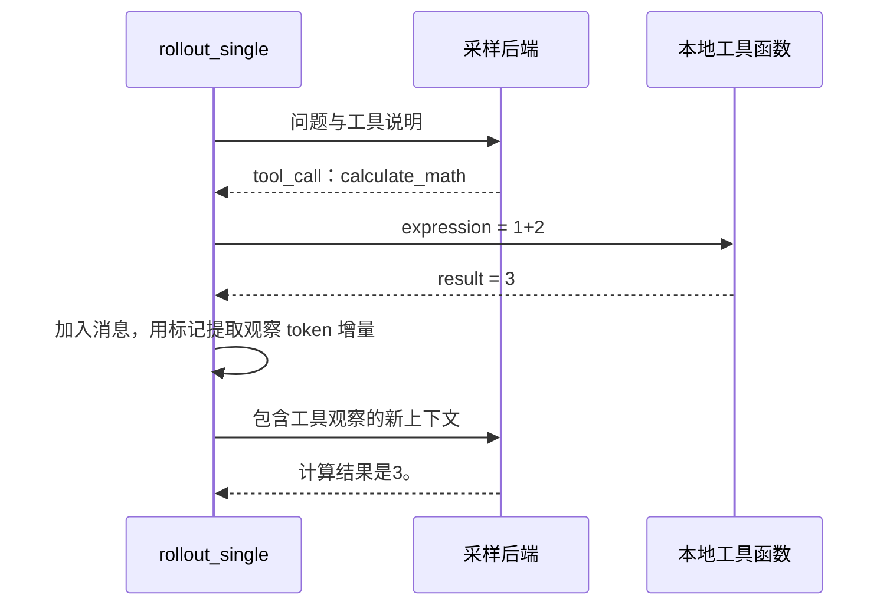
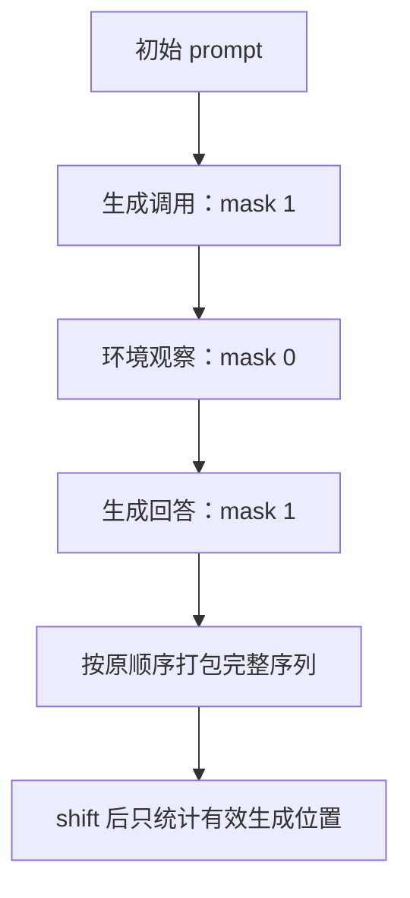

# 第 13 章 Agent 多轮交互与奖励

> 迁移候选：本章源码链接已更新，静态差异已核对；既有数值与实验记录仍属于旧基线，不表示新版已重验。
> 新版 PyTorch 实验与独立复核待完成，暂标 stale，不可直接用于新版出版验收。详见[迁移记录](https://github.com/cluster1900/minimind_reader/blob/main/meta/upstream-impact-2026-10-28.md)。

单轮回答结束后才评分，仍不足以描述工具交互。模型可能先请求计算，收到结果后再继续回答。
这意味着一条训练轨迹交替包含模型自己生成的内容，以及环境提供的观察。
本章要解决的核心问题是：怎样把这些内容放进上下文，又只对模型负责的部分计算策略目标？

我们用“计算 1 加 2”贯穿流程。这个例子足够小，便于观察每个 token、工具返回和奖励，
而不把复杂任务是否成功与轨迹拼接是否正确混在一起。

**主线必读：** 生成请求、执行工具、反馈和 response mask。先跟随本章的小输入，再对照图和源码。

**进阶选读：** 轨迹概率、奖励误匹配和轮数上限；第一次阅读可先掌握输入输出契约。

**需要额外设备/权重：** 训练后策略在真实工具环境中的评估。本章 CPU 实验只支持明确列出的机制结论。

## 13.1 工具定义、调用文本和执行器是三层

工具定义告诉模型可用的名字与参数格式；模型生成的 `<tool_call>` 文本表达请求；
真正执行工作的是外部 Python 代码。聊天模板只负责组织文本，不会因为出现一个标签就自己访问网络或运行函数。

源码入口是 MiniMind
[trainer/train_agent.py](https://github.com/jingyaogong/minimind/blob/233d00fa068ec2b8c0d4f07b703934d6391a5a73/trainer/train_agent.py)
中的 `parse_tool_calls`、`execute_tool`、`rollout_single`、`calculate_rewards` 和 `rl_train_epoch`。
`rollout_engine.py` 提供采样后端，但不独自负责全部 Agent 循环。

当前工具集合里，天气、时间、汇率和翻译等来自本地模拟数据；计算器等通过本地函数处理。
所以这个仓库的多轮示例可以教学交互机制，却不能被描述成已经验证了真实在线天气或金融服务。

数据入口是 [AgentRLDataset](https://github.com/jingyaogong/minimind/blob/233d00fa068ec2b8c0d4f07b703934d6391a5a73/dataset/lm_dataset.py)。
它读取 conversations 与 gt，从 system 消息提取工具定义，并移除最后一条示例消息供后续生成。
应核对末条确实是参考回答，以及 gt 的具体评判含义；数据类不会自动把任意对话修成合法任务。

## 13.2 一轮调用结束后，模型会收到什么

模型先生成一个合法 JSON 调用，例如请求 `calculate_math`，参数 `expression` 为 `1+2`。
解析器取出标签内的 JSON，执行器找到对应函数，返回 `{"result":"3"}`。
随后程序把 assistant 调用和 tool 结果加入消息列表，用模板提取新增观察；下一轮模型输入沿用原始 prompt ID 加累计 response ID，而不是重编码替换整条历史。

图 13-1：两轮交互。先追工具请求如何离开模型，再看结果如何变成下一轮模型输入。
同一条轨迹不只有一个生成片段，也包含执行器提供的观察。图中的工具是本地模拟集合，
没有隐藏的联网请求；真实服务接入需要另行实现并验证其契约。

`parse_tool_calls`（[`train_agent.py`](https://github.com/jingyaogong/minimind/blob/233d00fa068ec2b8c0d4f07b703934d6391a5a73/trainer/train_agent.py) 约 76 行）对无法解析的 JSON 会 `continue` 跳过；即使解析成功，也只有 `isinstance(call, dict)` 的对象才会进入列表。因此 `<tool_call>[1]</tool_call>` 这类合法但非对象的 JSON **不会**再被收下，旧基线上随后 `rollout_single` 对数组调用 `.get` 崩溃的路径已被堵上。若最终列表为空，循环仍可能按普通回答结束——“没有调用”不等于“输出格式一定正确”。
执行阶段对 `arguments` 若得到非 dict（含解析失败后的占位），会置为 `{}` 再交给 `execute_tool`；奖励阶段的参数检查同样先做这一层兜底。执行未知工具返回 None，也不能被当成成功结果。
执行器按全局工具表找函数，提供给模型的工具定义列表并不是这里的硬性白名单；
奖励阶段才另行检查名称和参数。真实工具接入应在执行边界明确检查这些条件，不能只靠事后扣分。
计算器已改用 `trainer_utils.safe_math_eval` 的 AST 白名单解析，不再使用 `eval`；只允许指定算术运算、math 函数及 pi/e/tau 常量。
表达式归一化后最多 512 字符，幂运算另设指数和结果规模检查。`execute_tool` 已移除 SIGALRM，
捕获 `Exception` 后返回 None；不存在通用的一秒超时保证。白名单与输入上限是局部保护，不是任意工具的完整资源隔离沙箱。

## 13.3 一条轨迹里，谁生成的 token 才参与策略目标

`rollout_single` 维护 `response_ids`、`response_mask` 和 `response_old_logps`。
模型生成的有效 ID 加入轨迹，非 EOS 的生成 ID 标 mask=1，EOS 标为 0；工具反馈与模板补入的观察增量也标为 0。
这些观察仍要输入模型，影响后续回答，但不应被当成模型刚刚采样的动作来优化。

| 轨迹部分 | 是否进入上下文 | 策略 mask |
|---|---|---:|
| 初始问题和工具说明 | 是 | 0 |
| 模型生成的工具调用 | 是 | 1 |
| 工具结果与相应模板补入内容 | 是 | 0 |
| 模型随后生成的回答 | 是 | 1 |

图 13-2：输入范围与优化范围的区别。自上而下理解整条轨迹，再看 mask 的 0/1。
观察被 mask 掉的是策略计分位置，不是从上下文删除。这个区别与第 06 章的 prompt 梯度讨论相呼应。

当前代码以 `completion_mask` 的和取得有效前缀长度，按该长度同时截取 ID 与旧 log-prob；不再按 PAD/EOS 的 ID 值过滤。
因此有效范围内 EOS 会保留在上下文与轨迹中，但其 response mask 为 0。若工具观察的首 token 又是同一 EOS，
且刚生成的最后 token 已是 EOS，则去掉这一份重复边界。不要把 token 保留、attention mask 与策略计分 mask 混为一谈。
这个前缀切片还依赖后端有效 mask 为连续前缀，不能无条件用于有中间空洞的自定义 mask。

## 13.4 保留采样 ID，再单独提取工具观察

新基线首轮编码 `prompt_ids`，后续轮用 `prompt_ids + response_ids` 直接构造模型输入。
这样保留原采样 token，不要求把 assistant 文本重新编码后仍得到相同 token 前缀。

提取观察时，代码暂时在 assistant 内容末尾放入唯一 marker，用完整消息生成带标记模板，
然后按 marker 分割，只编码其后的观察字符串。若模板丢弃 marker，就抛出 `RuntimeError`；
生成 ID 与 log-prob 长度不符也直接报错，不再只记日志后用 zip 静默截断。
marker 只用于定位边界，不作为后续模型输入；观察 ID 追加到 response，mask 与旧 log-prob 占位值均为 0。

旧实验曾在特定样例上观察到“轨迹 ID 等于最终字符串重编码”，但新版不再依赖这个性质。
新版应检查下一轮输入逐 token 等于前一次保留的轨迹，观察边界仅追加一次，EOS 保留但不计策略目标，
以及 ID、mask 和旧 log-prob 始终等长；完整重编码相等不应成为唯一正确性判据。

训练侧 `rl_train_epoch` 仍对完整轨迹左截断、右补齐，mask 与 log-prob 同步处理。
attention mask 改为按 `seq_lens` 构造，而非根据 PAD ID 值判断，所以有效内容中出现 PAD ID 也不会自动被当成补齐。
训练前向改为通过 DDP 包装的 `model` 调用；DDP 设置 `broadcast_buffers=False`。
末批更新位于保存之前，周期保存若落在组内仍有第 07 章说明的恢复限制。

## 13.5 reward 并不是“工具已经真正做对”的万能证明

当前奖励区分没有工具调用和有工具调用两条路径。
前者可结合长度、思考格式、重复惩罚及奖励模型分数；后者统计合法名称与参数、调用数量差异，
再检查最终文本是否包含 gt 中的内容或数值，并对未完成轨迹扣分。

`validate_gt_in_text` 使用文本匹配及数值比较，不是在所有任务上重新执行一个严格判题器。
例如 gt 为字符串 `3` 时，“答案是13”也会命中子串条件；本章实验复现了这个反例。
函数所在分支的注释提到执行结果奖励，也不能据此把它描述为完整的工具正确性证明。
训练可能学会满足匹配规则，但最终仍应在独立任务中检验。

单条轨迹得到奖励后，与同一 prompt 的其他候选一起做组内标准化，
再使用第 12 章的 GRPO/CISPO 目标。当前 Agent 入口的默认 `loss_type` 也是 cispo。
有效生成 token 为零的行在 Agent 目标中有单独处理，不能把另一训练器的归约直接照抄过来。

## 13.6 达到轮数上限时发生什么

当最后允许的一轮仍然生成了工具调用，`unfinished` 会被设为 true。
但当前流程仍执行这次工具并写入观察，只是不再开启下一轮模型生成。
因此“达到上限”不能被解释成在解析调用之前就完全停止一切副作用。

本章以 max_turns=1 运行调用样例，观察到工具结果仍进入 context，轨迹被标为 unfinished，奖励低于正常完成情况。
接入真实工具时，轮数、参数校验、失败结果、重复调用和资源边界应有明确设计；
本地模拟函数的成功不能代替这些外部行为的验证。

归约还有一个与第 12 章不同的边界：`rl_train_epoch` 用 `valid_rows = token_counts > 0`
排除没有有效动作 token 的行，再对剩余轨迹求均值；GRPO 的相应实现则仍把空行计入回答数。
因此不能把两个脚本同名的 `policy_loss` 直接当作相同平均口径。

## 13.7 一个可复现的交互实验

运行 `.venv/bin/python experiments/ch13_agent.py`。
它用脚本化后端先返回计算器调用，再返回“计算结果是3。”，但实际执行真实 `rollout_single`、
模板、解析器、计算器和奖励函数。这样可以控制输入，专门验证轨迹，而不需要先训练出 Agent。

旧基线的两轮轨迹记录 70 个 response 区域 token，其中 39 个为生成、31 个为观察，
当时过滤生成 EOS 且最终 token 重建完全一致；完整回答按当时规则得到奖励 3。
这些计数不能当作新基线结果。新版脚本化后端还必须返回 `completion_mask`，并增加 EOS 与观察边界测试；本次未运行完整新轨迹实验。
非法 JSON 被忽略，未知工具返回 None，轮数上限的 unfinished 分支也已验证。
结果与哈希在 `experiments/ch13-results.json`，不声称一个学习策略已获得相同成功率。

1. 聊天模板、工具请求与执行器分别做什么？
2. 工具观察 mask=0，是否表示模型不能读取它？
3. 仅有最终字符串，能否可靠还原每个训练位置的 log-prob？
4. max_turns 到上限，当前代码是否一定不再执行最后的工具调用？
5. gt 文本匹配成功，是否足以证明任意工具任务正确？

参考解释：第一题模板排列消息，工具请求声明名称和参数，执行器实际调用函数并返回观察。第二题 response mask=0 表示不把观察作为策略自己的动作计入相应目标，观察仍可作为后续生成的上下文。

第三题最终字符串不能唯一决定原采样 token、有效长度、EOS 的策略 mask、工具边界或采样时的概率，不能可靠还原轨迹。第四题当前到达轮数上限仍可能执行最后一次工具，再按 unfinished 分支收尾。第五题文本包含匹配并非语义判定，例如 gt 为 3 时字符串 13 也可能命中。

可选练习：让脚本化后端返回一次错误参数，再检查观察文本、unfinished 和奖励分别如何变化。
