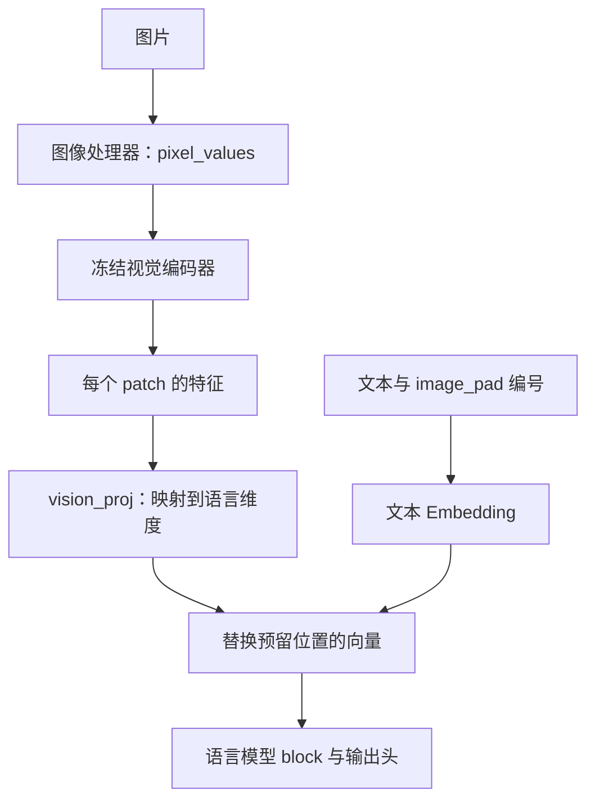
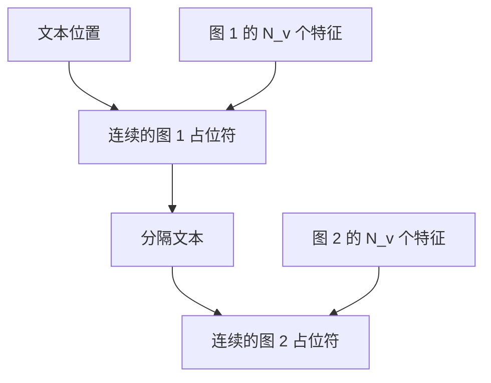

# 第 14 章 图像怎样进入语言模型

语言模型接收的原本是一排 token 向量，图片却是一张像素网格。MiniMind-V 的做法是：
先把图片转换成一排视觉特征，再映射到语言模型的隐藏维度，放入文本序列预留的位置。
模型因而能在同一个注意力上下文里处理文字和图像相关向量。

这一篇可以从第 08 章直接进入，不需要先学完强化学习。
我们先看输入和维度，再读注入代码；预训练视觉编码器怎样获得识别能力，属于复用模块的背景，
不会被说成本项目从零训练了整个视觉系统。

**主线必读：** 像素、patch、投影与占位符替换。先跟随本章的小输入，再对照图和源码。

**进阶选读：** 多图边界和缓存中的图像影响；第一次阅读可先掌握输入输出契约。

**需要额外设备/权重：** 默认视觉编码器权重与识别质量测试。本章 CPU 实验只支持明确列出的机制结论。

## 14.1 像素、patch 与视觉 token

一张 RGB 图片可表示为三个颜色通道。处理器把图片调整到编码器所需的尺寸和数值范围，
得到常见的 `(B,3,H,W)` 张量。H/W 是高度与宽度，别与 PIL 常见的宽高顺序混淆。

视觉编码器再把图像组织成 patch，并计算每个 patch 的表征。
对于整齐覆盖的方形 patch，若边长为 P，网格 token 数为：

$$
N_v=\frac{H}{P}\frac{W}{P}.
$$

这个算式需要对应的尺寸/patch 配置及编码器布局条件。
项目默认编码器路径名为 `siglip2-base-p32-256-ve`，语言侧默认约定 64 个视觉 token、视觉维度 768；
256×256、patch 32 对应 8×8=64。真正加载其他权重时，仍要核对其配置与输出，不能只相信文件夹名称。

本章实验采用真实但随机初始化的小 SigLIP：32×32 图片、patch 16，得到 4 个视觉位置，维度为 16。
这是为了让 CPU 上的真实神经网络前向足够小，不代表它已经能识别图片内容。

## 14.2 模型入口同时接收文字与像素

`MiniMindVLM` 继承文本模型外壳，增加视觉编码器、处理器与 `vision_proj`。
forward 先对 input_ids 做文本 Embedding，然后在首次前向中计算图像特征并替换预留位置，
之后沿语言模型各层继续运行。



图 14-1：两路输入在 Embedding 后汇合。先追图片从像素到向量，再看文字怎样预留接入位置。
图片没有直接变成一段必然正确的文字描述；它首先变成隐藏空间里的特征。
图中“冻结”指参数更新策略，不意味着图像编码可以跳过。

源码锚点是 MiniMind-V
[model/model_vlm.py](https://github.com/jingyaogong/minimind-v/blob/740d467ece78a0b7d2d976fcb424472095d4a688/model/model_vlm.py)
的 `VLMConfig`、`MiniMindVLM.__init__`、`get_image_embeddings` 与 `forward`。
注意本章引用的是 V 仓库，不能只用同名 `model_minimind.py` 代替多模态逻辑。

**输入边界：** 本章验证可用的是处理器返回的映射，例如单图
`pixel_values={"pixel_values": tensor}`，其中 tensor 为 `(B,3,H,W)`；同图数批次可用
`(B,N,3,H,W)`，模型先合并批与图片轴。字典里还可能有处理器要求的其他字段，应一起传递。
虽然 `MiniMindVLM.forward` 写了普通 Tensor 分支，它会把切出的 Tensor 传给
`MiniMindVLM.get_image_embeddings`，后者直接执行 `vision_model(**image_inputs)`。
在锁定版本中，Tensor 不是关键字参数映射，此处会抛出 TypeError；不能把“存在分支”写成“支持该接口”。
本章用同一份像素验证：两种字典形状得到一致 logits，直接传五维 Tensor 则报错。

## 14.3 projector 改变特征维度，不自动改变 token 数

`MMVisionProjector` 依次使用 LayerNorm、Linear、GELU、Linear。
这里是 LayerNorm，包含中心化，与第 03 章 RMSNorm 的公式不能混用。
它对每个 patch 向量先减去均值，再按带稳定项的标准差缩放，并使用可学习的缩放与偏置。
如果视觉特征维度为 $D_v$、语言维度为 D，输出形状变化为：

$$
(B,N_v,D_v)\longrightarrow(B,N_v,D).
$$

按行向量写出主要计算：

$$
v'=\operatorname{GELU}(\operatorname{LN}(v)W_1^{\mathsf T}+b_1)W_2^{\mathsf T}+b_2.
$$

两次 Linear 含各自 bias。即使默认输入输出维度都为 768，学习一个映射仍有意义：
维度相等不表示两个网络的坐标含义已对齐。
本章小例子从 16 维映到 32 维，projector 含 1632 个参数，计数包括 LayerNorm 的缩放/偏置与两个 Linear 的 bias。

构造函数虽然接收 `source_tokens`、`target_tokens`，当前 MLP 并没有用它们实现重采样。
因此把 `image_token_len` 改成 64，不会自动将任意长度视觉序列压成 64 个 token。
必须同时检查编码器实际长度、占位符数量和后续 reshape，不能只改一个配置名。

## 14.4 占位符在数值上怎样被替换

文本预处理用连续 `<|image_pad|>` 标记预留位置。编码后，它们是特殊 ID；
Embedding 最初仍会为这些 ID 查表。`count_vision_proj` 再扫描连续标记段，
把对应的一段文本向量替换成一张图的投影特征。

| 位置类别 | 替换前 | 替换后 |
|---|---|---|
| 普通文本 | 文本 Embedding 向量 | 保留 |
| 第 1 张图的预留段 | image_pad 的查表向量 | 第 1 张图的特征 |
| 中间分隔文本 | 文本向量 | 保留 |
| 第 2 张图的预留段 | image_pad 的查表向量 | 第 2 张图的特征 |

可以类比书页上提前空出插图位置，再把实际插图放进去。
但这里替换的是隐藏向量，且源码使用拼接产生新张量；“原位”说的是序列位置，不是保证原地写内存。



图 14-2：多图占位符与特征的对应。先沿文本顺序找到两个独立连续段，再看图像特征按顺序注入。
同样的标记 ID 不足以区分两张图，段落边界和特征顺序也必须一致。
这张图只解释替换位置，不把箭头当作 tokenizer 自动识别图片内容的过程。

## 14.5 连续段与特征数量不匹配会怎样

当前扫描以“连续出现同一标记”为一段。非标记位置在 `else` 里把下标加一；下面只保留标记段的拼接：

```python
while i < len(seq):
    if seq[i] == marker:
        start = i
        while i < len(seq) and seq[i] == marker:
            i += 1
        if k < vf.size(1):
            hb = torch.cat((hb[:start], vf[b][k][:i - start], hb[i:]), dim=0)[:seqlen]
            k += 1
```

仔细观察这一拼接：若两张图的占位符毫无分隔地相邻（例如连续 8 个 marker），内层循环会一口气把 `i` 推进 8 位，
将它们当成同一张图的占位段。然而第一张图只有 $N_v=4$ 个特征，切片 `vf[b][k][:i - start]` 最多提供 4 个特征；
而随后的 `hb[i:]` 却直接从跳过 8 个位置的 `i` 开始拼接！这导致不仅原本 8 个位置被压缩成 4 个（序列长度意外缩水），
而且只有图 1 被注入，图 2 的特征被直接遗漏。

本章用两张各 4-token 的合成特征验证：带分隔时正确替换两段；
直接连成 8 个标记时，长度为 10 的输入变成了长度 6 的结果。
这是一个输入契约被破坏的反例，不是推荐的压缩方式。
后续位置编码、batch 堆叠或 loss 对齐可能因此失败。应提前验证每段标记长度、图像数量和排序，
不能把“函数没有立即抛异常”当作注入正确。

## 14.6 缓存前向只在最初处理图片

forward 在 `pixel_values is not None` 且 `start_pos==0` 时走视觉路径。
首次图文前向形成的语言层 K/V 已包含图片对隐藏状态的影响；后续 decode 复用它们，不必每步重新编码同一图片。
如果直接复用另一张图或另一段 prompt 的旧缓存，语义也会错位。

实验钩子确认一次 prefill 后的单 token decode 没有再次调用视觉编码器，
而缓存 decode 与包含同一图片的完整前向最后位置 logits 在容差内一致。
这验证当前小配置的缓存连接，不等于已经完成多请求图像缓存、跨用户共享或服务级调度。

## 14.7 实验和自检

运行 `.venv/bin/python experiments/ch14_vision.py`。
实验使用真实随机小 SigLIP 和真实 MiniMindVLM，只替换预训练权重的加载环节；
没有下载默认视觉权重，也没有声称随机编码器能识别图片。
真实前向输出 `(1,7,6400)`，projector 有非零梯度，冻结编码器的参数梯度为 None。
缓存与全量最后位置误差约 `1.49e-7`，多图正常及异常连续段均已检查。

1. 图像先变成文字描述，才进入语言模型吗？
2. projector 的 target_tokens 参数是否保证改变视觉序列长度？
3. 输入输出都为 768 维，是否说明映射不需要学习？
4. 相邻两张图的标记直接连成一长段，有什么风险？
5. 后续 decode 不再编码图片，是否意味着图片完全不影响生成？

参考解释：第一题当前直接计算视觉特征并注入隐藏序列，没有先生成文字描述这一必经步骤。第二题本地 projector 主要改变最后一维，参数名 target_tokens 不代表已经实现序列重采样。第三题维度同为 768 只说明长度相等，两个空间各维的含义仍可能不同，需要学习连接。

第四题相邻标记可能被扫描为一段，只消费一张图的特征，并在拼接时改变原长度。第五题首次前向已经把图片影响带入隐藏状态和 K/V，后续查询仍可读取这些历史信息。

可选练习：交换两张合成特征的顺序，观察哪些预留位置改变，确认数据顺序的作用。
