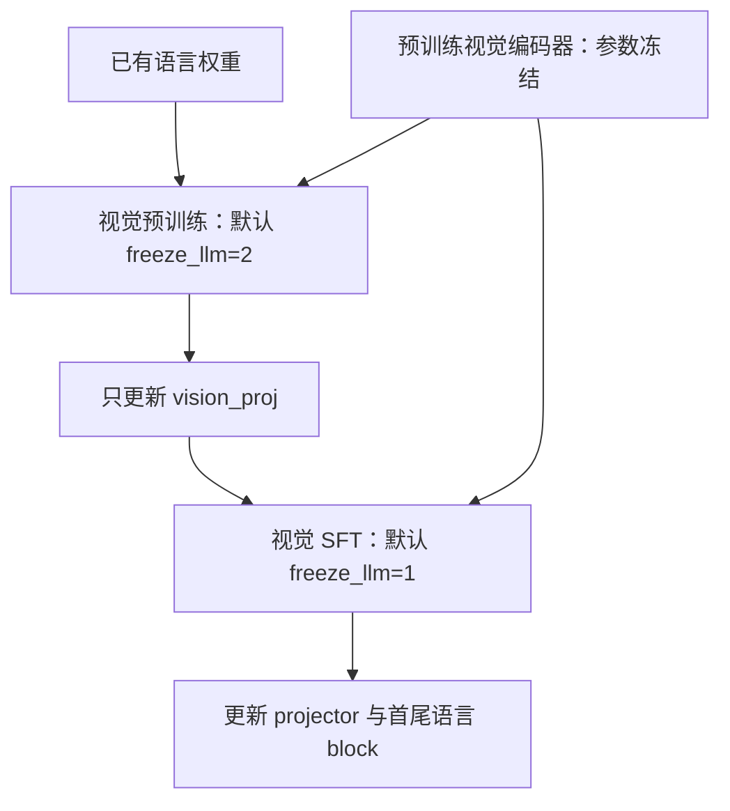
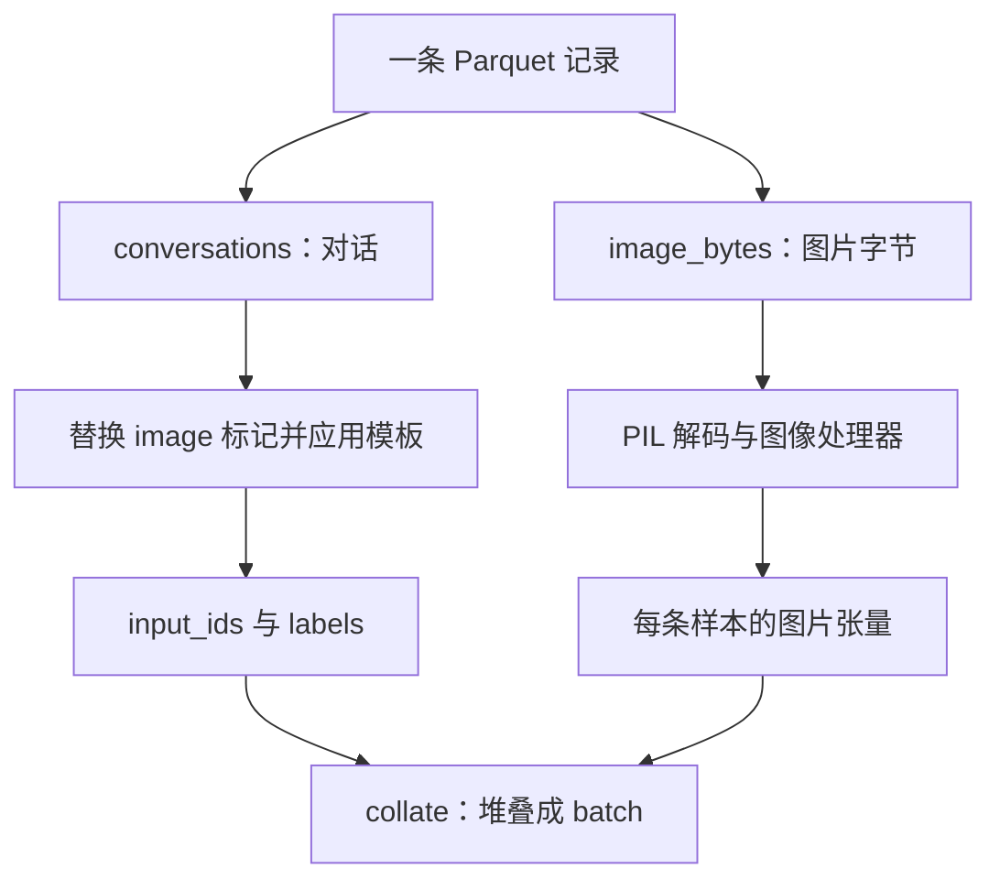

# 第 15 章 视觉训练与评估

> 迁移候选：本章源码链接已更新，静态差异已核对；既有数值与实验记录仍属于旧基线，不表示新版已重验。
> 新版 PyTorch 实验与独立复核待完成，暂标 stale，不可直接用于新版出版验收。详见[迁移记录](https://github.com/cluster1900/minimind_reader/blob/main/meta/upstream-impact-2026-10-28.md)。

图像能够注入语言模型，还需要训练让两种表征有效配合。最直接的工程问题是：
这一阶段究竟允许哪些参数变化？数据中有几张图，又怎样与预留位置组成一批？
本章把第 14 章的前向接入真实训练入口，重点核对冻结、数据与保存的契约。

我们仍使用 CPU 上的随机小视觉模型验证计算与梯度，不据此评价真实视觉问答。
训练效果需要正确的预训练视觉权重、数据、语言基座及独立评估，不能用一个低 loss 替代。

**主线必读：** 数据任务、冻结模式与 projector 梯度。先跟随本章的小输入，再对照图和源码。

**进阶选读：** 混合图数、保存字段和图像依赖评估；第一次阅读可先掌握输入输出契约。

**需要额外设备/权重：** 真实视觉权重和独立图文评测集。本章 CPU 实验只支持明确列出的机制结论。

## 15.1 两个入口和三种冻结策略

MiniMind-V 提供视觉预训练与视觉 SFT 两个脚本，二者调用同一个 `init_vlm_model`。
所谓两阶段，主要描述先对齐连接层、再进一步学习指令行为的路径；
真正哪些参数训练，由 `freeze_llm` 与初始化权重决定。

| freeze_llm | 语言模型参数 | projector | 视觉编码器 |
|---|---|---|---|
| 2 | 全部冻结 | 可训练 | 冻结 |
| 1 | 只开放首尾 block | 可训练 | 冻结 |
| 0 | 开放非视觉编码器部分 | 可训练 | 仍冻结 |

当前预训练脚本默认取 2，SFT 默认取 1，所以不能把默认 SFT 写成“所有模块全参解冻”。
模式 1 也不表示 Embedding、最终 norm 等全部开放；它按首尾 block 的参数名匹配。

图 15-1：默认路径的参数更新范围。先追语言权重进入哪个阶段，再看每阶段更新哪些模块。
视觉编码器仍被调用，只是参数冻结；如果显式改变模式，应重新画更新范围，不能继续沿用默认图。

源码索引：MiniMind-V 的
[train_pretrain_vlm.py](https://github.com/jingyaogong/minimind-v/blob/041d528e037a8a373c3c8aa7278a3ba3bd26b6dc/trainer/train_pretrain_vlm.py)、
[train_sft_vlm.py](https://github.com/jingyaogong/minimind-v/blob/041d528e037a8a373c3c8aa7278a3ba3bd26b6dc/trainer/train_sft_vlm.py)
与 [trainer_utils.py](https://github.com/jingyaogong/minimind-v/blob/041d528e037a8a373c3c8aa7278a3ba3bd26b6dc/trainer/trainer_utils.py)。
检查 CLI 默认值后，还要进入 `init_vlm_model` 看实际 requires_grad 设置。

## 15.2 冻结语言模型，梯度仍可以流到 projector

若只训练 projector，回答 loss 仍需经过语言模型才能形成。
冻结语言参数不等于把整个语言前向放进 no_grad：前者允许梯度穿过固定运算回到输入特征，
后者可能把这条学习路径切断。区别与基础篇“参数是否更新”和“计算图是否记录”完全一致。

本章实验的语言小模型是四层、隐藏维 32、4 个注意力头、2 个 KV 头、中间维 64、词表 6400，视觉特征维 16，并沿用默认的词嵌入绑定。
模式 0、1、2 的可训练参数数目分别是 243648、20224、1632。顺序与上一节表格里的 2、1、0 相反：模式 0 最多，模式 2 只有 projector 的 1632。
这些是该小配置的计数，不是默认发布模型的参数规模。
模式 2 的真实图文 loss 反向后，projector 有非零梯度，其他冻结参数的梯度为 None。

预训练入口的优化器筛选 `requires_grad` 参数；SFT 入口则把 `model.parameters()` 交给优化器。
因此“被冻结”与“根本不在参数列表里”不能混为一谈，检查更新时要同时看 `requires_grad`、grad 和优化器。
当前源码还有 projector 的乘零辅助连接，仅看到 grad 不是 None 也不能证明图片提供了有效信号。

另一个区别是训练/评估模式。`model.train()` 会递归改变子模块模式，
参数冻结并不等于编码器永远保持 eval。若编码器中有随机层，阶段切换后应检查实际模式。

## 15.3 Parquet 同时装载对话和图片字节

`VLMDataset` 从 Parquet 读取 `conversations` 与 `image_bytes`。
conversations 可以是需要 JSON 解码的字符串，image_bytes 可以是一张图或多张图的字节列表。
每张图通过 PIL 解码，再经处理器得到模型输入；对话中的 `<image>` 则被替换成重复的图像占位标记。

图 15-2：同一记录的两条处理路径。第一遍核对两路是否描述同一组图片，再看它们如何在 batch 中保持对应。
文字中出现 image 标记，不会自动验证图片字节正确；图片能解码，也不保证文本预留了匹配数量的位置。

源码锚点是
[dataset/lm_dataset.py](https://github.com/jingyaogong/minimind-v/blob/041d528e037a8a373c3c8aa7278a3ba3bd26b6dc/dataset/lm_dataset.py)
的 `VLMDataset.__getitem__`、`create_chat_prompt` 与 `generate_labels`。
它替换非 system 消息中的 image 字符串，再执行截断和补齐；监督扫描遵循该库的 assistant 边界。
这里的 labels 与 input_ids 尚未错位，扫描会保留多个 assistant 段；当结束序列位于 padding 之前时，
末尾 padding 在监督区外。真正的 shift 在 MiniMind-V
[model/model_vlm.py — MiniMindVLM.forward](https://github.com/jingyaogong/minimind-v/blob/041d528e037a8a373c3c8aa7278a3ba3bd26b6dc/model/model_vlm.py)
中：logits 取 `[:-1]`，labels 取 `[1:]`，交叉熵忽略 -100，并对本批有效 token 求均值。
训练器再加 `aux_loss`、除以累积步数并反向；达到累积边界才裁剪梯度、更新参数及清零。
不能再在 Dataset 外手动 shift 一遍，也不能把平均单位误写成图片数。

## 15.4 每条有多图，不等于任意图数都能混成一批

假设一条样本有 N 张图，每张处理后为 `(3,H,W)`，该样本通常形成 `(N,3,H,W)`。
若 batch 中每条 N 一致，collate 再 stack 成 `(B,N,3,H,W)`。
模型收到的若是字典，并且其中张量是 5 维 `(B,N,...)`，才会 `flatten(0, 1)` 合并批和图，再 `view` 回 `(B,N,image_token_len,-1)`。不是 5 维的字典分支不做这一步。普通 Tensor 分支虽然按图片下标循环，
却会在 `get_image_embeddings` 的关键字参数展开处报错，详见第 14 章的接口实验。
此处的形状描述以处理器字典及其字段为前提，不表示可以直接把一个五维 Tensor 传给模型。

当前 `VLMDataset.__getitem__` 会读取 `image_inputs_list[0]`，空图片列表会越界；
这条数据路径要求至少一张图，不能直接把纯文本记录与图文记录混用。
`vlm_collate_fn` 直接 stack，没有为不同图片数自动 padding。
本章真实 Parquet 实验中，一张图样本与另一张一张图样本可组成 `(2,1,3,32,32)`；
把一张图与两张图样本直接混在一起，则在 stack 时失败。
所以“模型有多图分支”不等于“数据批处理已自动支持任意混合图数”。

工程选择可以是按图片数分组，或设计明确的补齐与有效图 mask 方案；后者需要同时修改消费路径。
不能只给像素补零，却仍让占位符数量、特征顺序或 loss 的对应关系保持错误。
第 14 章的连续标记段问题也在这里出现：相邻图片的标记需要可辨认的边界。

## 15.5 保存文件里到底有没有视觉编码器

不要把文本训练器的保存结论直接搬过来。V 库的 `vlm_checkpoint` 生成的轻量权重文件，
会去掉 `vision_encoder.` 开头的项并转为 CPU FP16；续训字典中的 model 则使用完整 state_dict。

| 文件用途 | 当前内容 | 本章 CPU 实测 |
|---|---|---|
| 推理/阶段接力导出 | 排除视觉编码器，保存其余权重 | FP16 |
| resume 字典的 model | 保留完整模型 state_dict | 含编码器，本实验为 FP32 |

resume 的 dtype 跟随实际模型状态，不保证所有环境都必为 FP32。
本轮 V 仅 `eval_vlm.py` 将原生/transformers 分界改为目录名等于 `model`（与 M/O 对齐）；`vlm_checkpoint` 的推理过滤与 resume 完整 state_dict 行为未改，**不要**把 M/O 的 resume-FP32 修复误写进视觉章。
推理导出不含编码器，所以重载时还需要正确的外部视觉模型、处理器和配置。
只分发一个小权重文件，不能自动重建整个视觉系统。

切换训练阶段也要区分“拿前一阶段权重初始化”和“恢复完整优化器状态”。
冻结范围、优化器参数组及训练日程改变后，不能无条件复用另一阶段的 resume。
两个视觉训练器现在都在 `step == iters` 时于循环内尝试更新，再执行末批保存；循环外的剩余梯度 flush 已删除。
尾组仍按配置累积步数缩放，并未按实际尾组长度重新平均。组内周期保存不含未提交梯度的问题仍见第 07 章。
本次 V 库还同步了语言主干的 FP32 分数处理与 Top-1 直通梯度，分别见第 04、09 章；冻结策略及 checkpoint 字段未变。

## 15.6 评估时怎样证明模型真的利用了图片

至少固定图片预处理、prompt 模板、生成配置和权重版本，并检查独立图文样本。
单看回答流畅，可能只是语言先验在起作用。可以比较原图、替换图和无图条件下的输出变化，
但变化本身也不等于理解正确，还需要任务标准或人工核对。

训练前还应检查编码器与处理器是否真实加载。当前加载函数在某些缺失或失败路径返回 None，
这不是“视觉路径已正常就绪”的证明。应核对实际模块、特征 shape 与梯度，再进入长时间训练。

本章不从随机小编码器的输出评价识别能力，也不编造视觉问答准确率。
实际质量评估还应记录数据重复、图像泄漏、截断比例及失败样例，沿用第 08 章的独立评估原则。

## 15.7 动手验证与自检

运行 `.venv/bin/python experiments/ch15_vlm_training.py`。
实验用真实初始化函数核对三种冻结模式，创建真实 PNG 字节与 Parquet，运行 Dataset 和 collate，
再检查冻结语言模型时的 projector 反向以及实际 checkpoint 的内容。
视觉编码器是真实随机小 SigLIP，只有预训练加载被替代，因此结论限定为结构、数据和梯度路径。

1. 默认视觉 SFT 是否解冻了所有参数？
2. 冻结语言参数是否意味着 projector 无法通过语言模型获得梯度？
3. 当前 collate 会自动补齐不同图片数吗？
4. 推理权重不含编码器，是否意味着 resume 也不含？
5. 回答看起来通顺，是否足以证明模型正确使用了图片？

参考解释：第一题默认视觉 SFT 只开放语言模型首尾 block 和 projector，视觉编码器仍冻结。第二题冻结参数不等于阻断对输入的梯度，损失仍可经过冻结语言主干回到 projector。第三题当前 collate 直接组织图像张量，不会自动把任意不同图数补成一致批。

第四题不能：本地视觉 checkpoint 的推理权重过滤编码器，resume 却保留完整模型状态与原模型 dtype，应分别查看两份保存字典。第五题能返回文本并不证明使用了图片，可比较原图、换图、空图时同一问题的输出，并用留出图文数据进一步评估。

可选练习：打印一个图文 batch 的标记段、图片数和有效目标数，逐项说明它们如何与模型的三条输入对应。
