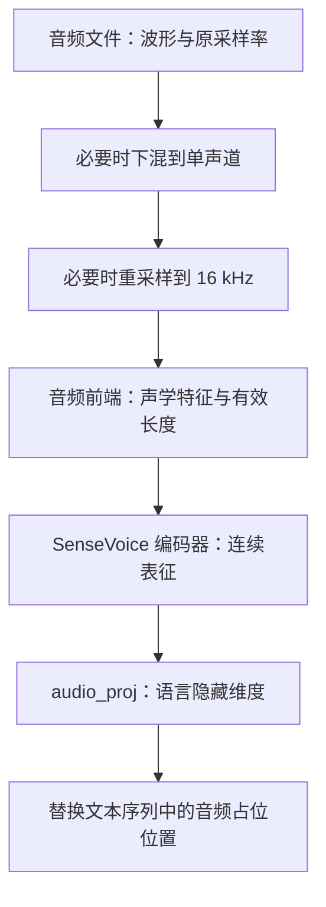
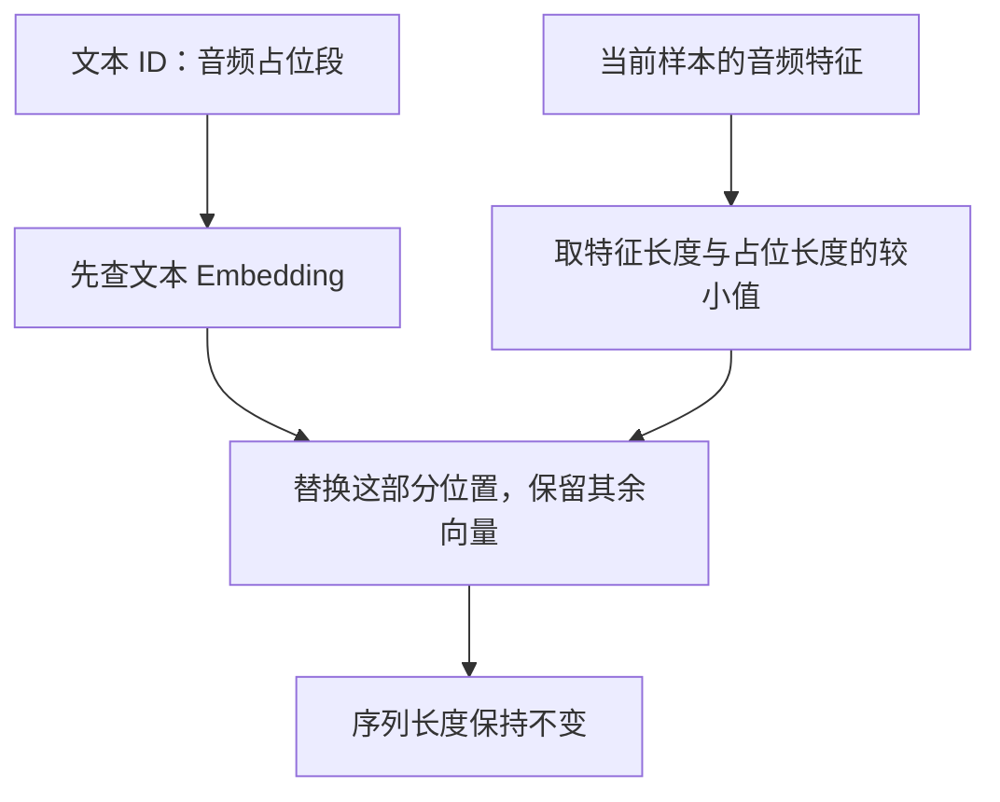

# 第 16 章 音频入门与特征注入

图片可以画成网格，声音则是一条随时间变化的信号。进入语音模型之前，先把三件事分开：
波形采样点、声学特征帧、生成用的离散码本编号。它们都带时间维，但数量和含义不同。
如果把“16 kHz 音频”理解成每秒 16000 个语言 token，后面的全部对齐都会出错。

本章从一个短音调开始，追到 MiniMind-O 的输入特征注入。
音频输出和 Mimi 码本在第 18 章展开；这里先回答“听到的信号怎样进入语言主干”。

**主线必读：** 采样点、采样率、特征帧和占位符。先跟随本章的小输入，再对照图和源码。

**进阶选读：** 冻结模块的注册方式与增强边界；第一次阅读可先掌握输入输出契约。

**需要额外设备/权重：** SenseVoice 权重及真实语音识别评估。本章 CPU 实验只支持明确列出的机制结论。

## 16.1 采样率告诉我们一秒有多少采样点

数字波形记录离散时刻的振幅。采样率 $f_s$ 的单位是每秒采样点数，
若音频时长为 $T$ 秒，样本数为 $N_s$，则：

$$
T=\frac{N_s}{f_s},\qquad \Delta t=\frac1{f_s}.
$$

例如 16 kHz 表示每秒 16000 点，1600 点对应 0.1 秒。
立体声还多一个通道轴，常见读入形状为 `(N_s,2)`；不是时间长度变成两倍。
若使用 16 位整数 PCM，单声道每个采样点占 2 字节，16 kHz 一秒原始样本约占 32000 字节，另有文件头等开销。

一个便于观察的教学波形是：

$$
x[n]=A\sin\left(2\pi f_0\frac{n}{f_s}\right).
$$

$A$ 是振幅，$f_0$ 是音调频率，n 是采样索引。
本章用 440 Hz 的短音调，只为验证形状和重采样，不拿它代替人类语音测试。

## 16.2 重采样不是只改一个文件标签

如果把 8000 个采样点直接标成 16 kHz 播放，时长就从 1 秒变成 0.5 秒，音调也会变化。
正确重采样需要生成另一套采样点，让相同时间范围按新的采样率表示。
本项目 `OmniDataset.process_audio` 先读波形，必要时将双声道求均值，再用 librosa 转成 16 kHz。



图 16-1：音频输入的主线。先看采样率转换，再看前端和编码器，最后才进入语言模型。
每个箭头可能改变轴长度或数值含义，不能只把所有中间变量都叫“音频 tensor”。
双声道求均值是一种下混方式，若两路相位相反，还可能相互抵消，实际数据应检查。

源码入口：MiniMind-O 的
[dataset/omni_dataset.py](https://github.com/jingyaogong/minimind-o/blob/ccab6d98520ac5ac5d7583a3fa21a65105137e28/dataset/omni_dataset.py)
与 [model/model_omni.py](https://github.com/jingyaogong/minimind-o/blob/ccab6d98520ac5ac5d7583a3fa21a65105137e28/model/model_omni.py)。

## 16.3 声学特征帧不是波形采样点

音频前端将短时间窗口转换成声学特征，之后编码器继续提取表征。
本地数据代码按 SenseVoice 前端约定使用 560 维特征，编码器输出的默认维度是 512，
audio_proj 再映到语言隐藏维度。560、512、768 是不同阶段的维度，不能随手互换。

| 对象 | 常见形状 | 每项表示什么 |
|---|---|---|
| 单声道波形 | `(N_s,)` | 振幅采样点 |
| 前端特征 | `(T_f,560)` | 按时间组织的声学描述 |
| 编码器表征 | `(T_e,512)` | 编码后的连续向量 |
| 注入特征 | `(T_e,D)` | 语言主干可消费的向量 |

具体帧率与长度变化取决于前端和编码器配置，不能用波形采样率直接代替。
`SenseVoiceAudioProcessor` 根据前端返回的 flen 构造有效位置 mask。
因此变量或注释写“encoder 输出帧数”时，也要检查这个长度到底在哪一步产生。
当前 `MiniMindOmni.encode_audio_inputs` 写的是 `emb, _ = self.audio_encoder(...)`，
丢弃了编码器返回的长度，再按输入的 `valid_lens` 与 `emb.size(1)` 的较小值裁剪（下限为 1）。
补充实验让替代编码器返回有效长度 1、输入长度为 3，结果仍投影 3 帧。
这证明当前接口使用哪份长度，不证明真实 SenseVoice 的长度错误；若换成改变帧率的编码器，
必须重新核对两种长度的单位，不能假定输出长度会被自动采用。

另一个细节是：这个 processor 虽接收 `sampling_rate` 参数，函数体并没有自行重采样。
本章实际检查了这一点；重采样发生在数据加载或调用者准备输入的路径中，不能只改实参就假设完成了转换。

## 16.4 冻结编码器与训练连接层

`load_sensevoice` 从外部模型取出 encoder 和 frontend，冻结编码器参数。
`encode_audio_inputs` 在 no_grad 中调用 encoder，但随后在可求导的 audio_proj 上计算，
从而可以训练输入连接层。它和视觉篇“冻结编码器但训练 projector”的思想相通。

在当前模型构造函数中，编码器与处理器通过 `object.__setattr__` 挂到模型，未按普通子模块方式注册。
所以参数统计、state_dict 和递归 `.to(...)` 不能盲目假定包含它们；训练入口会显式把外部编码器移到设备上。
这些处理是工程组织方式，不代表外部模块不占内存或不需要加载。

当前函数还用特征张量是否全零区分 dummy 样本，并在混合 batch 中保留对应位置的 None。
这里检查的是前端特征，不是一个通用的“静音检测器”；真实静音经过声学前端后也不必全为零。

## 16.5 音频占位符与声学码本不是同一套 ID

文本序列中的 `<|audio_pad|>` 在当前 tokenizer 里使用 ID 16。
Talker 音频通道的 pad 则是 2049，属于另一套声学词表。
它们名字接近，却不能直接拿来相互索引。前者预留连续特征注入位置，后者表示声学生成通道的填充状态。



图 16-2：当前音频注入的边界处理。先定位第一个连续占位段，再看实际替换多少向量。
若特征比占位段短，剩余位置保留原来的查表向量；这不等于已经补出了缺少的音频特征。
同一样本的特征在此路径中消费一次，不能自动表示任意多个独立音频片段。

与第 14 章的视觉拼接边界不同，`inject_audio_features` 按实际注入长度保留尾部，因此保持原总长度。
函数能返回同样 shape，只能证明形状没变，仍需检查占位长度是否与有效音频相匹配。

## 16.6 数据增强也要回到真实运算

`load_audio_inputs` 在重采样后调用波形和特征增强，包括变速、加噪、缩放、时间遮蔽和频率遮蔽。
其中以重采样点数改变速度的写法也会影响音调，不能描述为天然保音高的 time-stretch。
源码还累积随机噪声再归一化添加；注释中的噪声名称不代替对频谱特性的验证。

调试时先关闭或固定随机性，确认干净路径的长度和标签，再检查增强后的结果。
若同时改变时长、占位长度和监督标签，却只打印一个 loss，往往难以定位错位从哪里开始。

## 16.7 实验与自检

使用音频环境运行：

```bash
.venv-omni/bin/python experiments/ch16_audio_input.py
```

实验实际加载 8 kHz、800 点的双声道 WAV，得到 16 kHz、1600 点的单声道输入。
前端用明确的合成输出，编码器用小 Linear 替代 SenseVoice；真实 wrapper、重采样、投影和注入代码仍被执行。
得到 `(4,560)` 特征及有效长度 3，编码后注入 `(3,32)`，dummy 行和未覆盖占位均被保留。
projector 有梯度，冻结编码器没有梯度。结论不包含真实语音理解或识别质量。

1. 1600 个采样点一定是一秒吗？
2. 给 processor 传 sampling_rate=8000，是否代表它自动转成 16 kHz？
3. 特征维度 560 与编码器维度 512 是否矛盾？
4. 文本 audio_pad ID 与音频通道 pad ID 能否互换？
5. 注入后 shape 相同，是否保证音频长度已经正确对齐？

参考解释：第一题还需采样率：1600 点在 16 kHz 下是 0.1 秒，在 8 kHz 下是 0.2 秒。第二题 processor 内部没有重采样运算，实参不能替代调用者对波形的转换。第三题 560 是前端特征宽度，512 是编码器表征宽度，两次变换的对象不同。

第四题文本音频占位符与声学 pad 分属不同词表，不能互换索引。第五题例如有五个占位、只有三帧特征时，代码可替换前三个并保留后两个原向量，长度未变却仍需检查是否符合预期。

可选练习：缩短合成特征长度，检查哪些占位仍保留原向量，再解释这个结果对数据检查的意义。
