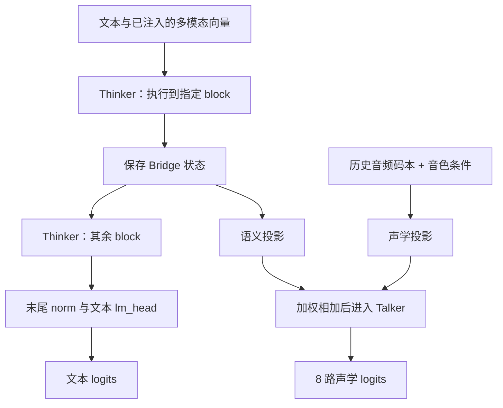
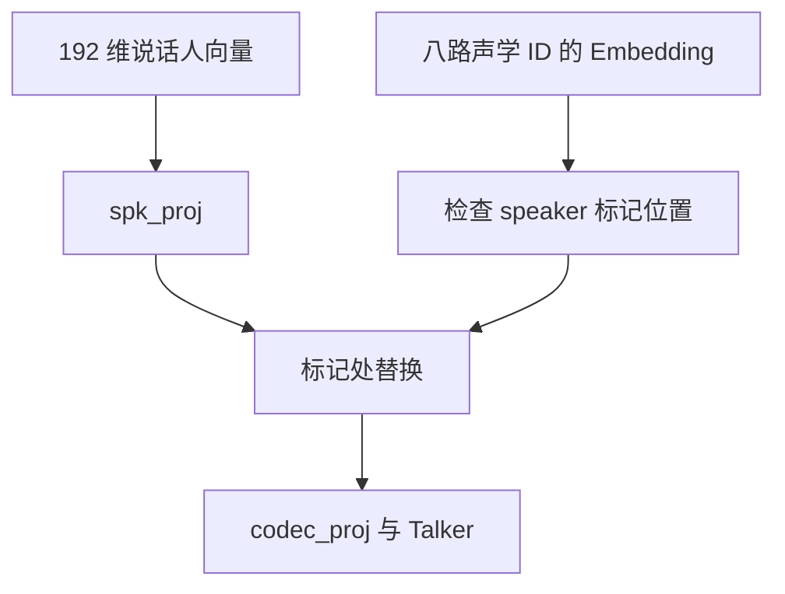

# 第 17 章 Thinker、Bridge 与 Talker

模型既要输出文字，又要输出声音，两者不必共用最后一个预测头。
MiniMind-O 保留语言主干作为 Thinker，另建 Talker 处理声学码本。
Thinker 的中间状态通过 Bridge 提供条件，Talker 再结合历史音频与说话人信息形成声学预测。

这些名字帮助理解职责，不表示模型真的拥有两个独立的人类心智。
本章沿实际张量和梯度解释它们怎样连接，尤其区分“声音输入影响语言”与“输出音频历史影响 Talker”。

**主线必读：** Thinker/Bridge/Talker 的数据流与条件。先跟随本章的小输入，再对照图和源码。

**进阶选读：** 缓存切分、Bridge 索引和分支梯度；第一次阅读可先掌握输入输出契约。

**需要额外设备/权重：** 预训练语音权重与音色质量测试。本章 CPU 实验只支持明确列出的机制结论。

## 17.1 两条路径共享什么，又各自计算什么

`thinker` 是 `self.model` 的别名，不是额外复制的一套语言参数。
Thinker 处理文本 Embedding 以及前面注入的音频/视觉特征，输出文本 logits。
Talker 则有自己的 block、norm、声学 Embedding 和八路输出头。

图 17-1：双路径的连接。先在 Bridge 处停一下：保存的同一状态分给后续 Thinker 和 Talker，
后续 Thinker 的计算结果不再回填这份 Bridge。箭头表示前向数据依赖；再沿每条路径找各自输出。
图中的历史音频是待生成语音的离散历史，不是第 16 章送入 SenseVoice 的用户波形。
输入音频可影响 Thinker；输出声学历史在当前 forward 中则进入 Talker 路径。

源码在 MiniMind-O
[model/model_omni.py](https://github.com/jingyaogong/minimind-o/blob/b5d1bc11ece8de17404cbc034c3e09718d0fecdf/model/model_omni.py)
的 `MiniMindOmni.__init__`、`forward`、`TalkerModule` 与 `OmniConfig`。

## 17.2 Bridge 的位置要按索引数

配置默认 `bridge_layer=num_hidden_layers//2-1`。
8 个 Thinker block 时得到 index 3，即第 4 个 block 执行后，不能写成第 3 个 block 后。
循环在匹配的 i 上保存当前 hidden_states，最后的文本 norm 并不把这个保存值替换成顶层结果。

选择中间层可能有设计动机，但“这个位置最适合语音”需要相应消融证据，不能只由层号推出。
本章实验用四层小模型，默认 index 1，并通过 hook 核对 Bridge 与第二个 block 输出一致。

还要检查自定义配置。循环开始前，`bridge_states` 取的是当时的 `hidden_states`：
已经过 Embedding 和 dropout，并且在 `start_pos==0` 时，音频或图像注入也已经写进这份状态。
若只设一层，默认公式给出 -1。循环里的 `i` 从 0 开始，没有一次相等，
Bridge 就停在进 block 之前的这份状态，而不是某个 block 的输出。
没有音频、图像，且模块处于 eval、dropout 不改变数值时，它会和 `embed_tokens` 的输出相同。
这只是这种调用下的观察，不表示索引未命中就会跳过注入。
实际改模型时应验证索引位于有效范围，不能只观察代码是否报错。

## 17.3 两种条件怎样合成 Talker 输入

Talker 先把八路音频 ID 转成一个同时间轴的向量序列，再对语义与声学条件分别投影。
主要组合可写成：

$$
h_{\mathrm{talker}}=
\alpha P_{\mathrm{text}}(h_{\mathrm{bridge}})
+\beta P_{\mathrm{audio}}(e_{\mathrm{audio}}).
$$

两个 $P$ 都包含自己的变换与归一化。系数 $\alpha,\beta$ 对应可学习的 `text_scale`、`audio_scale`，初始为 3 和 1。
这不是“文字永远比音频重要三倍”的保证：系数会训练，向量方向与分布也参与后续计算。

先把投影后的两个向量缩到两维来手算。若语义分支给出 `[1,2]`，声学分支给出 `[2,-1]`，
初始加权结果就是 `[3×1+2,3×2-1]=[5,5]`。这是解释相加运算的教学数值，
不是给定文字必然产生的隐藏状态；真实的两套投影还会随权重和输入改变。

设 Thinker 隐藏宽度为 $D$，Talker 隐藏宽度为 $D_a$，此处取完整序列 logits：

| 步骤 | 输入 | 输出 | 关键解释 |
|---|---|---|---|
| 提取文本与声学 ID | `(B,9,S)` | `(B,S)` 与 `(B,8,S)` | 前八路声学、最后一路文本 |
| Thinker 与 Bridge | `(B,S,D)` | `(B,S,D)` | 取指定 block 后状态，不增加时间轴 |
| 语义投影 | `(B,S,D)` | `(B,S,D_a)` | 将两条分支宽度对齐 |
| 声学查表与投影 | `(B,8,S)` | `(B,S,D_a)` | 八路查表后汇总，不拼成八倍序列 |
| 加权相加与 Talker | 两个 `(B,S,D_a)` | `(B,S,D_a)` | 同位置逐元素相加，再处理上下文 |
| 声学输出头 | `(B,S,D_a)` | 八个 `(B,S,V_a)` | 列表项是码本通道，最后一轴是声学词表 |

也可只传 `(B,S)` 文本 ID；`MiniMindOmni.forward` 会构造默认全 pad 的八路声学历史。
ID 是整数，隐藏向量是浮点数；两条投影的输出必须位于相同设备并有相容形状，才能相加。

| 条件 | 来自哪里 | 进入哪一路 |
|---|---|---|
| 输入音频特征 | 前端、SenseVoice、audio_proj | 注入 Thinker 输入 |
| Bridge 状态 | 指定 Thinker block 输出 | 投影后作为 Talker 语义条件 |
| 输出音频历史 | 八路声学 ID | TalkerEmbedding 与声学投影 |
| 说话人向量 | 预先准备的音色特征 | 在指定声学位置替换并进入 Talker |

本章实测只改变输出音频历史时，文本 logits 不变、声学 logits 改变。
这项结论针对当前 forward 的分支，不等于真实多模态交互中所有音频都与文本生成无关。

## 17.4 音色不是每个位置都无条件相加

配置默认说话人向量为 192 维。`spk_proj` 把它映到 Talker 隐藏维度，
但当前 forward 只在音频第 0 通道等于 audio_spk_token 的位置，用投影值替换原声学 Embedding。
随后再进入 codec_proj 与前面的加权合成。

图 17-2：说话人条件的注入位置。先找到 marker，再看替换的是哪一段向量。
只提供 spk_emb 而没有相应标记，并不保证它改变输出。
实验验证了有标记时声学 logits 变化，无标记时更换说话人向量不改变该路径输出。

参考音频码本与说话人向量也是不同条件：前者是音频内容的离散序列，后者是一条音色特征向量。
生成器会在 prompt 对应的声学缓冲里放入参考码本及 speaker 标记；具体布局在第 18 章继续追踪。

## 17.5 两套缓存按顺序装在一个列表里

当前 past_key_values 先放 Thinker 各层，再放 Talker 各层。
forward 按 `n_thinker` 切分列表，分别传给两条路径，最后按同样顺序返回。
这不是把两个网络的 K/V 头直接拼成一个注意力头集合。

本章四层 Thinker、两层 Talker 产生 6 个缓存条目，decode 后每项长度同步增长。
对相同文本与默认声学 pad 历史，缓存与完整前向的文本和八路音频 logits 均在容差内一致。
跨请求或跨不同音频历史复用缓存则需要另外的契约，不能仅靠列表长度正确就判断可以复用。

Talker 的配置由自己的 MiniMindConfig 创建，并不自动继承 Thinker 的全部自定义超参。
修改头数、前馈宽度或迁移初始化权重时，必须核对实际两边配置；第 19 章会检查权重复制条件。

## 17.6 梯度从 Bridge 分叉

若只对声学 logits 计算损失，梯度可沿 Bridge 回到较早的 Thinker block，
但不会因为后面的 Thinker block 也执行过，就自动传到它们。
执行过某段计算与该计算参与当前损失的图，是两回事。

实验单独反向一项声学目标，较早 block 有梯度、Bridge 之后的最后 block 无梯度。
正常联合训练还包含文本损失，会提供另一条路径；不能把单目标实验描述成整个训练始终不更新后半主干。
共享 Embedding/输出权重还可能接收来自其他使用位置的梯度，判断时应按具体参数路径检查。

## 17.7 实验与自检

运行 `.venv-omni/bin/python experiments/ch17_thinker_talker.py`。
它使用真实随机小 Omni，不加载外部编码器，检查别名、Bridge hook、两类条件、双缓存与分支梯度。
另构造一层、且不提供音频和图像的配置，核对默认索引 -1 时 Bridge 与 `embed_tokens` 输出一致。
若同一次前向带有注入，未命中的 Bridge 保留的是注入之后的隐藏状态。
这些结果证明结构关系，不报告语音自然度、音色相似度或端到端响应速度。

1. thinker 是否是 model 的第二份参数副本？
2. 默认 8 层、bridge_layer=3 对应第几个 block 后？
3. 输出音频历史与用户音频输入是否同一对象？
4. 提供 spk_emb 但没有 speaker 标记，一定改变输出吗？
5. 后半 Thinker 执行过，就一定受到纯音频损失更新吗？

参考解释：第一题 thinker 与 model 引用同一个主干对象，别名不会复制参数。第二题索引从 0 数，3 对应第 4 个 block 执行后。第三题用户波形经编码器变成连续输入特征；输出音频历史则是 Talker 的离散码本 ID，两者入口不同。

第四题 spk_emb 只在第 0 声学通道含 speaker 标记的位置替换历史向量，没有标记就没有这次替换。第五题纯音频目标从 Bridge 分叉；若它不依赖后半 Thinker 的输出，这些层即使前向执行过，也不会从该目标获得梯度。

可选练习：显式改变合法 Bridge 索引，用 hook 与梯度检查同时验证其位置。
