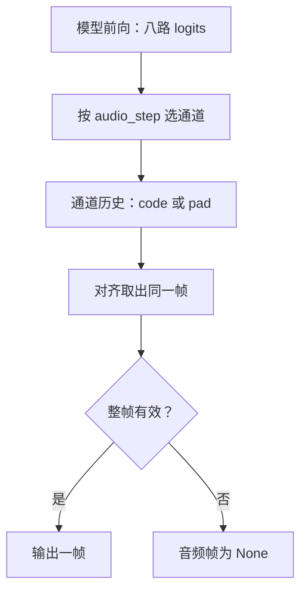

# 第 18 章 八路码本与时间对齐

Talker 输出的不是直接可播放的声波，而是若干离散编号。Mimi codec 再把这些编号还原成波形。
最容易误读的地方在于：八路头一次计算，并不表示八个连续时间点同时完成。
本项目的八路分别属于码本通道，训练和生成还通过 delay pattern 将它们错开。

本章用三帧、八路的人工编号追踪整条链，先看数据怎样排，再看生成怎样收集，最后检查波形长度。
人工编号和随机 codec 只用于验证接口与时序，不代表有意义的声音。

**主线必读：** 码本通道、延迟网格和三帧手算。先跟随本章的小输入，再对照图和源码。

**进阶选读：** 思考模式、停止位置和生成器上下文；第一次阅读可先掌握输入输出契约。

**需要额外设备/权重：** 预训练 Mimi 与实际音质试听。本章 CPU 实验只支持明确列出的机制结论。

## 18.1 一个声学帧可以有多个码本编号

神经音频 codec 用学习到的离散表示压缩声音。多个码本可共同描述同一时间帧，
不能把某一路简单称为“一个单词”或“一个音素”。Mimi 的内部还包含神经网络和量化结构，
MiniMind-O 主要学习如何预测它所需的编号接口。

本项目使用 8 路、每秒 12.5 帧、输出采样率 24 kHz 的约定，一帧对应：

$$
\begin{aligned}
&\frac{1}{12.5}=0.08\ \mathrm{s}\\
&\frac{24000}{12.5}=1920\ \mathrm{samples}.
\end{aligned}
$$

因此 3 帧对应 0.24 秒、5760 个单声道采样点。这里的帧率与第 16 章的输入声学特征帧率不同。
本项目的八路接口也不表示所有 Mimi 配置只有八个码本，必须看加载配置与实际选择。

真实 codec 编号范围按 2048 个值计算，若仅按每个值 11 bit 固定打包，
8×12.5×11=1100 bit/s。这个算式只计编号，不含特殊标记、协议或文件头，不能冒充实际文件码率或音质结果。

## 18.2 共享主体与八路 adapter

`TalkerHead` 先计算一份共享 base logits，再分别加上八个 adapter 的输出。
每个 adapter 含 Linear、GELU、Linear，因此不是第 10 章那种可直接线性合并的 LoRA 增量。
其主要关系为：

$$
z_i(h)=W_bh+F_i(h),\qquad i=0,\ldots,7.
$$

这个式子使用列向量表示输出头关系，$F_i$ 是包含非线性的第 i 路变换。
实际输出为八个 `(B,S,V_a)` 张量组成的列表；默认音频词表宽度 $V_a=2112$，包括 codec 值之外的预留标记。

反方向的 `TalkerEmbedding` 对每一路查共享表、加对应 adapter，再把八路结果相加除以 8。
某个模型位置上这八路历史来自哪个声学时间，取决于 delay 布局；不能因它们被一起平均就说它们总是同一帧。

源码锚点：MiniMind-O
[model/model_omni.py](https://github.com/jingyaogong/minimind-o/blob/b5d1bc11ece8de17404cbc034c3e09718d0fecdf/model/model_omni.py)
中的 `TalkerHead`、`TalkerEmbedding` 和 `stream_generate`。

## 18.3 Dataset 先延迟各通道，再统一 shift

设源码最终算出的声学起点为 $a$，第 $i$ 路第 $t$ 帧编号为 $c_{i,t}$。
没有思考段时，$a$ 是最后一个可见 assistant 段的正文起点；若在该起点后前 50 个位置内
找到 `</think>\n\n` 的起始位置，则将 $a$ 移到此结束序列之后。
这个有限搜索并不保证跳过任意长的思考内容：若结束标记在搜索范围之外，声学起点仍在思考段开头。
推理循环则等待实际生成的结束序列，二者不能无条件视为同一种对齐规则。
原始声学布局将它放在：

$$
\operatorname{position}(c_{i,t})=a+i+1+t.
$$

下面只画前三路，实际八路遵循同一规律。pad 是音频通道填充，不是文本词表的 PAD：

| 原始位置 | 通道 0 | 通道 1 | 通道 2 |
|---|---|---|---|
| a | pad | pad | pad |
| a+1 | $c_{0,0}$ | pad | pad |
| a+2 | $c_{0,1}$ | $c_{1,0}$ | pad |
| a+3 | $c_{0,2}$ | $c_{1,1}$ | $c_{2,0}$ |
| a+4 | stop | $c_{1,2}$ | $c_{2,1}$ |

随后 Dataset 把九通道输入取 `[:-1]`，把文本和音频标签取 `[1:]`。
因此模型输出位置 a+i 已经对应第 i 路第一帧目标，不能在训练器里再 shift 一次。
九通道是前八路音频加最后一路文本；标签还有各自的有效范围。

例如取 $a=20$：第 0 路首帧放在原序列 21，shift 后成为输出位置 20 的目标；
第 7 路首帧放在原序列 28，shift 后成为输出位置 27 的目标。
两者描述同一个声学帧，却在不同模型位置受监督。看网格时先沿一列追一路码本的时间，
再沿斜线寻找同一帧的八个编号，就能区分“模型位置”和“声学帧”。

实现位于
[dataset/omni_dataset.py](https://github.com/jingyaogong/minimind-o/blob/b5d1bc11ece8de17404cbc034c3e09718d0fecdf/dataset/omni_dataset.py)
的 `OmniDataset.__getitem__`。源码中“7 层 audio targets”的注释与实际 `range(8)` 不一致，书中以执行代码为准。

## 18.4 生成时把错开的预测重新拼成同一帧

普通生成从 step=0 开始，代码定义 `audio_step=step-1`。
第 i 路在 audio_step 至少为 i 时才开始从本路 logits 采样声学编号，停止标记也可能被采出；之前往历史里放 pad。
所以第一路先开始，最后一路要等到更后面的迭代。



图 18-1：八路预测到一个完整帧。先看每路是否到达开始时刻，再看历史索引怎样对齐。
生成器用 `audio_codes[i][step-7+i]` 收集一帧；这些值在不同迭代产生，却表示同一个声学帧。
“整帧有效”指八路都在各自停止位置之前；任一路已到达或越过停止位置时，本步不返回音频帧。
是否还返回文字或结束循环，另看 18.5 节。
这与“一次生成八个未来文本 token”是不同概念。

开启思考模式时，生成器等待匹配 think_end_ids，再把声学起点移动到相应位置。
若关闭标记在第 k 步完整出现，代码设置 think_end_step=k+2，再计算新的 audio_step。
因此提示模板与 open_thinking 参数要一起核对，不能只改一处就假设时序同步。

## 18.5 文字结束和音频结束不是一个条件

每一轮都先对文本 logits 做 `multinomial`。文本 token 可能被改写之后，才采样八路声学编号；两者都在把 token 写回序列之前。
`text_finished` 并不是在采到 EOS 的瞬间、声学采样之前就变成真。
采到 EOS 的那一轮开始时标志仍为假，所以不会改写这个 token，也不会在写回序列前 `break`。
这一轮先把 EOS 接到 `input_ids` 并 `yield` 文本，`yield` 之后才执行：

```python
if text_token == eos_token_id:
    text_finished = True
```

下一轮开始时标志已经为真。源码仍会先采样一次文本，再立刻丢掉结果：

```python
if text_finished:
    text_token = args.get('enter_token_id', 201) if first_finished else args.get('pad_token_id', 0)
    first_finished = False
```

`first_finished` 初始为真，所以文本结束后第一次进入这个分支时，token 被改成默认 201，此后改成默认 0。
`eval_omni.py` 和 `webui/web_demo.py` 调用 `generate` 时都没有传入这两个参数，因此用的就是默认整数。
这里不是 `self.tokenizer.pad_token_id`。所带 tokenizer 的 pad 恰好也是 0（`<|endoftext|>`），
但生成器并不读取 tokenizer，两处不能当成同一次查找。

声学停止位置在改写文本 token 之后、写回序列之前更新。
只有本轮开始时文本已经结束，并且八路都已记下停止位置，才在写回前退出：

```python
if text_finished and all(audio_stop_pos[i] is not None for i in range(8)):
    break
```

因此采到 EOS 的那一轮即使八路刚好都停下，也不会 `break`：标志要等 `yield` 之后才变真。
紧接着的下一轮是第一次进入改写分支，`first_finished` 仍为真，来不及写回的是默认 201。
这一轮若八路已经齐了，201 不会接到 `input_ids` 上，这一步也不再 `yield`，循环也还不会改写成 0。
默认 0 只出现在更后面的已结束轮；八路若是在那些轮才齐，写回前丢掉的才是 0。
若这一轮还没齐，改写后的 token 会写回序列，对外 `yield` 的文本是 `None`，音频帧仍按 18.4 节返回。
循环还有一处长度出口：`while input_ids.shape[1] < start_pos + max_new_tokens`。
文本结束后是否继续，同时看这个长度上限和上面的 `break`，不是 Talker 另有一条“必须说完”的分支。

名字也要验证：当前默认 `enter_token_id` 是 201，但所带 tokenizer 的换行 ID 是 234。
实验发现 201 单独解码并不是换行，不能把变量名当作语义证明。
定制这一处时应从真实 tokenizer 获取对应 ID，并检验与训练序列的关系。

音频采样不使用文本的 `temperature`。当前循环把该路 logits 除以字面量 `0.2`，对这一路最近 3 个编号做系数 `1.05` 的重复惩罚，再在 `topk(50)` 里采样。这三个数写在 `stream_generate` 里，不是命令行参数。
代码把首次生成 `code >= 2048` 的位置记录为停止位置，因此判定范围比单独的 stop ID 2050 更宽。
一帧只有在八路都有效时才对外返回，不能把预留特殊值当作合法 Mimi code 解码。

## 18.6 参考音频与 speaker 位置

生成器将参考码本在 prompt 的声学缓冲末端右对齐，必要时截取尾部，
并在前面预留 speaker 标记位置。Dataset 也有参考码本和说话人向量的准备逻辑，
但它们是否启用、是否丢弃以及如何截断，都要按当前分支核对。

参考码本并不直接作为“应该生成的答案”参与全部音频 loss。
它提供条件，目标码本另按延迟规则放入受监督区域。
把 ref_codes、输入语音特征和目标 answer_audios 混成一个连续数组，会掩盖三者不同的用途。

## 18.7 生成器的返回值与梯度上下文

Omni 的 generate 不等于文本模型那个返回完整 ID 张量的接口。
`stream=True` 返回可迭代对象，每次 yield 为 `(text_ids, audio_frame)`：非空文本是截至当前的
累计生成前缀，非空音频是新的一帧八路编号。调用者应替换当前文本、追加音频帧；逐次拼接文本会重复内容。
`stream=False` 在函数内耗尽生成器，却只返回最后一次 yield，并未汇总前面的帧。
本章三帧脚本化输入下，最后返回的是 `(None, 最后一帧)`，此前的文本与前两帧音频都不能由它恢复。
`return_audio_codes` 控制帧是否返回，也不自动关闭 Talker 计算。

当前 `stream_generate` 的音频缓冲批大小写死为 1，且文本采样使用第 0 行和 `.item()`。
因此本章生成接口只验证单样本；`forward` 能处理 batch 不能推出这个生成循环也支持批量。

还有一个 Python 细节：装饰器包住返回生成器的函数，不等于包住未来对生成器的迭代。
本章探针观察到，没有外层上下文时，`stream=True` 的实际迭代可处在梯度启用状态。
`stream=False` 在带装饰器的函数内部消费生成器，探针所见则是关闭梯度；要区分这两条调用路径。
上游 eval_sample 和 Web 的 run_generate 在实际迭代期间使用 no_grad，正是需要追到调用者的原因。

## 18.8 实验与自检

运行 `.venv-omni/bin/python experiments/ch18_audio_codes.py`。
真实 Dataset 得到 `(9,127)` 输入，各路首标签位置依次为 20～27。
脚本化 logits 驱动真实生成循环，普通和思考两种模式都重建出同样三帧，且文字结束后仍有音频帧输出。
随后用真实随机小 Mimi 解码，得到 `(1,1,5760)` 有限波形，即 0.24 秒。
这只验证时序和接口，不评价随机声音的语义或音质。

1. 八路头分别对应八个连续时间点吗？
2. Dataset 已经 shift 后，训练器还应再做一次吗？
3. 文本 EOS 是否必然结束全部声学生成？
4. 返回生成器的函数被 inference_mode 装饰，是否足以保证迭代也关闭梯度？
5. 三帧、12.5 Hz、24 kHz 对应多少采样点？

参考解释：第一题八路是共同描述声音的码本通道；因延迟布局，同一次前向的各路目标还可能属于不同帧。第二题再 shift 会使监督比约定多错一位，应在训练器中直接对齐现有 logits 和 labels。第三题采到 EOS 的那一轮要等 yield 之后才把 `text_finished` 设为真，生成器仍可能继续产出音频帧；是否退出还要看八路停止位置是否都已记下。

第四题生成器的函数体在迭代时才执行，装饰创建它的外层函数不保证覆盖未来迭代；应核对实际消费循环的 no_grad 上下文。第五题三帧的时长是 3 除以 12.5，即 0.24 秒，再乘每秒 24000 点，得到 5760 点。

可选练习：将人工帧数改为 4，预测各路停止位置和解码时长，再运行核对。
