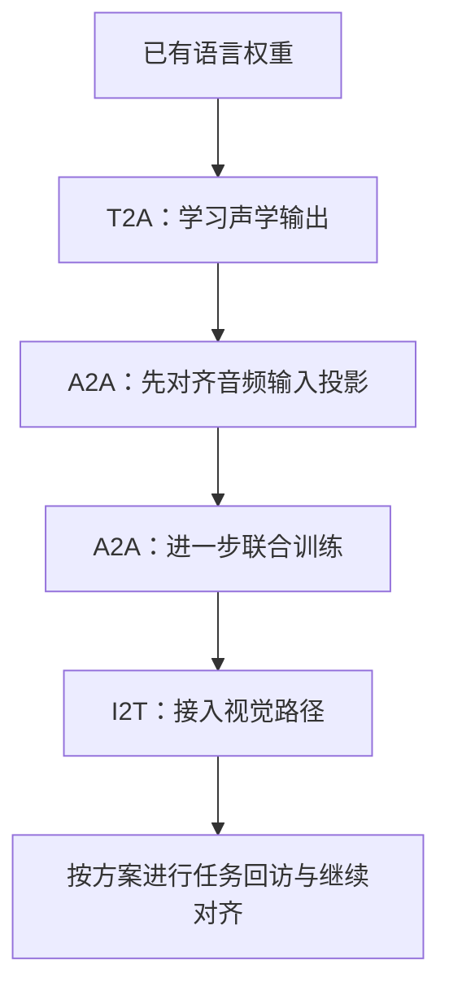
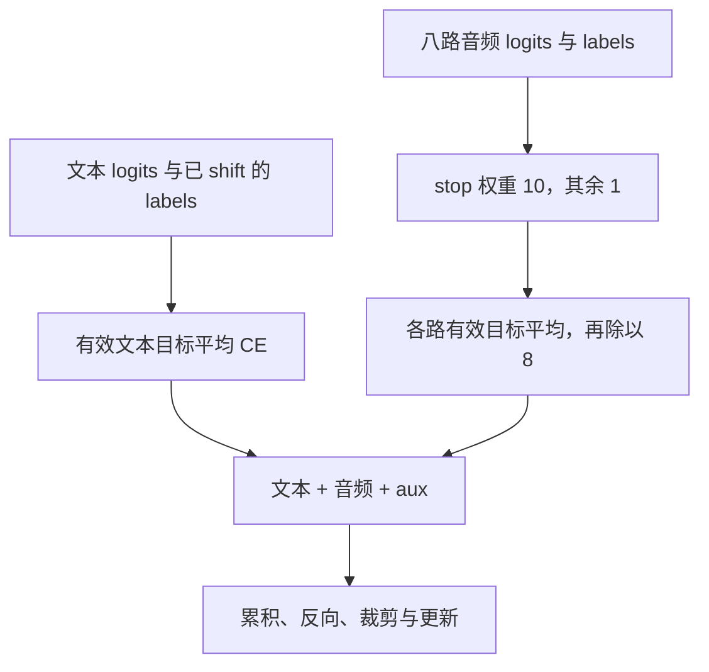

# 第 19 章 Omni 训练流水线

> 迁移候选：本章源码链接已更新，静态差异已核对；既有数值与实验记录仍属于旧基线，不表示新版已重验。
> 新版 PyTorch 实验与独立复核待完成，暂标 stale，不可直接用于新版出版验收。详见[迁移记录](https://github.com/cluster1900/minimind_reader/blob/main/meta/upstream-impact-2026-10-18.md)。

模型能够前向，还要把数据任务、可训练模块和损失连接起来。
T2A、A2A、I2T 描述不同输入输出任务，而 `mode`、`freeze_backbone` 控制参数是否更新。
它们不是同一个开关，混在一起就很容易出现“损失在变化，想训练的模块却没有有效信号”。

本章先追数据与权重，再拆开文本和八路音频损失。
实验使用真实初始化、Dataset 相关方法和源代码计算块，不把小张量测试当成发布模型训练复现。

**主线必读：** 任务数据、冻结模式和两类损失。先跟随本章的小输入，再对照图和源码。

**进阶选读：** 初始化复制、扰动、批处理和恢复；第一次阅读可先掌握输入输出契约。

**需要额外设备/权重：** 完整 T2A/A2A/I2T 训练与评估。本章 CPU 实验只支持明确列出的机制结论。

## 19.1 三种任务不等于只有三次固定训练

T2A 是文本到音频，A2A 是音频到音频，I2T 是图像到文本。
它们逐步接入不同能力，但真实 `trainer/train.sh` 的 full 示例还包含投影层单独对齐、联合训练及任务回访。
mini 路线又有所不同，不能只用三个箭头代替全部命令和初始化关系。



图 19-1：能力接入的阅读主线。先看新能力在哪一步进入，再回到脚本检查具体数据、mode、学习率和权重来源。
图中的回访不是固定次数承诺，full 和 mini 示例应分别阅读。
脚本注释中的耗时属于特定条件说明，本书没有把它们改写成任意硬件上的保证。

源码索引为 MiniMind-O 的
[trainer/train_sft_omni.py](https://github.com/jingyaogong/minimind-o/blob/f900448c608318c53314ebf8a947ab05cd8c038e/trainer/train_sft_omni.py)
和 [trainer/train.sh](https://github.com/jingyaogong/minimind-o/blob/f900448c608318c53314ebf8a947ab05cd8c038e/trainer/train.sh)。
默认 data_path 与示例中显式指定的文件名也可能不同，运行前应核对实际数据，而不是只复制默认参数。

## 19.2 Dataset 选择的是哪一轮和哪份模态数据

`OmniDataset` 可拼接多个 Parquet 文件，并可能随机截到某一轮 assistant。
它只保留 token 截断后最后一个可见 assistant 段的文本监督；音频目标却先按截断前所选对话的
assistant 数量索引 `answer_audios`。正常完整样本里二者对应同一轮，这与文本 SFT 监督多个回答不同。
若模板展开、模态占位或 `max_length` 截断使最后一轮消失，当前代码没有额外保证这两次“最后一个”仍对应。
应同时检查保留下来的角色边界、有效标签和音频索引，不能把随机截轮与 token 截断当作同一个操作。

输入音频按当前 user 数量选择对应 question_audios；当前图像代码却取 image_bytes 的第一项，
不能因为旁边注释写“最后 user 图像”就推断它按同样索引取图。
这条路径没有逐一加载每轮历史音频或每幅历史图片；保留历史对话也不等于保留全部模态内容。
参考音频和说话人向量另有字段，它们提供条件，不等于目标音频标签。

| 数据对象 | 用途 | 需要核对 |
|---|---|---|
| conversations | 文本、角色、预留位置 | 截断后最后回答与有效目标 |
| question_audios | 输入波形 | 与当前 user 的对应关系 |
| answer_audios | 输出 codec 编号 | 帧优先排列、八路拆分与 stop |
| ref_audios / spk_emb | 参考声音与音色条件 | 是否启用、截断和位置预留 |
| image_bytes | 输入图像 | 实际选取索引与占位段 |

源码在 [dataset/omni_dataset.py](https://github.com/jingyaogong/minimind-o/blob/f900448c608318c53314ebf8a947ab05cd8c038e/dataset/omni_dataset.py)。
最后返回九通道输入、文本标签、八路音频标签、输入特征和其他条件，shift 已在这里完成。

## 19.3 “scheduled sampling”要看替换值从哪里来

[Scheduled Sampling 原论文（Bengio 等，2015）](https://arxiv.org/abs/1506.03099v3)
逐步增加用模型历史预测替换真实 token 的概率。
MiniMind-O 的随机替换实际发生在 `dataset/omni_dataset.py` 的
`OmniDataset.apply_scheduled_sampling`；`train_sft_omni.py` 构造 Dataset，由取样过程执行它。
构造时的默认概率是 `0.05`；不大于 0 就原样返回。`__getitem__` 在九通道输入和标签都完成 shift 之后才调用它。概率为正时，节选为：

```python
audio_mask = (audio_labels != -100).any(dim=0) & (torch.rand(input_ids.size(1)) < self.scheduled_sampling_prob)
for i in range(8):
    input_ids[i] = torch.where(audio_mask, torch.randint(0, self.audio_vocab_size, input_ids[i].shape), input_ids[i])
text_mask = (text_labels != -100) & (input_ids[8] != self.image_token_id) & (torch.rand(input_ids.size(1)) < self.scheduled_sampling_prob)
input_ids[8] = torch.where(text_mask, torch.randint(0, self.text_vocab_size, input_ids[8].shape), input_ids[8])
```

九通道输入的前八路是音频，下标 8 是文本。
音频掩码先看这一列是否至少有一路标签不是 -100，再与一次随机比较相与；命中的列上，八路各自换成 `[0, audio_vocab_size)` 的均匀整数，八次 `randint` 互不共用。
文本掩码另抽一次随机数，还要求标签有效，且当前位置不是 `image_token_id`，替换范围是 `[0, text_vocab_size)`。
两边都不是从当前模型的 logits 里采样。
`text_vocab_size` 取的是 `len(tokenizer)`，不是模型配置里的 `vocab_size` 这个名字本身。
音频上界是 `audio_vocab_size`，默认 2112，所以随机整数可以落在 2048 及以上的特殊编号上，不只是 Mimi 的普通码。

函数文档字符串写的是“用随机值替代部分 GT，让模型学会从错误历史中恢复”。
这是作者注释里的意图，不是已经测过的鲁棒性结论，也不能把它写成经典算法的同一种运算。

训练脚本注释里的“保护图像/音频 token”还要对照这两行掩码。
文本侧明确排除的只有图像标记。实验把一个文本通道上的音频标记放进有效目标，它仍被随机 ID 换掉，没有同样的显式保护。
音频侧则是：标签有效的时间列会被换掉，并不是把音频 token 保护起来。
掩码检查的是 shift 后的目标，而被替换的是对应输入，因此也可能改到“第一个有效目标之前的输入”。
排除原有图像标记也不等于禁止随机抽中新的特殊 ID。定制模板时应核对替换前后的编号与位置，不能只读注释。

## 19.4 初始化 Talker 需要满足多项条件

`init_omni_model` 创建模型后加载指定权重，过滤部分 shape 不匹配项，再以 strict=False 加载。
如果不是 resume、两条分支隐藏维度相同、权重里没有 Talker 层且 Talker 层数为正，
代码尝试把 Thinker 最后的若干层复制给 Talker。

本章四层 Thinker、两层 Talker 的匹配小配置，实际将 layers[2:4] 复制到 Talker[0:2]，逐项权重检查一致。
但隐藏维度相同不保证头配置、前馈宽度与层数都兼容；尤其 Talker 有自己的配置来源。
读取成功、跳过不兼容键和完整初始化成功，也是不同层次，不能只看一条“已加载”日志。

实现位于
[trainer/trainer_utils.py](https://github.com/jingyaogong/minimind-o/blob/f900448c608318c53314ebf8a947ab05cd8c038e/trainer/trainer_utils.py)
的 `init_omni_model`。如果权重路径不存在，加载分支会直接跳过，模型仍可保持随机初始化，
相应的 Thinker→Talker 复制也不会在该分支执行。脚本能启动不能证明已有基座加载成功，必须核对文件与加载结果。

## 19.5 两种冻结参数的组合

`freeze_backbone` 只遍历 `model.model.parameters()`。`MiniMindOmni` 用 `object.__setattr__` 把 `self.thinker` 设成 `self.model` 的别名，所以这里改的是 Thinker 的词嵌入、各 block 和末尾 RMSNorm。挂在 `model.model` 上的 `lm_head` 别名没有注册成子模块，不在这次循环里；外层真正的 `lm_head`、Talker、`audio_proj` 和 `vision_proj` 也不在里面。
默认 `tie_word_embeddings=True` 时，外层 `lm_head.weight` 与 `embed_tokens.weight` 是同一参数，冻结词嵌入会把这块权重一起冻住。
随后 `mode` 才可能改全部已注册参数。两个参数都可以取值 `all`，含义并不相同：

| 设置 | 直接行为 |
|---|---|
| freeze_backbone=none | 不改这些参数的 `requires_grad` |
| freeze_backbone=all | 冻结上述 Thinker 主干参数；Talker 和两个 projector 保持进入该开关之前的状态 |
| freeze_backbone=last1 | 先同样冻结，再只把 `model.model.layers[-1]` 设回可训练 |
| mode=all | 不再改 `requires_grad`，保留 `freeze_backbone` 刚设好的状态 |
| mode=audio_proj | 全部已注册参数冻结后，只开放 audio_proj |
| mode=vision_proj | 全部已注册参数冻结后，只开放 vision_proj |

命令行帮助把 `freeze_backbone=all` 写成“只训练 audio 层”，把 `last1` 写成“只训练最后 1 层 + audio 层”，又把 `mode=all` 写成“全量训练”。这些是帮助字符串里的说法。实际范围以上表的 `requires_grad` 为准。

只训练 audio_proj 时，要有真正经过输入音频投影的任务数据。
若提供的任务只用文本条件生成声音，audio_proj 可能只有乘零的图连接，没有有效数据梯度。
视觉投影模式同理。应检查非零梯度和输入路径，而不是只检查参数名或 grad 是否为 None。

## 19.6 文本与音频损失怎样组合

文本 logits 和 labels 已对齐，训练器直接计算逐位置交叉熵，再按有效文本目标数平均。
音频侧逐头处理；普通有效目标权重为 1，硬编码 stop ID 2050 的权重为 10。

令 u 遍历批内位置，m 为有效 mask，$\ell_{i,u}$ 为第 i 路交叉熵，则：

$$
\begin{aligned}
&w_{i,u}=1+9\mathbf 1[y_{i,u}=2050]\\
&N_i=\sum_u m_{i,u}.
\end{aligned}
$$

$$
\mathcal L_{\mathrm{audio}}=
\frac18\sum_{i:N_i>0}
\frac{\sum_u m_{i,u}w_{i,u}\ell_{i,u}}{N_i+10^{-9}}.
$$

分母是有效目标数量，不是加权数量；而且最后固定除以 8，不是只对有目标的头求平均。
源码先做 `stop_mask = (target_flat == 2050).float()`，再乘 `1 + stop_mask * 9`。旁边没有注释说明为什么是 10。
本章实验在均匀 logits 下看到该位置的梯度范数约为普通目标的 10 倍，这只说明权重进了分子。
它不能单独证明生成时更少出现拖尾，也不能从第 18 章的停止条件推出“不加权就会爆出杂音”。
修改任务参与程度、stop 比例或码本数，会改变 loss 的量级，不能不加解释地横向比较。
总损失再加文本项及 aux_loss，并除以梯度累积步数。
文本项也用有效目标数加 `1e-9` 作分母；有限 logits 下，全 -100 的文本标签得到 0，
而不是第 06 章模型内置 mean 交叉熵的 NaN。八路音频都无目标时音频项也是 0，aux_loss 仍须单独看。
实验执行真实损失代码块复现了这两个零值，所以“loss 有限”不足以证明这批样本有任何有效监督。

先用两个相同的逐目标损失 2 来手算：一路中有普通目标和 stop 各一个，分子为 `2+10×2=22`，
有效数量是 2，忽略极小稳定项后得到 11。若其他七路没有目标，音频总项仍是 `11/8=1.375`。
若误用加权数量 11 作分母，就会得到完全不同的 2；这正是公式要明确分母的原因。



图 19-2：损失中的两层归约。先分开文本和音频，再看 stop 权重与八路平均。
这不是纯语言模型 NLL，不能把总 loss 的指数直接称为文本困惑度。
特殊 ID 在配置、Dataset、训练器和生成器中要一起核对，改一处不代表全部同步。

## 19.7 批处理与保存的边界

collate 会对有效音频特征按时间补齐；Dataset 在处理器存在而样本无该模态时，通常提供 dummy 张量以保留 batch 位置。
若自定义数据把其中一行改成 None，collate 会过滤它，但 audio_lens 仍保留原批大小，可能失去样本对应。
本章实验复现了音频批变成 1 行、长度表仍为 2 行的情况，不能把“支持变长”理解成任意混合 None 都正确。

`omni_checkpoint` 排除外部编码器并将保存的模型状态转为 CPU FP16，resume 也使用这份状态。
这与视觉篇 resume 保留原完整 state_dict 的行为不同。真实 dtype 和字段应逐仓库检查。
新基线将最后一批的尝试更新放到保存之前，删除循环外 flush，修复旧版末批保存落后于剩余梯度更新的顺序问题。
组内周期保存不含未提交梯度的限制仍然存在；末批修复不能代替精确恢复验证。

具体执行顺序是 `scaler.scale(loss).backward()` 累积梯度，达到累积边界或 `step == iters` 后先 unscale，
再裁剪、`scaler.step(optimizer)`、更新 scaler，最后清空梯度。每个小批的有效目标均值先除以累积步数，
因此不同小批目标数量不同时，它不是整组有效 token 的统一平均。
`omni_checkpoint` 的 resume 字典包含模型、optimizer、epoch、step、world_size、日志 ID，
本训练器还传入 scaler 状态；它没有保存所有随机数状态、DataLoader 顺序或尚未更新的 `.grad`。
读者可以加载模型与部分训练状态，但不能据此承诺从任意中断点逐步完全复现原轨迹。

## 19.8 实验与自检

运行 `.venv-omni/bin/python experiments/ch19_omni_training.py`。
实验验证真实初始化复制和冻结模式、执行原损失计算块、检查 collate、随机扰动及 checkpoint。
给定均匀 logits，文本三类 CE 为约 1.0986；仅第一音频头有两个目标且一个为 stop 时，
音频项约为 5.2631，stop 对应梯度范数约为普通项的 10 倍。
这些是目标算术与控制流验证，不是完整 T2A/A2A/I2T 训练或音质评价。

1. mode=all 是否总会重新开放此前冻结的 Thinker？
2. 当前 scheduled_sampling 替换为模型预测，还是随机 ID？
3. stop 权重为 10 时，分母是否也按加权数量计算？
4. 只有一个音频头有目标时，最后是否仍除以 8？
5. collate 支持变长，是否保证 None 与正常特征混合后仍保持批索引？

参考解释：第一题 mode=all 保留 freeze_backbone 先前设置的状态，不主动解冻。第二题当前函数用随机 ID 扰动历史，没有调用模型来取得替换预测。第三题 stop 只把分子中的对应 CE 放大 10 倍，分母仍数有效目标。

第四题最后固定除以 8；仅一路有监督时，不能按“有数据的头数”改成除以 1。第五题过滤 None 会压缩特征批索引，而长度表仍可能保留原样本位置，所以需要 dummy 或明确的索引映射来保持对应。

可选练习：改变合成样例的 stop 比例，手算损失量级后核对，并说明为何它不能直接作为质量分数。
