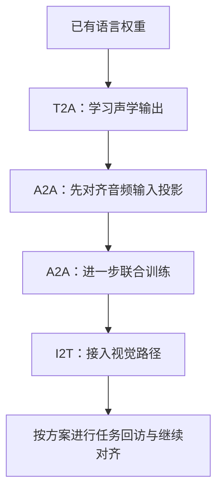
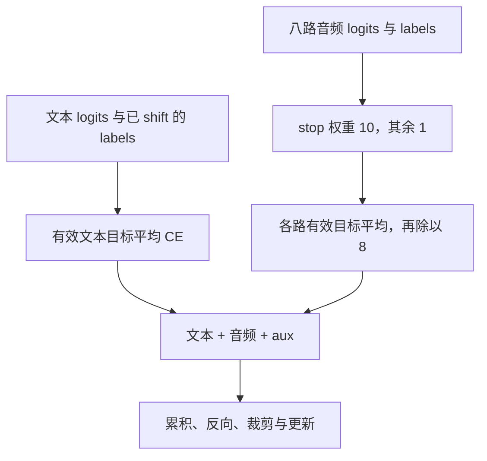

# 第 19 章 Omni 训练流水线

模型能够前向，还要把数据任务、可训练模块和损失连接起来。
T2A、A2A、I2T 描述不同输入输出任务，而 `mode`、`freeze_backbone` 控制参数是否更新。
它们不是同一个开关，混在一起就很容易出现“损失在变化，想训练的模块却没有有效信号”。

本章先追数据与权重，再拆开文本和八路音频损失。
实验使用真实初始化、Dataset 相关方法和源代码计算块，不把小张量测试当成发布模型训练复现。

**主线必读：** 任务数据、冻结模式和两类损失。先跟随本章的小输入，再对照图和源码。

**进阶选读：** 初始化复制、扰动、批处理和恢复；第一次阅读可先掌握输入输出契约。

**需要额外设备/权重：** 完整 T2A/A2A/I2T 训练与评估。本章 CPU 实验只支持明确列出的机制结论。

## 19.1 三种任务不等于只有三次固定训练

T2A 是文本到音频，A2A 是音频到音频，I2T 是图像到文本。
它们逐步接入不同能力，但真实 `trainer/train.sh` 的 full 示例还包含投影层单独对齐、联合训练及任务回访。
mini 路线又有所不同，不能只用三个箭头代替全部命令和初始化关系。

图 19-1：能力接入的阅读主线。先看新能力在哪一步进入，再回到脚本检查具体数据、mode、学习率和权重来源。
图中的回访不是固定次数承诺，full 和 mini 示例应分别阅读。
脚本注释中的耗时属于特定条件说明，本书没有把它们改写成任意硬件上的保证。

源码索引为 MiniMind-O 的
[trainer/train_sft_omni.py](https://github.com/jingyaogong/minimind-o/blob/ccab6d98520ac5ac5d7583a3fa21a65105137e28/trainer/train_sft_omni.py)
和 [trainer/train.sh](https://github.com/jingyaogong/minimind-o/blob/ccab6d98520ac5ac5d7583a3fa21a65105137e28/trainer/train.sh)。
默认 data_path 与示例中显式指定的文件名也可能不同，运行前应核对实际数据，而不是只复制默认参数。

## 19.2 Dataset 选择的是哪一轮和哪份模态数据

`OmniDataset` 可拼接多个 Parquet 文件，并可能随机截到某一轮 assistant。
它只保留最后一个 assistant 的文本监督，音频目标也从对应的 answer_audios 读取。
这与文本 SFT 默认监督多个回答的做法不同。

输入音频按当前 user 数量选择对应 question_audios；当前图像代码却取 image_bytes 的第一项，
不能因为旁边注释写“最后 user 图像”就推断它按同样索引取图。
参考音频和说话人向量另有字段，它们提供条件，不等于目标音频标签。

| 数据对象 | 用途 | 需要核对 |
|---|---|---|
| conversations | 文本、角色、预留位置 | 截断后最后回答与有效目标 |
| question_audios | 输入波形 | 与当前 user 的对应关系 |
| answer_audios | 输出 codec 编号 | 帧优先排列、八路拆分与 stop |
| ref_audios / spk_emb | 参考声音与音色条件 | 是否启用、截断和位置预留 |
| image_bytes | 输入图像 | 实际选取索引与占位段 |

源码在 [dataset/omni_dataset.py](https://github.com/jingyaogong/minimind-o/blob/ccab6d98520ac5ac5d7583a3fa21a65105137e28/dataset/omni_dataset.py)。
最后返回九通道输入、文本标签、八路音频标签、输入特征和其他条件，shift 已在这里完成。

## 19.3 “scheduled sampling”要看替换值从哪里来

当前同名函数用随机 ID 替换部分历史输入，并不是从当前模型的预测分布采样再放回。
它更直接体现为一种 token 扰动。解释目的可以说希望提高对历史错误的适应，但不能把实际运算写成另一个算法。

音频侧根据是否有有效标签选出时间列，再扰动八路；文本侧排除 image_token_id。
代码注释中的“保护图像/音频 token”还需细看：明确的文本排除项只有图像标记，正常数据也受监督 mask 限制。
实验在一个人为设为有效目标的位置放入文本音频标记，观察到它并未受到同样显式保护。
因此定制模板时不能只依赖注释。

## 19.4 初始化 Talker 需要满足多项条件

`init_omni_model` 创建模型后加载指定权重，过滤部分 shape 不匹配项，再以 strict=False 加载。
如果不是 resume、两条分支隐藏维度相同、权重里没有 Talker 层且 Talker 层数为正，
代码尝试把 Thinker 最后的若干层复制给 Talker。

本章四层 Thinker、两层 Talker 的匹配小配置，实际将 layers[2:4] 复制到 Talker[0:2]，逐项权重检查一致。
但隐藏维度相同不保证头配置、前馈宽度与层数都兼容；尤其 Talker 有自己的配置来源。
读取成功、跳过不兼容键和完整初始化成功，也是不同层次，不能只看一条“已加载”日志。

实现位于
[trainer/trainer_utils.py](https://github.com/jingyaogong/minimind-o/blob/ccab6d98520ac5ac5d7583a3fa21a65105137e28/trainer/trainer_utils.py)
的 `init_omni_model`。路径不存在时的行为也要检查，不能让随机初始化悄悄冒充已有基座。

## 19.5 两种冻结参数的组合

`freeze_backbone` 先作用于 Thinker 主干；随后 `mode` 可进一步限制全部注册参数。
相同单词 all 出现在不同参数中，含义并不相同：

| 设置 | 直接行为 |
|---|---|
| freeze_backbone=none | 不额外冻结主干 |
| freeze_backbone=all | 冻结 Thinker 主干，其他分支仍需另看 |
| freeze_backbone=last1 | 冻结主干后仅开放最后一个 block |
| mode=all | 保留此前的参数状态 |
| mode=audio_proj | 全部注册参数冻结后，只开放 audio_proj |
| mode=vision_proj | 全部注册参数冻结后，只开放 vision_proj |

只训练 audio_proj 时，要有真正经过输入音频投影的任务数据。
若提供的任务只用文本条件生成声音，audio_proj 可能只有乘零的图连接，没有有效数据梯度。
视觉投影模式同理。应检查非零梯度和输入路径，而不是只检查参数名或 grad 是否为 None。

## 19.6 文本与音频损失怎样组合

文本 logits 和 labels 已对齐，训练器直接计算逐位置交叉熵，再按有效文本目标数平均。
音频侧逐头处理；普通有效目标权重为 1，硬编码 stop ID 2050 的权重为 10。

令 u 遍历批内位置，m 为有效 mask，$\ell_{i,u}$ 为第 i 路交叉熵，则：

$$
\begin{aligned}
&w_{i,u}=1+9\mathbf 1[y_{i,u}=2050]\\
&N_i=\sum_u m_{i,u}.
\end{aligned}
$$

$$
\mathcal L_{\mathrm{audio}}=
\frac18\sum_{i:N_i>0}
\frac{\sum_u m_{i,u}w_{i,u}\ell_{i,u}}{N_i+10^{-9}}.
$$

分母是有效目标数量，不是加权数量；而且最后固定除以 8，不是只对有目标的头求平均。
因此修改任务参与程度、stop 比例或码本数，会改变 loss 的量级，不能不加解释地横向比较。
总损失再加文本项及 aux_loss，并除以梯度累积步数。

先用两个相同的逐目标损失 2 来手算：一路中有普通目标和 stop 各一个，分子为 `2+10×2=22`，
有效数量是 2，忽略极小稳定项后得到 11。若其他七路没有目标，音频总项仍是 `11/8=1.375`。
若误用加权数量 11 作分母，就会得到完全不同的 2；这正是公式要明确分母的原因。

图 19-2：损失中的两层归约。先分开文本和音频，再看 stop 权重与八路平均。
这不是纯语言模型 NLL，不能把总 loss 的指数直接称为文本困惑度。
特殊 ID 在配置、Dataset、训练器和生成器中要一起核对，改一处不代表全部同步。

## 19.7 批处理与保存的边界

collate 会对有效音频特征按时间补齐；Dataset 在处理器存在而样本无该模态时，通常提供 dummy 张量以保留 batch 位置。
若自定义数据把其中一行改成 None，collate 会过滤它，但 audio_lens 仍保留原批大小，可能失去样本对应。
本章实验复现了音频批变成 1 行、长度表仍为 2 行的情况，不能把“支持变长”理解成任意混合 None 都正确。

`omni_checkpoint` 排除外部编码器并将保存的模型状态转为 CPU FP16，resume 也使用这份状态。
这与视觉篇 resume 保留原完整 state_dict 的行为不同。真实 dtype 和字段应逐仓库检查。
循环末尾保存与梯度累积仍有基础篇提到的顺序边界；多个模态并不会自动修复它。

具体执行顺序是 `scaler.scale(loss).backward()` 累积梯度，达到累积边界后先 unscale，
再裁剪、`scaler.step(optimizer)`、更新 scaler，最后清空梯度。每个小批的有效目标均值先除以累积步数，
因此不同小批目标数量不同时，它不是整组有效 token 的统一平均。
`omni_checkpoint` 的 resume 字典包含模型、optimizer、epoch、step、world_size、日志 ID，
本训练器还传入 scaler 状态；它没有保存所有随机数状态、DataLoader 顺序或尚未更新的 `.grad`。
读者可以加载模型与部分训练状态，但不能据此承诺从任意中断点逐步完全复现原轨迹。

## 19.8 实验与自检

运行 `.venv-omni/bin/python experiments/ch19_omni_training.py`。
实验验证真实初始化复制和冻结模式、执行原损失计算块、检查 collate、随机扰动及 checkpoint。
给定均匀 logits，文本三类 CE 为约 1.0986；仅第一音频头有两个目标且一个为 stop 时，
音频项约为 5.2631，stop 对应梯度范数约为普通项的 10 倍。
这些是目标算术与控制流验证，不是完整 T2A/A2A/I2T 训练或音质评价。

1. mode=all 是否总会重新开放此前冻结的 Thinker？
2. 当前 scheduled_sampling 替换为模型预测，还是随机 ID？
3. stop 权重为 10 时，分母是否也按加权数量计算？
4. 只有一个音频头有目标时，最后是否仍除以 8？
5. collate 支持变长，是否保证 None 与正常特征混合后仍保持批索引？

参考解释：第一题 mode=all 保留 freeze_backbone 先前设置的状态，不主动解冻。第二题当前函数用随机 ID 扰动历史，没有调用模型来取得替换预测。第三题 stop 只把分子中的对应 CE 放大 10 倍，分母仍数有效目标。

第四题最后固定除以 8；仅一路有监督时，不能按“有数据的头数”改成除以 1。第五题过滤 None 会压缩特征批索引，而长度表仍可能保留原样本位置，所以需要 dummy 或明确的索引映射来保持对应。

可选练习：改变合成样例的 stop 比例，手算损失量级后核对，并说明为何它不能直接作为质量分数。
