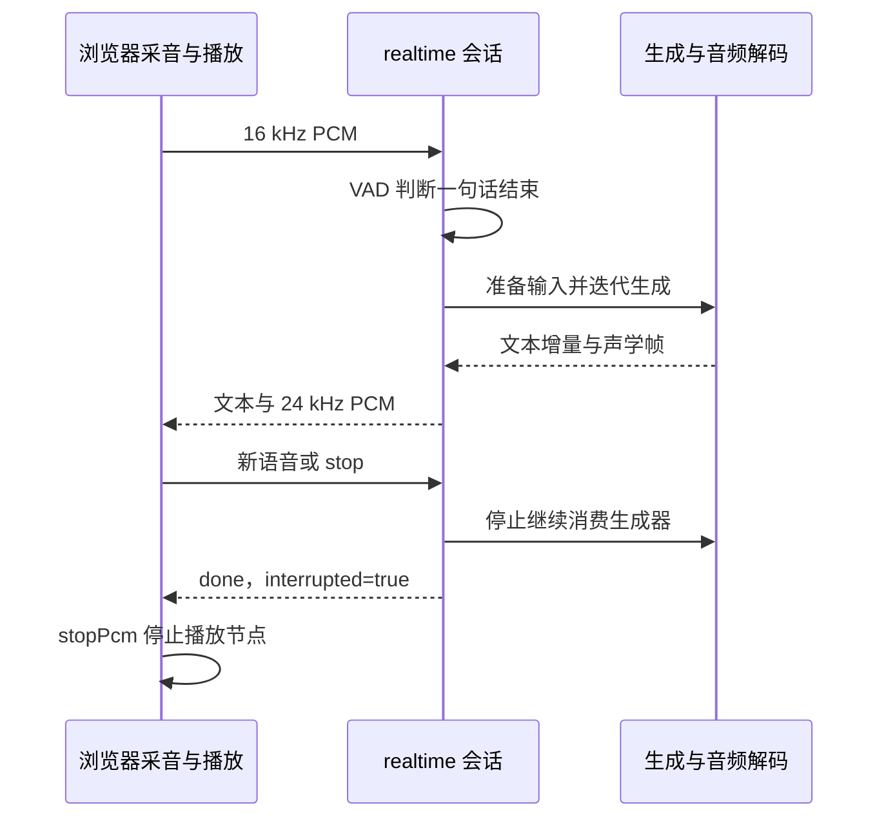
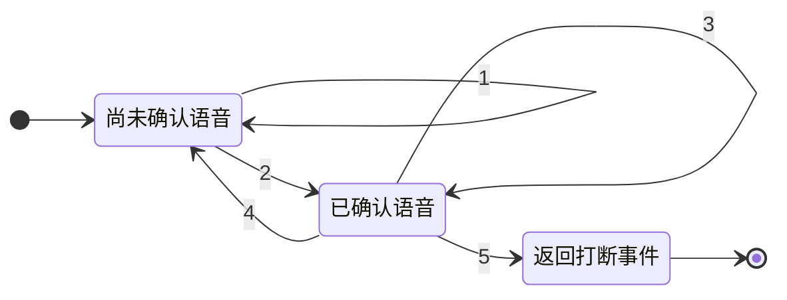

# 第 20 章 流式交互、打断与综合实战

能生成一段语音，还不等于能进行顺畅对话。用户可能在播放过程中再次开口，
系统既要接收输入，又要停止旧回复的后续生成和已排队播放。
本章从浏览器到服务端再回到扬声器，分别追踪这些状态，避免把一个 interrupt 标志当作整个系统都已停止。

本章的实战是可控制的状态与协议实验，不打开真实麦克风，也不宣称已经测得真实端到端延迟。
这样可以先把正常完成、用户停止和语音打断三条路径验证清楚，再接入实际设备与权重。

**主线必读：** VAD、生成、传输和播放四层状态。先跟随本章的小输入，再对照图和源码。

**进阶选读：** 大块提前返回、重叠解码和共享锁；第一次阅读可先掌握输入输出契约。

**需要额外设备/权重：** 麦克风、扬声器、语音权重与真实延迟测量。本章 CPU 实验只支持明确列出的机制结论。

## 20.1 一次实时会话经过哪些组件

浏览器把麦克风波形重采样到 16 kHz、编码成 PCM，经 WebSocket 发送。
服务端接收线程把消息放进队列，主会话消费队列并调用 VAD；达到一句话结束条件后，
准备模型输入，迭代生成文本与声学帧，再把解码后的 24 kHz PCM 发回浏览器播放。

图 20-1：完整交互的主线。先追正常输入输出，再看最后四步的取消路径。
组件框表示职责，不意味着它们恰好各占一个独立进程；服务端实际还包含接收线程、队列和共享模型锁。
停止迭代不是对正在运行的 GPU kernel 做任意时刻抢占。

源码入口分为三个位置：

- [webui/web_demo.py](https://github.com/jingyaogong/minimind-o/blob/ccab6d98520ac5ac5d7583a3fa21a65105137e28/webui/web_demo.py)：会话、生成和解码包装。
- [webui/web_demo.html](https://github.com/jingyaogong/minimind-o/blob/ccab6d98520ac5ac5d7583a3fa21a65105137e28/webui/web_demo.html)：采音、消息与播放队列。
- [model/model_omni.py](https://github.com/jingyaogong/minimind-o/blob/ccab6d98520ac5ac5d7583a3fa21a65105137e28/model/model_omni.py)：VAD 与会话状态。

## 20.2 VAD 判断有没有语音，不识别说了什么

VAD 是 Voice Activity Detection，语音活动检测。这里 SileroVAD 通过 ONNX Runtime 输出概率，
并维护自己的 h/c 状态；RealtimeSession 再累计时间，决定是否开始、结束或打断。
概率阈值不是直接对波形振幅取阈值，实验中的简易检测器只用于控制状态输入。

默认会话按 1024 个样本为窗口处理，采样率 16 kHz，因此窗口时长为：

$$
T_w=\frac{1024}{16000}=0.064\ \mathrm{s}.
$$

默认开始语音至少 128 ms，即两个高概率窗口；结束静音阈值 800 ms，按整窗口累计时要 13 个窗口，约 832 ms。
它不是每个毫秒都连续检查一次。浏览器还以 4096 点的块发送，输入积累与传输也会影响实际响应时间。

在尚未 speaking 时，低概率窗口会重置未达标的语音累计；进入 speaking 后，短暂停顿可继续累计，
直到连续静音达到结束阈值。模型检测质量、背景噪声和麦克风回声还需用真实音频评估。

## 20.3 buffer、ring 与 generating 各自负责什么

buffer 保存当前话语，ring 保留最近的前导静音窗口，开始语音时可一起接入。
结束检测后，代码裁掉多余尾静音，仅保留一小段，再由 get_audio 取出并清空 buffer。
这些状态属于一次会话，不是模型权重，也不是 Transformer 的 KV Cache。

图 20-2：输入检测状态怎样产生结束或打断事件。先追未确认到已确认语音的转移，
再看外部 `generating` 标志如何参与打断条件。图的终点表示本次返回打断事件，不表示会话已经销毁。
`generating` 与 `speaking` 不是互斥状态；同时生成和检测到新语音，正是这里需要检查的组合。

图中转移编号的含义是：1，低概率窗口清掉尚未达到阈值的语音累计；2，高概率累计达到开始阈值；
3，还未满足结束或打断条件，继续收音；4，连续静音达到结束阈值，返回 `speech_end`，令 speaking 为假并清零本轮计数；
5，当前窗口为高概率、已经确认语音且正在生成，设置 interrupt 并返回。
停止旧回复由会话消费者处理，不是 VAD 模型自己取消 GPU 计算或播放节点。

还有一个必须检查的分块边界：push_chunk 返回 interrupt 时会提前退出当前大块，
剩余窗口没有在这个函数中自动保存。本章给 4096 点高概率块，实际只保留前 2048 点就返回。
这不等于剩余音频已可靠进入下一轮；改造时应设计未处理片段的保留与重放，不能声称原实现完全无丢失。

## 20.4 服务端怎样停止旧回复

`realtime` 的接收线程把二进制音频和 JSON 控制消息入队。
生成迭代期间，`poll_interrupt` 消费新消息：新的语音事件、stop 或 end 都可使本轮停止。
主循环在拿到一次生成结果后检查中断，再决定是否发送文本和 PCM。

因此取消是迭代边界上的协作式停止。即使停止消息已入队，也可能已有一次前向正在进行。
`run_generate` 还持有全局 MODEL_LOCK，并在整个迭代期间使用 no_grad。
共享锁限制并发生成，不能把该演示直接描述成已经实现高吞吐的多用户调度。

中断时不再 flush 旧回复剩余音频，随后发送带 interrupted 的 done 消息。
这一选择与正常结束的尾块补发不同；如果仍无条件 flush，用户打断后可能又听到旧回复尾部。

## 20.5 码本块、重叠上下文与 PCM

`stream_pcm` 按 audio_chunk_frames 决定何时调用解码，默认 4 帧约 320 ms。
它可以额外带上之前的重叠帧作为解码上下文，再按比例裁掉重叠部分的输出。
这不是把每帧完全孤立解码，也不等于自动实现了任意边界无缝的神经流式状态。

正常完成时，如果最后不足一整块，flush 补发余下部分；若恰好整除，则无需再发一个重复空块。
本章实验设每块 2 帧、重叠 1 帧，三帧最终发出 7680 与 3840 字节 PCM，
对应总计 5760 个 16 位单声道采样点，没有把重叠片段重复播放。
解码器在该切块测试中提供可控波形，真实随机 Mimi 的长度验证已在第 18 章完成。

## 20.6 浏览器已经排队的声音也要停止

浏览器通过 AudioBufferSourceNode 排队播放 PCM，维护 playing 列表及下一段的计划时间。
服务端不再发送数据，并不自动取消这些已排队节点。
HTML 中的 stopPcm 会逐个 stop，清空列表，并重置播放状态和下一段时间。

收到 interrupted 的 done 消息会调用它；重新检测到用户说话时也有相应停止路径。
本章执行了真实消息处理和 stopPcm 代码片段，以计数节点代替 WebAudio，验证两个已排队节点均被停止，
playing 变空、asstPlay 为 false、nextT 重置到当前时间。
这验证的是代码行为，不是扬声器硬件立即静音的毫秒数。

## 20.7 “全模态”名称不代替具体输入路径

模型 forward 可以接收音频和图像特征，但 Web 的 prepare_turn 会根据输入组合选择不同准备方式。
在当前实时图像加语音分支，do_asr_for_image 为 true，会先做 ASR 转录，再把文本与图像交给模型。
普通语音分支则注入声学特征；若保留历史，还可能另开 ASR 线程供历史文本使用。

所以不能把整个应用概括成“任何路径都没有 ASR”，也不能仅凭可同时采音和播放，就宣称模型原生持续双工理解。
需要区分前端通道、VAD 会话状态、模型条件输入和输出生成方式。
评估延迟时分别记录输入结束、首文本、首音频、播放开始和打断完成，避免用一个不明口径的“实时”代替证据。

## 20.8 实验与全书收束

运行 `.venv-omni/bin/python experiments/ch20_realtime.py`。
它执行真实会话消费、PCM 切块、生成包装及浏览器事件代码，外部 VAD、接收线程、WebSocket、解码波形和播放节点受控替代。
正常场景发送两块 PCM；stop 和语音打断场景只消费一次生成结果，未发送旧 PCM，done 标记正确。
实验还确认服务端包装在迭代期间关闭梯度，并复现大输入块提前返回的边界。

没有进行真实麦克风、扬声器或默认模型质量测量，不能从这些测试推出生产环境的无缝体验。
至此，源码阅读主线已从 token 延伸到训练、视觉、音频和交互；真正可迁移的能力是按对象、张量、时间与证据理解系统。

1. VAD 与 ASR 分别回答什么问题？
2. 800 ms 静音阈值为什么在 64 ms 窗口下可能到 832 ms 才触发？
3. 服务端停止发送是否自动取消浏览器已排队声音？
4. 原实现的 interrupt 返回是否保证保留大块中的所有未处理样本？
5. 图像加语音的实时入口是否总把原音频特征直接输入模型？

参考解释：第一题 VAD 检测语音活动，ASR 识别文字，检测到讲话不等于识别了句子。
第二题 12 个 64 ms 窗口只有 768 ms；第 13 个才到 832 ms。

第三题服务端停止发送不会清空浏览器队列，须调用 stopPcm 停止节点。
第四题 push_chunk 提前返回 interrupt 会留下未处理窗口。
第五题 prepare_turn 的该分支先做 ASR，再走图文路径，应按实际入口判断。

可选练习：用真实设备实测五个时间点，解释各段耗时。
